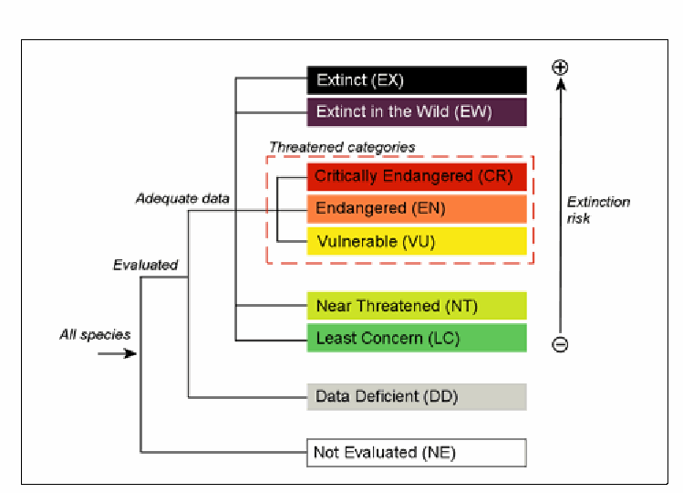
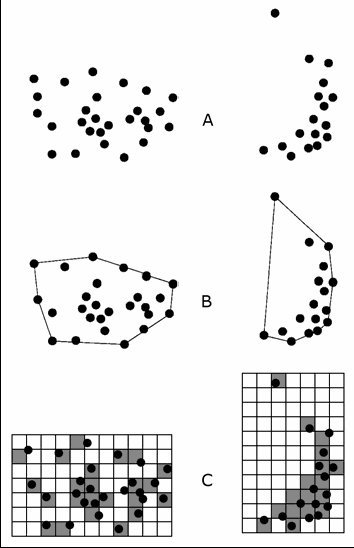

================================================================================
Page 1
================================================================================

IUCN RED LIST CATEGORIES AND
CRITERIA
Version 3.1 Second edition
The IUCN Red List of Threatened Species™

================================================================================
Page 2
================================================================================

IUCN RED LIST
CATEGORIES AND CRITERIA
Version 3.1
Second edition
Prepared by the IUCN Species Survival Commission
As approved by the
51st meeting of the IUCN Council
Gland, Switzerland
9 February 2000
IUCN (International Union for Conservation of Nature)
2012

================================================================================
Page 3
================================================================================

The designation of geographical entities in this book, and the presentation of the material, do not imply
the expression of any opinion whatsoever on the part of IUCN concerning the legal status of any country,
territory, or area, or of its authorities, or concerning the delimitation of its frontiers or boundaries.
The views expressed in this publication do not necessarily reflect those of IUCN.
Published by: IUCN, Gland, Switzerland
Red List logo: © 2008
Copyright: © 2001, 2012 International Union for Conservation of Nature and Natural
Resources
First published 2001
Second edition 2012
Reproduction of this publication for educational or other non-commercial uses is
authorized without prior written permission from the copyright holder provided the
source is fully acknowledged.
Reproduction of this publication for resale or other commercial purposes is prohibited
without prior written permission of the copyright holder.
Citation: IUCN. (2012). IUCN Red List Categories and Criteria: Version 3.1. Second edition.
Gland, Switzerland and Cambridge, UK: IUCN. iv + 32pp.
ISBN: 978-2-8317-1435-6
Cover design: Chadi Abi Faraj, IUCN Centre for Mediterranean Cooperation
Cover illustration: The Diversity of Life by Federico Gemma
Layout by: Chadi Abi Faraj
Printed by: Colchester Print Group
Available from: IUCN (International Union for Conservation of Nature)
Rue Mauverney 28
1196 Gland
Switzerland
Tel +41 22 999 0000
Fax +41 22 999 0002
www.iucn.org/publications
The text of this book is printed on 115 gsm 50-50 recycled silk paper made from wood fibre from well-
managed forests certified in accordance with the rules of the Forest Stewardship Council (FSC).

================================================================================
Page 4
================================================================================

Preface
The first edition of the IUCN Red List Categories and Criteria: Version 3.1 was published
in 2001, after its formal adoption by the IUCN Council in February 2000. Since then it
has been used as the standard for global Red List assessments published on the IUCN
Red List of Threatened SpeciesTM. It is also used alongside the Guidelines for Application
of IUCN Red List Criteria at Regional and National Levels (IUCN 2003, 2012), by many
countries around the world as a standard system for national Red List assessments.
Over the last decade, the IUCN Red List Categories and Criteria have been used to
assess an increasingly diverse range of taxa occurring in a wide variety of habitats. In
addition, ongoing technological advances continue to provide more scope for improving
data analysis. Therefore it is necessary for the IUCN Red List to adapt to maintain and
further develop its usefulness as a conservation tool. However, it is also essential that the
central rules for assessing extinction risk for the IUCN Red List remain stable to be able
to compare changes in Red List status over time.
This second edition of the IUCN Red List Categories and Criteria: Version 3.1 retains
the same assessment system presented in the 2001 publication. To allow for occasional
changes in documentation requirements for assessments, information that was previously
outlined in Annex 3 has been moved to a separate reference document: Documentation
Standards and Consistency Checks for IUCN Red List Assessments and Species
Accounts.
To ensure full understanding of IUCN Red List assessments, it is very important to refer
to all of the following documents:
(1) IUCN Red List Categories and Criteria: Version 3.1 (IUCN 2001 and later
editions)
(2) The latest version of the Guidelines for Using the IUCN Red List Categories and
Criteria (available from www.iucnredlist.org/documents/RedListGuidelines.pdf;
check the IUCN Red List website for regular updates of this document)
(3) The latest version of the Documentation Standards and Consistency Checks
for IUCN Red List Assessments and Species Accounts (available from www.
iucnredlist.org/documents/RL_Standards_Consistency.pdf; check the IUCN Red
List website for regular updates of this document)
For national and regional level assessments using the IUCN Red List Categories and
Criteria, the Guidelines for Application of IUCN Red List Criteria at Regional and National
Levels: Version 4.0 (IUCN 2012 and later versions) must also be used.
All of the above documents are freely available to download from the IUCN Red List
website (www.iucnredlist.org). Note that documents (2) and (3) above are regularly
updated, therefore it is important to check the website for the current versions.
iii

================================================================================
Page 5
================================================================================

Acknowledgements
IUCN gratefully acknowledges the dedication and efforts of the Red List Criteria Review
Working Group (CRWG) in attending numerous workshops to discuss and debate the
merits and demerits of the Red List Criteria. The members of the CRWG were: Resit
Akçakaya, Jonathan Baillie, William Bond, Nigel Collar, Ulf Gärdenfors, Kevin Gaston,
Craig Hilton-Taylor, Elodie Hudson, Bob Irvin, David Keith, Russell Lande, Charlotte Lusty,
Nigel Leader-Williams, Georgina Mace, Michael Maunder, Larry Master, E.J. Milner-
Gulland, Sanjay Molur, Howard Powles, André Punt, Jon Paul Rodríguez, Mary Seddon,
Alison Stattersfield, Simon Stuart, John Wang, and Tetsukazu Yahara. Particular thanks
must go to Dr Georgina Mace, who chaired the CRWG and who ably steered an extremely
complex process through to a successful conclusion. The review process culminated in
the adoption of this revised set of Red List Categories and Criteria by the IUCN Council.
The work of the CRWG and the hosting of the review workshops were made possible
through generous financial support from the Canadian Wildlife Service; Federal Ministry for
Economic Co-operation and Development, Germany (BMZ); Global Guardian Trust; New
South Wales National Parks and Wildlife Service, Australia; New South Wales Scientific
Committee, Australia; Ministry of the Environment, Finland; Ministry of the Environment,
Sweden; Swedish Species Information Centre; and WWF Sweden. The review process
was co-ordinated by the IUCN Red List Programme Officer funded by the UK Department
for the Environment, Food and Rural Affairs (DEFRA); the Centre for Applied Biodiversity
Science at Conservation International; and WWF UK.
IUCN is indebted to the hundreds of scientists who participated in the criteria review
workshops or who submitted comments and suggestions during the review process.
This combined input has resulted in a far more robust, user friendly and widely applicable
system.
As a result of the review process, several new topics have become the focus of active
research and publication in the academic community. As a greater clarity emerges on
tricky and unresolved issues, these will be addressed in a comprehensive set of user
guidelines. The intention is to keep this revised system stable to enable genuine changes
in the status of species to be detected rather than to have such changes obscured by the
constant medication of the criteria.
The IUCN Red List Categories and Criteria: Version 3.1 are available in booklet
form in the following language versions: English, French and Spanish from the IUCN
Publications Services (www.iucn.org/knowledge/publications_doc/publications/).
They are also available to download from the IUCN Red List website in English, French and
Spanish, at: http://www.iucnredlist.org/technical-documents/categories-and-criteria.
iv

================================================================================
Page 6
================================================================================

I. INTRODUCTION
1. The IUCN Red List Categories and Criteria are intended to be an easily and widely
understood system for classifying species at high risk of global extinction. The general
aim of the system is to provide an explicit, objective framework for the classification of
the broadest range of species according to their extinction risk. However, while the
Red List may focus attention on those taxa at the highest risk, it is not the sole means
of setting priorities for conservation measures for their protection.
Extensive consultation and testing in the development of the system strongly suggest
that it is robust across most organisms. However, it should be noted that although the
system places species into the threatened categories with a high degree of consistency,
the criteria do not take into account the life histories of every species. Hence, in certain
individual cases, the risk of extinction may be under- or over-estimated.
2. Before 1994 the more subjective threatened species categories used in IUCN Red
Data Books and Red Lists had been in place, with some modification, for almost 30
years. Although the need to revise the categories had long been recognized (Fitter and
Fitter 1987), the current phase of development only began in 1989 following a request
from the IUCN Species Survival Commission (SSC) Steering Committee to develop
a more objective approach. The IUCN Council adopted the new Red List system in
1994.
The IUCN Red List Categories and Criteria have several specific aims:
ƒ to provide a system that can be applied consistently by different people;
ƒ to improve objectivity by providing users with clear guidance on how to evaluate
different factors which affect the risk of extinction;
ƒ to provide a system which will facilitate comparisons across widely different taxa;
ƒ to give people using threatened species lists a better understanding of how
individual species were classified.
3. Since their adoption by IUCN Council in 1994, the IUCN Red List Categories have
become widely recognized internationally, and they are now used in a range of
publications and listings produced by IUCN, as well as by numerous governmental
and non-governmental organizations. Such broad and extensive use revealed the
need for a number of improvements, and SSC was mandated by the 1996 World
Conservation Congress (WCC Res. 1.4) to conduct a review of the system (IUCN
1996). This document presents the revisions accepted by the IUCN Council.
The proposals presented in this document result from a continuing process of drafting,
consultation and validation. The production of a large number of draft proposals has
led to some confusion, especially as each draft has been used for classifying some
1

================================================================================
Page 7
================================================================================

set of species for conservation purposes. To clarify matters, and to open the way for
modifications as and when they become necessary, a system for version numbering
has been adopted as follows:
Version 1.0: Mace and Lande (1991)
The first paper discussing a new basis for the categories, and presenting
numerical criteria especially relevant for large vertebrates.
Version 2.0: Mace et al. (1992)
A major revision of Version 1.0, including numerical criteria appropriate to all
organisms and introducing the non-threatened categories.
Version 2.1: IUCN (1993)
Following an extensive consultation process within SSC, a number of changes
were made to the details of the criteria, and fuller explanation of basic principles
was included. A more explicit structure clarified the significance of the non-
threatened categories
Version 2.2: Mace and Stuart (1994)
Following further comments received and additional validation exercises, some
minor changes to the criteria were made. In addition, the Susceptible category
present in Versions 2.0 and 2.1 was subsumed into the Vulnerable category. A
precautionary application of the system was emphasised.
Version 2.3: IUCN (1994)
IUCN Council adopted this version, which incorporated changes as a result of
comments from IUCN members, in December 1994. The initial version of this
document was published without the necessary bibliographic details, such as
date of publication and ISBN number, but these were included in the subsequent
reprints in 1998 and 1999. This version was used for the 1996 IUCN Red List of
Threatened Animals (Baillie and Groombridge 1996), The World List of Threatened
Trees (Oldfield et al. 1998) and the 2000 IUCN Red List of Threatened Species
(Hilton-Taylor 2000).
Version 3.0: IUCN/SSC Criteria Review Working Group (1999)
Following comments received, a series of workshops were convened to look at
the IUCN Red List Criteria following which, changes were proposed affecting the
criteria, the definitions of some key terms and the handling of uncertainty.
Version 3.1: IUCN (2001)
The IUCN Council adopted this latest version, which incorporated changes as
a result of comments from the IUCN and SSC memberships and from a final
meeting of the Criteria Review Working Group, in February 2000.
All new assessments from January 2001 should use the latest adopted version and
cite the year of publication and version number.
2

================================================================================
Page 8
================================================================================

4. In the rest of this document, the proposed system is outlined in several sections.
Section II, the Preamble, presents basic information about the context and structure
of the system, and the procedures that are to be followed in applying the criteria to
species. Section III provides definitions of key terms used. Section IV presents the
categories, while Section V details the quantitative criteria used for classification within
the threatened categories. Annex 1 provides guidance on how to deal with uncertainty
when applying the criteria; Annex 2 suggests a standard format for citing the Red
List Categories and Criteria; and Annex 3 refers to the required and recommended
supporting information for taxa to be included on IUCN’s global Red List and where to
find further guidance on these. It is important for the effective functioning of the system
that all sections are read and understood to ensure that the definitions and rules are
followed.
3

================================================================================
Page 9
================================================================================

II. PREAMBLE
The information in this section is intended to direct and facilitate the use and
interpretation of the categories (Critically Endangered, Endangered, etc.), criteria (A to
E), and subcriteria (1, 2, etc.; a, b, etc.; i, ii, etc.).
1. Taxonomic level and scope of the categorization process
The criteria can be applied to any taxonomic unit at or below the species level. In the
following information, definitions and criteria the term ‘taxon’ is used for convenience,
and may represent species or lower taxonomic levels, including forms that are not yet
formally described. There is sufficient range among the different criteria to enable the
appropriate listing of taxa from the complete taxonomic spectrum, with the exception
of micro-organisms. The criteria may also be applied within any specified geographical
or political area, although in such cases special notice should be taken of point 14.
In presenting the results of applying the criteria, the taxonomic unit and area under
consideration should be specified in accordance with the documentation guidelines
(see Annex 3). The categorization process should only be applied to wild populations
inside their natural range, and to populations resulting from benign introductions. The
latter are defined in the IUCN Guidelines for Re-introductions (IUCN 1998) as ‘...an
attempt to establish a species, for the purpose of conservation, outside its recorded
distribution, but within an appropriate habitat and eco-geographical area. This is a
feasible conservation tool only when there is no remaining area left within a species’
historic range’.
2. Nature of the categories
Extinction is a chance process. Thus, a listing in a higher extinction risk category implies
a higher expectation of extinction, and over the time-frames specified more taxa listed in
a higher category are expected to go extinct than those in a lower one (without effective
conservation action). However, the persistence of some taxa in high-risk categories
does not necessarily mean their initial assessment was inaccurate.
All taxa listed as Critically Endangered qualify for Vulnerable and Endangered, and all
listed as Endangered qualify for Vulnerable. Together these categories are described
as ‘threatened’. The threatened categories form a part of the overall scheme. It will be
possible to place all taxa into one of the categories (see Figure 1).
3. Role of the different criteria
For listing as Critically Endangered, Endangered or Vulnerable there is a range of
quantitative criteria; meeting any one of these criteria qualifies a taxon for listing at that
4

================================================================================
Page 10
================================================================================

Figure 1. Structure of the categories
level of threat. Each taxon should be evaluated against all the criteria. Even though
some criteria will be inappropriate for certain taxa (some taxa will never qualify under
these however close to extinction they come), there should be criteria appropriate for
assessing threat levels for any taxon. The relevant factor is whether any one criterion
is met, not whether all are appropriate or all are met. Because it will never be clear in
advance which criteria are appropriate for a particular taxon, each taxon should be
evaluated against all the criteria, and all criteria met at the highest threat category must
be listed.
4. Derivation of quantitative criteria
The different criteria (A-E) are derived from a wide review aimed at detecting risk
factors across the broad range of organisms and the diverse life histories they exhibit.
The quantitative values presented in the various criteria associated with threatened
categories were developed through wide consultation, and they are set at what are
generally judged to be appropriate levels, even if no formal justification for these values
exists. The levels for different criteria within categories were set independently but
against a common standard. Broad consistency between them was sought.
5

================================================================================
Page 11
================================================================================

5. Conservation actions in the listing process
The criteria for the threatened categories are to be applied to a taxon whatever the level
of conservation action affecting it. It is important to emphasise here that a taxon may
require conservation action even if it is not listed as threatened. Conservation actions
which may benefit the taxon are included as part of the documentation requirements
(see Annex 3).
6. Data quality and the importance of inference and projection
The criteria are clearly quantitative in nature. However, the absence of high-quality data
should not deter attempts at applying the criteria, as methods involving estimation,
inference and projection are emphasised as being acceptable throughout. Inference
and projection may be based on extrapolation of current or potential threats into the
future (including their rate of change), or of factors related to population abundance or
distribution (including dependence on other taxa), so long as these can reasonably be
supported. Suspected or inferred patterns in the recent past, present or near future can
be based on any of a series of related factors, and these factors should be specified as
part of the documentation.
Taxa at risk from threats posed by future events of low probability but with severe
consequences (catastrophes) should be identified by the criteria (e.g. small distributions,
few locations). Some threats need to be identified particularly early, and appropriate
actions taken, because their effects are irreversible or nearly so (e.g. pathogens, invasive
organisms, hybridization).
7. Problems of scale
Classification based on the sizes of geographic ranges or the patterns of habitat
occupancy is complicated by problems of spatial scale. The finer the scale at which
the distributions or habitats of taxa are mapped, the smaller the area will be that they
are found to occupy, and the less likely it will be that range estimates (at least for ‘area
of occupancy’: see Definitions, point 10) exceed the thresholds specified in the criteria.
Mapping at finer scales reveals more areas in which the taxon is unrecorded. Conversely,
coarse-scale mapping reveals fewer unoccupied areas, resulting in range estimates
that are more likely to exceed the thresholds for the threatened categories. The choice
of scale at which range is estimated may thus, itself, influence the outcome of Red
List assessments and could be a source of inconsistency and bias. It is impossible to
provide any strict but general rules for mapping taxa or habitats; the most appropriate
scale will depend on the taxon in question, and the origin and comprehensiveness of
the distribution data.
6

================================================================================
Page 12
================================================================================

8. Uncertainty
The data used to evaluate taxa against the criteria are often estimated with considerable
uncertainty. Such uncertainty can arise from any one or all of the following three factors:
natural variation, vagueness in the terms and definitions used, and measurement error.
The way in which this uncertainty is handled can have a strong influence on the results
of an evaluation. Details of methods recommended for handling uncertainty are included
in Annex 1, and assessors are encouraged to read and follow these principles.
In general, when uncertainty leads to wide variation in the results of assessments, the
range of possible outcomes should be specified. A single category must be chosen
and the basis for the decision should be documented; it should be both precautionary
and credible.
When data are very uncertain, the category of ‘Data Deficient’ may be assigned.
However, in this case the assessor must provide documentation showing that this
category has been assigned because data are inadequate to determine a threat
category. It is important to recognize that taxa that are poorly known can often be
assigned a threat category on the basis of background information concerning the
deterioration of their habitat and/or other causal factors; therefore the liberal use of
‘Data Deficient’ is discouraged.
9. Implications of listing
Listing in the categories of Not Evaluated and Data Deficient indicates that no
assessment of extinction risk has been made, though for different reasons. Until such
time as an assessment is made, taxa listed in these categories should not be treated as
if they were non-threatened. It may be appropriate (especially for Data Deficient forms)
to give them the same degree of attention as threatened taxa, at least until their status
can be assessed.
10. Documentation
All assessments should be documented. Threatened classifications should state the
criteria and subcriteria that were met. No assessment can be accepted for the IUCN
Red List as valid unless at least one criterion is given. If more than one criterion or
subcriterion is met, then each should be listed. If a re-evaluation indicates that the
documented criterion is no longer met, this should not result in automatic reassignment
to a lower category of threat (downlisting). Instead, the taxon should be re-evaluated
against all the criteria to clarify its status. The factors responsible for qualifying the
taxon against the criteria, especially where inference and projection are used, should
be documented (see Annexes 2 and 3). The documentation requirements for other
categories are also specified in Annex 3.
7

================================================================================
Page 13
================================================================================

11. Threats and priorities
The category of threat is not necessarily sufficient to determine priorities for conservation
action. The category of threat simply provides an assessment of the extinction risk
under current circumstances, whereas a system for assessing priorities for action will
include numerous other factors concerning conservation action such as costs, logistics,
chances of success, and other biological characteristics of the subject.
12. Re-evaluation
Re-evaluation of taxa against the criteria should be carried out at appropriate intervals.
This is especially important for taxa listed under Near Threatened, Data Deficient and for
threatened taxa whose status is known or suspected to be deteriorating.
13. Transfer between categories
The following rules govern the movement of taxa between categories:
A. A taxon may be moved from a category of higher threat to a category of lower
threat if none of the criteria of the higher category has been met for five years or
more.
B. If the original classification is found to have been erroneous, the taxon may
be transferred to the appropriate category or removed from the threatened
categories altogether, without delay (but see Point 10 above).
C. Transfer from categories of lower to higher risk should be made without delay.
14. Use at regional level
The IUCN Red List Categories and Criteria were designed for global taxon
assessments. However, many people are interested in applying them to subsets of
global data, especially at regional, national or local levels. To do this it is important to
refer to guidelines prepared by the IUCN/SSC Regional Applications Working Group
and the National Red List Working Group of the IUCN SSC Red List Committee (e.g.
Gärdenfors et al. 2001; IUCN 2003, 2012). When applied at national or regional levels
it must be recognized that a global category may not be the same as a national or
regional category for a particular taxon. For example, taxa classified as Least Concern
globally might be Critically Endangered within a particular region where numbers are
very small or declining, perhaps only because they are at the margins of their global
range. Conversely, taxa classified as Vulnerable on the basis of their global declines
in numbers or range might be Least Concern within a particular region where their
populations are stable. It is also important to note that taxa endemic to regions or
nations will be assessed globally in any regional or national applications of the criteria,
and in these cases great care must be taken to check that an assessment has not
8

================================================================================
Page 14
================================================================================

already been undertaken by a Red List Authority (RLA), and that the categorization
is agreed with the relevant RLA (e.g. an SSC Specialist Group known to cover the
taxon).
9

================================================================================
Page 15
================================================================================

III. DEFINITIONS
1. Population and Population Size (Criteria A, C and D)
The term ‘population’ is used in a specific sense in the Red List Criteria that is different to
its common biological usage. Population is here defined as the total number of individuals
of the taxon. For functional reasons, primarily owing to differences between life forms,
population size is measured as numbers of mature individuals only. In the case of taxa
obligately dependent on other taxa for all or part of their life cycles, biologically appropriate
values for the host taxon should be used.
2. Subpopulations (Criteria B and C)
Subpopulations are defined as geographically or otherwise distinct groups in the
population between which there is little demographic or genetic exchange (typically one
successful migrant individual or gamete per year or less).
3. Mature individuals (Criteria A, B, C and D)
The number of mature individuals is the number of individuals known, estimated or
inferred to be capable of reproduction. When estimating this quantity, the following points
should be borne in mind:
ƒ Mature individuals that will never produce new recruits should not be counted (e.g.
densities are too low for fertilization).
ƒ In the case of populations with biased adult or breeding sex ratios, it is appropriate
to use lower estimates for the number of mature individuals, which take this into
account.
ƒ Where the population size fluctuates, use a lower estimate. In most cases this will
be much less than the mean.
ƒ Reproducing units within a clone should be counted as individuals, except where
such units are unable to survive alone (e.g. corals).
ƒ In the case of taxa that naturally lose all or a subset of mature individuals at some
point in their life cycle, the estimate should be made at the appropriate time, when
mature individuals are available for breeding.
ƒ Re-introduced individuals must have produced viable offspring before they are
counted as mature individuals.
10

================================================================================
Page 16
================================================================================

4. Generation (Criteria A, C and E)
Generation length is the average age of parents of the current cohort (i.e. newborn
individuals in the population). Generation length therefore reflects the turnover rate of
breeding individuals in a population. Generation length is greater than the age at first
breeding and less than the age of the oldest breeding individual, except in taxa that
breed only once. Where generation length varies under threat, the more natural, i.e. pre-
disturbance, generation length should be used.
5. Reduction (Criterion A)
A reduction is a decline in the number of mature individuals of at least the amount (%)
stated under the criterion over the time period (years) specified, although the decline need
not be continuing. A reduction should not be interpreted as part of a fluctuation unless
there is good evidence for this. The downward phase of a fluctuation will not normally
count as a reduction.
6. Continuing decline (Criteria B and C)
A continuing decline is a recent, current or projected future decline (which may be smooth,
irregular or sporadic) which is liable to continue unless remedial measures are taken.
Fluctuations will not normally count as continuing declines, but an observed decline
should not be considered as a fluctuation unless there is evidence for this.
7. Extreme fluctuations (Criteria B and C)
Extreme fluctuations can be said to occur in a number of taxa when population size or
distribution area varies widely, rapidly and frequently, typically with a variation greater than
one order of magnitude (i.e. a tenfold increase or decrease).
8. Severely fragmented (Criterion B)
The phrase ‘severely fragmented’ refers to the situation in which increased extinction
risk to the taxon results from the fact that most of its individuals are found in small
and relatively isolated subpopulations (in certain circumstances this may be inferred
from habitat information). These small subpopulations may go extinct, with a reduced
probability of recolonization.
9. Extent of occurrence (Criteria A and B)
Extent of occurrence is defined as the area contained within the shortest continuous
imaginary boundary which can be drawn to encompass all the known, inferred or projected
sites of present occurrence of a taxon, excluding cases of vagrancy (see Figure 2). This
11

================================================================================
Page 17
================================================================================

measure may exclude discontinuities or disjunctions within the overall distributions of taxa
(e.g. large areas of obviously unsuitable habitat) (but see ‘area of occupancy’, point 10
below). Extent of occurrence can often be measured by a minimum convex polygon (the
smallest polygon in which no internal angle exceeds 180 degrees and which contains all
the sites of occurrence).
Figure 2. Two examples of the
distinction between extent of
occurrence and area of occupancy.
(A) is the spatial distribution of known,
inferred or projected sites of present
occurrence. (B) shows one possible
boundary to the extent of occurrence,
which is the measured area within this
boundary. (C) shows one measure
of area of occupancy which can be
achieved by the sum of the occupied
grid squares.
10. Area of occupancy (Criteria A, B and D)
Area of occupancy is defined as the area within its ‘extent of occurrence’ (see point 9
above) which is occupied by a taxon, excluding cases of vagrancy. The measure reflects
the fact that a taxon will not usually occur throughout the area of its extent of occurrence,
which may contain unsuitable or unoccupied habitats. In some cases (e.g. irreplaceable
colonial nesting sites, crucial feeding sites for migratory taxa) the area of occupancy is the
smallest area essential at any stage to the survival of existing populations of a taxon. The
size of the area of occupancy will be a function of the scale at which it is measured, and
should be at a scale appropriate to relevant biological aspects of the taxon, the nature of
threats and the available data (see point 7 in the Preamble). To avoid inconsistencies and
12

================================================================================
Page 18
================================================================================

bias in assessments caused by estimating area of occupancy at different scales, it may
be necessary to standardize estimates by applying a scale-correction factor. It is difficult
to give strict guidance on how standardization should be done because different types of
taxa have different scale-area relationships.
11. Location (Criteria B and D)
The term ‘location’ defines a geographically or ecologically distinct area in which a single
threatening event can rapidly affect all individuals of the taxon present. The size of the
location depends on the area covered by the threatening event and may include part of
one or many subpopulations. Where a taxon is affected by more than one threatening
event, location should be defined by considering the most serious plausible threat.
12. Quantitative analysis (Criterion E)
A quantitative analysis is defined here as any form of analysis which estimates the
extinction probability of a taxon based on known life history, habitat requirements, threats
and any specified management options. Population viability analysis (PVA) is one such
technique. Quantitative analyses should make full use of all relevant available data. In a
situation in which there is limited information, such data as are available can be used to
provide an estimate of extinction risk (for instance, estimating the impact of stochastic
events on habitat). In presenting the results of quantitative analyses, the assumptions
(which must be appropriate and defensible), the data used and the uncertainty in the data
or quantitative model must be documented.
13

================================================================================
Page 19
================================================================================

IV. THE CATEGORIES1
A representation of the relationships between the categories is shown in Figure 1.
EXTINCT (EX)
A taxon is Extinct when there is no reasonable doubt that the last individual has died. A
taxon is presumed Extinct when exhaustive surveys in known and/or expected habitat,
at appropriate times (diurnal, seasonal, annual), throughout its historic range have failed
to record an individual. Surveys should be over a time frame appropriate to the taxon’s
life cycle and life form.
EXTINCT IN THE WILD (EW)
A taxon is Extinct in the Wild when it is known only to survive in cultivation, in captivity
or as a naturalized population (or populations) well outside the past range. A taxon is
presumed Extinct in the Wild when exhaustive surveys in known and/or expected habitat,
at appropriate times (diurnal, seasonal, annual), throughout its historic range have failed
to record an individual. Surveys should be over a time frame appropriate to the taxon’s
life cycle and life form.
CRITICALLY ENDANGERED (CR)
A taxon is Critically Endangered when the best available evidence indicates that it meets
any of the criteria A to E for Critically Endangered (see Section V), and it is therefore
considered to be facing an extremely high risk of extinction in the wild.
ENDANGERED (EN)
A taxon is Endangered when the best available evidence indicates that it meets any of the
criteria A to E for Endangered (see Section V), and it is therefore considered to be facing
a very high risk of extinction in the wild.
1 Note: As in previous IUCN categories, the abbreviation of each category (in parenthesis) follows the
English denominations when translated into other languages (see Annex 2).
14

================================================================================
Page 20
================================================================================

VULNERABLE (VU)
A taxon is Vulnerable when the best available evidence indicates that it meets any of the
criteria A to E for Vulnerable (see Section V), and it is therefore considered to be facing a
high risk of extinction in the wild.
NEAR THREATENED (NT)
A taxon is Near Threatened when it has been evaluated against the criteria but does not
qualify for Critically Endangered, Endangered or Vulnerable now, but is close to qualifying
for or is likely to qualify for a threatened category in the near future.
LEAST CONCERN (LC)
A taxon is Least Concern when it has been evaluated against the criteria and does not
qualify for Critically Endangered, Endangered, Vulnerable or Near Threatened. Widespread
and abundant taxa are included in this category.
DATA DEFICIENT (DD)
A taxon is Data Deficient when there is inadequate information to make a direct, or
indirect, assessment of its risk of extinction based on its distribution and/or population
status. A taxon in this category may be well studied, and its biology well known, but
appropriate data on abundance and/or distribution are lacking. Data Deficient is therefore
not a category of threat. Listing of taxa in this category indicates that more information is
required and acknowledges the possibility that future research will show that threatened
classification is appropriate. It is important to make positive use of whatever data are
available. In many cases great care should be exercised in choosing between DD and a
threatened status. If the range of a taxon is suspected to be relatively circumscribed, and
a considerable period of time has elapsed since the last record of the taxon, threatened
status may well be justified.
NOT EVALUATED (NE)
A taxon is Not Evaluated when it has not yet been evaluated against the criteria.
15

================================================================================
Page 21
================================================================================

V. THE CRITERIA FOR CRITICALLY ENDANGERED,
ENDANGERED AND VULNERABLE
CRITICALLY ENDANGERED (CR)
A taxon is Critically Endangered when the best available evidence indicates that it meets
any of the following criteria (A to E), and it is therefore considered to be facing an extremely
high risk of extinction in the wild:
A. Reduction in population size based on any of the following:
1. An observed, estimated, inferred or suspected population size reduction of
≥90% over the last 10 years or three generations, whichever is the longer, where
the causes of the reduction are clearly reversible AND understood AND ceased,
based on (and specifying) any of the following:
(a) direct observation
(b) an index of abundance appropriate to the taxon
(c) a decline in area of occupancy, extent of occurrence and/or quality of
habitat
(d) actual or potential levels of exploitation
(e) the effects of introduced taxa, hybridization, pathogens, pollutants,
competitors or parasites.
2. An observed, estimated, inferred or suspected population size reduction of ≥80%
over the last 10 years or three generations, whichever is the longer, where the
reduction or its causes may not have ceased OR may not be understood OR may
not be reversible, based on (and specifying) any of (a) to (e) under A1.
3. A population size reduction of ≥80%, projected or suspected to be met within the
next 10 years or three generations, whichever is the longer (up to a maximum of
100 years), based on (and specifying) any of (b) to (e) under A1.
4. An observed, estimated, inferred, projected or suspected population size
reduction of ≥80% over any 10 year or three generation period, whichever is
longer (up to a maximum of 100 years in the future), where the time period must
include both the past and the future, and where the reduction or its causes may
not have ceased OR may not be understood OR may not be reversible, based on
(and specifying) any of (a) to (e) under A1.
B. Geographic range in the form of either B1 (extent of occurrence) OR B2 (area of
occupancy) OR both:
16

================================================================================
Page 22
================================================================================

1. Extent of occurrence estimated to be less than 100 km2, and estimates indicating
at least two of a-c:
a. Severely fragmented or known to exist at only a single location.
b. Continuing decline, observed, inferred or projected, in any of the following:
(i) extent of occurrence
(ii) area of occupancy
(iii) area, extent and/or quality of habitat
(iv) number of locations or subpopulations
(v) number of mature individuals.
c. Extreme fluctuations in any of the following:
(i) extent of occurrence
(ii) area of occupancy
(iii) number of locations or subpopulations
(iv) number of mature individuals.
2. Area of occupancy estimated to be less than 10 km2, and estimate indicating at
least two of a-c:
a. Severely fragmented or known to exist at only a single location.
b. Continuing decline, observed, inferred or projected, in any of the following:
(i) extent of occurrence
(ii) area of occupancy
(iii) area, extent and/or quality of habitat
(iv) number of locations or subpopulations
(v) number of mature individuals.
c. Extreme fluctuations in any of the following:
(i) extent of occurrence
(ii) area of occupancy
(iii) number of locations or subpopulations
(iv) number of mature individuals.
C. Population size estimated to number fewer than 250 mature individuals and either:
1. An estimated continuing decline of at least 25% within three years or one
generation, whichever is longer, (up to a maximum of 100 years in the
future) OR
2. A continuing decline, observed, projected, or inferred, in numbers of mature
individuals AND at least one of the following (a-b):
17

================================================================================
Page 23
================================================================================

a. Population structure in the form of one of the following:
(i) no subpopulation estimated to contain more than 50 mature individuals,
OR
(ii) at least 90% of mature individuals in one subpopulation.
b. Extreme fluctuations in number of mature individuals.
D. Population size estimated to number fewer than 50 mature individuals.
E. Quantitative analysis showing the probability of extinction in the wild is at least 50%
within 10 years or three generations, whichever is the longer (up to a maximum of
100 years).
ENDANGERED (EN)
A taxon is Endangered when the best available evidence indicates that it meets any of
the following criteria (A to E), and it is therefore considered to be facing a very high risk of
extinction in the wild:
A. Reduction in population size based on any of the following:
1. An observed, estimated, inferred or suspected population size reduction of
≥70% over the last 10 years or three generations, whichever is the longer, where
the causes of the reduction are clearly reversible AND understood AND ceased,
based on (and specifying) any of the following:
(a) direct observation
(b) an index of abundance appropriate to the taxon
(c) a decline in area of occupancy, extent of occurrence and/or quality of
habitat
(d) actual or potential levels of exploitation
(e) the effects of introduced taxa, hybridization, pathogens, pollutants,
competitors or parasites.
2. An observed, estimated, inferred or suspected population size reduction of
≥50% over the last 10 years or three generations, whichever is the longer, where
the reduction or its causes may not have ceased OR may not be understood OR
may not be reversible, based on (and specifying) any of (a) to (e) under A1.
3. A population size reduction of ≥50%, projected or suspected to be met within
the next 10 years or three generations, whichever is the longer (up to a maximum
of 100 years), based on (and specifying) any of (b) to (e) under A1.
18

================================================================================
Page 24
================================================================================

4. An observed, estimated, inferred, projected or suspected population size
reduction of ≥50% over any 10 year or three generation period, whichever is
longer (up to a maximum of 100 years in the future), where the time period must
include both the past and the future, AND where the reduction or its causes may
not have ceased OR may not be understood OR may not be reversible, based
on (and specifying) any of (a) to (e) under A1.
B. Geographic range in the form of either B1 (extent of occurrence) OR B2 (area of
occupancy) OR both:
1. Extent of occurrence estimated to be less than 5,000 km2, and estimates
indicating at least two of a-c:
a. Severely fragmented or known to exist at no more than five locations.
b. Continuing decline, observed, inferred or projected, in any of the following:
(i) extent of occurrence
(ii) area of occupancy
(iii) area, extent and/or quality of habitat
(iv) number of locations or subpopulations
(v) number of mature individuals.
c. Extreme fluctuations in any of the following:
(i) extent of occurrence
(ii) area of occupancy
(iii) number of locations or subpopulations
(iv) number of mature individuals.
2. Area of occupancy estimated to be less than 500 km2, and estimates indicating
at least two of a-c:
a. Severely fragmented or known to exist at no more than five locations.
b. Continuing decline, observed, inferred or projected, in any of the following:
(i) extent of occurrence
(ii) area of occupancy
(iii) area, extent and/or quality of habitat
(iv) number of locations or subpopulations
(v) number of mature individuals.
c. Extreme fluctuations in any of the following:
(i) extent of occurrence
(ii) area of occupancy
19

================================================================================
Page 25
================================================================================

(iii) number of locations or subpopulations
(iv) number of mature individuals.
C. Population size estimated to number fewer than 2,500 mature individuals and
either:
1. An estimated continuing decline of at least 20% within five years or two
generations, whichever is longer, (up to a maximum of 100 years in the
future) OR
2. A continuing decline, observed, projected, or inferred, in numbers of mature
individuals AND at least one of the following (a-b):
a. Population structure in the form of one of the following:
(i) no subpopulation estimated to contain more than 250 mature individuals,
OR
(ii) at least 95% of mature individuals in one subpopulation.
b. Extreme fluctuations in number of mature individuals.
D. Population size estimated to number fewer than 250 mature individuals.
E. Quantitative analysis showing the probability of extinction in the wild is at least 20%
within 20 years or five generations, whichever is the longer (up to a maximum of 100
years).
VULNERABLE (VU)
A taxon is Vulnerable when the best available evidence indicates that it meets any of
the following criteria (A to E), and it is therefore considered to be facing a high risk of
extinction in the wild:
A. Reduction in population size based on any of the following:
1. An observed, estimated, inferred or suspected population size reduction of
≥50% over the last 10 years or three generations, whichever is the longer, where
the causes of the reduction are clearly reversible AND understood AND ceased,
based on (and specifying) any of the following:
(a) direct observation
(b) an index of abundance appropriate to the taxon
(c) a decline in area of occupancy, extent of occurrence and/or quality of
habitat
20

================================================================================
Page 26
================================================================================

(d) actual or potential levels of exploitation
(e) the effects of introduced taxa, hybridization, pathogens, pollutants,
competitors or parasites.
2. An observed, estimated, inferred or suspected population size reduction of
≥30% over the last 10 years or three generations, whichever is the longer, where
the reduction or its causes may not have ceased OR may not be understood OR
may not be reversible, based on (and specifying) any of (a) to (e) under A1.
3. A population size reduction of ≥30% projected or suspected to be met within the
next 10 years or three generations, whichever is the longer (up to a maximum of
100 years), based on (and specifying) any of (b) to (e) under A1.
4. An observed, estimated, inferred, projected or suspected population size
reduction of ≥30% over any 10 year or three generation period, whichever is
longer (up to a maximum of 100 years in the future), where the time period must
include both the past and the future, AND where the reduction or its causes may
not have ceased OR may not be understood OR may not be reversible, based
on (and specifying) any of (a) to (e) under A1.
B. Geographic range in the form of either B1 (extent of occurrence) OR B2 (area of
occupancy) OR both:
1. Extent of occurrence estimated to be less than 20,000 km2, and estimates
indicating at least two of a-c:
a. Severely fragmented or known to exist at no more than 10 locations.
b. Continuing decline, observed, inferred or projected, in any of the following:
(i) extent of occurrence
(ii) area of occupancy
(iii) area, extent and/or quality of habitat
(iv) number of locations or subpopulations
(v) number of mature individuals.
c. Extreme fluctuations in any of the following:
(i) extent of occurrence
(ii) area of occupancy
(iii) number of locations or subpopulations
(iv) number of mature individuals.
2. Area of occupancy estimated to be less than 2,000 km2, and estimates indicating
at least two of a-c:
21

================================================================================
Page 27
================================================================================

a. Severely fragmented or known to exist at no more than 10 locations.
b. Continuing decline, observed, inferred or projected, in any of the following:
(i) extent of occurrence
(ii) area of occupancy
(iii) area, extent and/or quality of habitat
(iv) number of locations or subpopulations
(v) number of mature individuals.
c. Extreme fluctuations in any of the following:
(i) extent of occurrence
(ii) area of occupancy
(iii) number of locations or subpopulations
(iv) number of mature individuals.
C. Population size estimated to number fewer than 10,000 mature individuals and
either:
1. An estimated continuing decline of at least 10% within 10 years or three
generations, whichever is longer, (up to a maximum of 100 years in the
future) OR
2. A continuing decline, observed, projected, or inferred, in numbers of mature
individuals AND at least one of the following (a-b):
a. Population structure in the form of one of the following:
(i) no subpopulation estimated to contain more than 1,000 mature
individuals, OR
(ii) all mature individuals in one subpopulation.
b. Extreme fluctuations in number of mature individuals.
D. Population very small or restricted in the form of either of the following:
1. Population size estimated to number fewer than 1,000 mature individuals.
2. Population with a very restricted area of occupancy (typically less than 20 km2)
or number of locations (typically five or fewer) such that it is prone to the effects
of human activities or stochastic events within a very short time period in an
uncertain future, and is thus capable of becoming Critically Endangered or even
Extinct in a very short time period.
E. Quantitative analysis showing the probability of extinction in the wild is at least 10%
within 100 years.
22

================================================================================
Page 28
================================================================================

Annex 1: Uncertainty
The Red List Criteria should be applied to a taxon based on the available evidence
concerning its numbers, trend and distribution. In cases where there are evident threats
to a taxon through, for example, deterioration of its only known habitat, a threatened
listing may be justified, even though there may be little direct information on the biological
status of the taxon itself. In all these instances there are uncertainties associated with the
available information and how it was obtained. These uncertainties may be categorized
as natural variability, semantic uncertainty and measurement error (Akçakaya et al. 2000).
This section provides guidance on how to recognize and deal with these uncertainties
when using the criteria. More information is available in the Guidelines for Using the IUCN
Red List Categories and Criteria (downloadable from www.iucnredlist.org/documents/
RedListGuidelines.pdf; check the IUCN Red List website for regular updates of this
document).
Natural variability results from the fact that species’ life histories and the environments
in which they live change over time and space. The effect of this variation on the criteria
is limited, because each parameter refers to a specific time or spatial scale. Semantic
uncertainty arises from vagueness in the definition of terms or lack of consistency in
different assessors’ usage of them. Despite attempts to make the definitions of the
terms used in the criteria exact, in some cases this is not possible without the loss of
generality. Measurement error is often the largest source of uncertainty; it arises from
the lack of precise information about the parameters used in the criteria. This may be
due to inaccuracies in estimating the values or a lack of knowledge. Measurement
error may be reduced or eliminated by acquiring additional data. For further details, see
Akçakaya et al. (2000) and Burgman et al. (1999).
One of the simplest ways to represent uncertainty is to specify a best estimate and a
range of plausible values. The best estimate itself might be a range, but in any case the
best estimate should always be included in the range of plausible values. When data are
very uncertain, the range for the best estimate might be the range of plausible values.
There are various methods that can be used to establish the plausible range. It may be
based on confidence intervals, the opinion of a single expert, or the consensus opinion
of a group of experts. Whichever method is used should be stated and justified in the
documentation.
When interpreting and using uncertain data, attitudes toward risk and uncertainty may
play an important role. Attitudes have two components. First, assessors need to consider
whether they will include the full range of plausible values in assessments, or whether they
will exclude extreme values from consideration (known as dispute tolerance). An assessor
with a low dispute tolerance would include all values, thereby increasing the uncertainty,
whereas an assessor with a high dispute tolerance would exclude extremes, reducing the
uncertainty. Second, assessors need to consider whether they have a precautionary or
evidentiary attitude to risk (known as risk tolerance). A precautionary attitude will classify
23

================================================================================
Page 29
================================================================================

a taxon as threatened unless it is certain that it is not threatened, whereas an evidentiary
attitude will classify a taxon as threatened only when there is strong evidence to support
a threatened classification. Assessors should resist an evidentiary attitude and adopt a
precautionary but realistic attitude to uncertainty when applying the criteria, for example,
by using plausible lower bounds, rather than best estimates, in determining population
size, especially if it is fluctuating. All attitudes should be explicitly documented.
An assessment using a point estimate (i.e. single numerical value) will lead to a single Red
List Category. However, when a plausible range for each parameter is used to evaluate
the criteria, a range of categories may be obtained, reflecting the uncertainties in the data.
A single category, based on a specific attitude to uncertainty, should always be listed
along with the criteria met, while the range of plausible categories should be indicated in
the documentation (see Annex 3).
Where data are so uncertain that any category is plausible, the category of ‘Data
Deficient’ should be assigned. However, it is important to recognize that this category
indicates that the data are inadequate to determine the degree of threat faced by a taxon,
not necessarily that the taxon is poorly known or indeed not threatened. Although Data
Deficient is not a threatened category, it indicates a need to obtain more information on
a taxon to determine the appropriate listing; moreover, it requires documentation with
whatever available information exists.
24

================================================================================
Page 30
================================================================================

Annex 2: Citation of the IUCN Red List Categories
and Criteria
In order to promote the use of a standard format for citing the Red List Categories and
Criteria the following forms of citation are recommended:
1. The Red List Category may be written out in full or abbreviated as follows (when
translated into other languages, the abbreviations should follow the English
denominations):
Extinct, EX Near Threatened, NT
Extinct in the Wild, EW Least Concern, LC
Critically Endangered, CR Data Deficient, DD
Endangered, EN Not Evaluated, NE
Vulnerable, VU
2. Under Section V (the criteria for Critically Endangered, Endangered and Vulnerable)
there is a hierarchical alphanumeric numbering system of criteria and subcriteria.
These criteria and subcriteria (all three levels) form an integral part of the Red List
assessment and all those that result in the assignment of a threatened category must
be specified after the category. Under the criteria A to C, and D under Vulnerable,
the first level of the hierarchy is indicated by the use of numbers (1-4) and if more
than one is met, they are separated by means of the ‘+’ symbol. The second level
is indicated by the use of the lower-case alphabet characters (a-e). These are listed
without any punctuation. A third level of the hierarchy under criteria B and C involves
the use of lower case roman numerals (i-v). These are placed in parentheses (with no
space between the preceding alphabet character and start of the parenthesis) and
separated by the use of commas if more than one is listed. Where more than one
criterion is met, they should be separated by semicolons. The following are examples
of such usage:
EX CR D
EN B1ac(i,ii,iii) VU C2a(ii)
CR A2c+3c; B1ab(iii) EN B2b(iii)c(ii)
EN B2ab(i,ii,iii) VU B1ab(iii)+2ab(iii)
EN A1c; B1ab(iii); C2a(i) VU A2c+3c
EN B1ab(i)c(ii,v)+2ab(i)c(ii,v) CR C1+2a(ii)
CR A1cd VU D1+2
EN A2c; D VU D2
EN A2abc+3bc+4abc; B1b(iii,iv,v)c(ii,iii,iv)+2b(iii,iv,v)c(ii,iii,iv)
25

================================================================================
Page 31
================================================================================

Annex 3: Required and Recommended Supporting
Information for IUCN Red List Assessments
All assessments published on the IUCN Red List are freely available for public use. To
ensure assessments are fully justified and to allow Red List assessment data to be
analysed, thus making the IUCN Red List a powerful tool for conservation and policy
decisions, a set of supporting information is required to accompany every assessment
submitted for publication on the IUCN Red List of Threatened SpeciesTM.
The reference document Documentation Standards and Consistency Checks for IUCN
Red List Assessments and Species Accounts is available to download from the Red List
website (www.iucnredlist.org) and provides guidance on the following:
ƒ Required supporting information for all IUCN Red List assessments.
ƒ Required supporting information under specific conditions (e.g. taxa assessed
under specific Red List Categories or Criteria, plant assessments, reassessed taxa,
etc.).
ƒ Recommended supporting information, if sufficient time and data are available.
ƒ Tools available for preparing and submitting assessments for the IUCN Red List,
including the IUCN Species Information Service (SIS) and RAMAS® Red List
(Akçakaya and Ferson 2001).
ƒ General formatting and style guidelines for documenting IUCN Red List
assessments.
Note that the Documentation Standards and Consistency Checks for IUCN Red List
Assessments and Species Accounts will be updated on a regular basis. Users should check
the IUCN Red List website for the most current version of this reference document.
26

================================================================================
Page 32
================================================================================

Annex 4: Summary of the IUCN Red List Criteria
See pages 28-29 for a summary of the five criteria (A-E) used to evaluate if a taxon
belongs in an IUCN Red List threatened category (Critically Endangered, Endangered
or Vulnerable).
27

================================================================================
Page 33
================================================================================

**Table 1 (Page 33)**

| 4A
ot
1A
fo
yna
no
desab
)snoitareneg
3
ro
sraey
01
fo
regnol
eht
revo
derusaem(
noitcuder
noitalupoP
.noitcuder
ezis
noitalupoP
.A | elbarenluV            | %05
≥ | %03
≥       | ecnadnuba ycnapucco ecnerrucco fo ,axat ,snegohtap ro
]3A
ytilauq slevel
tpecxe[ srotitepmoc
noxat decudortni
fo tatibah laitnetop
noitavresbo eht fo
fo aera
ot tnetxe ro/dna ,noitazidirbyh
xedni etairporppa ni enilced ro noitatiolpxe fo ,stnatullop .setisarap
tcerid ,)OOA( )OOE( lautca stceffe
na
a
)a( )b( )c( )d( )e(
no eht :gniwollof
desab fo
yna
ni DNA eht eb eht noitalupop erutuf yam
detcepsus ni ton ni noitcuder .elbisrever
elbisrever detcepsus yam tem eht
.]3A dna
RO eb detcepsus
ro ,derrefni ylraelc ro desaec ot detcepsus rof desu tsap eht fo sesuac eb ton
,derrefni eb yam
era evah tonnac ro htob eht
,detamitse noitcuder ,detamitse ton ro detcejorp edulcni erehw RO dootsrednu
yam derrefni )a([
.elbisrever )sraey tsum dna
eht noitcuder ,derrefni ,)erutuf
,devresbo fo .desaec ,devresbo ,detcejorp 001 doirep eb
sesuac eb fo ni ton
fo ton mumixam ,detamitse emit sraey yam
noitcuder evah noitcuder sesuac noitcuder
eht yam eht 001 RO
erehw DNA eht RO a ,devresbo erehw fo desaec
noitalupoP dootsrednu noitalupoP erehw dootsrednu noitalupoP ot .xam
pu( noitcuder
tsap evah
a
erutuf ot
eht tsap nA pu( ton
1A 2A 3A 4A |
| ----------------------------------------------------------------------------------------------------------------------------------- | --------------------- | ----- | ----------- | --------------------------------------------------------------------------------------------------------------------------------------------------------------------------------------------------------------------------------------------------------------------------------------------------------------------------------------------------------------------------------------------------------------------------------------------------------------------------------------------------------------------------------------------------------------------------------------------------------------------------------------------------------------------------------------------------------------------------------------------------------------------------------------------------------------------------------------------------------------------------------------------------------------------------------------------------------------------------------------------------------------------------------------------------------------------------------------------------------------------------------------------------------------------------- |
|                                                                                                                                     | deregnadnE            | %07 ≥ | %05 ≥    |                                                                                                                                                                                                                                                                                                                                                                                                                                                                                                                                                                                                                                                                                                                                                                                                                                                                                                                                                                                                                                                                                                                                                                             |
|                                                                                                                                     | deregnadnE yllacitirC | %09 ≥ | %08 ≥    |                                                                                                                                                                                                                                                                                                                                                                                                                                                                                                                                                                                                                                                                                                                                                                                                                                                                                                                                                                                                                                                                                                                                                                             |
|                                                                                                                                     |                       | 1A    | 4A & 3A ,2A |                                                                                                                                                                                                                                                                                                                                                                                                                                                                                                                                                                                                                                                                                                                                                                                                                                                                                                                                                                                                                                                                                                                                                                             |

**Table 2 (Page 33)**

| )ycnapucco
fo
aera(
2B
RO/DNA
)ecnerrucco
fo
tnetxe(
1B
rehtie
fo
mrof
eht
ni
egnar
cihpargoeG
.B | elbarenluV            | 2mk
000,02
<                   | 2mk
000,2
<                 | ,aera rebmun
)iii(
01 )vi(
;ycnapucco
≤ ;snoitalupopbus
fo slaudividni
aera
)ii( ro
snoitacol
5 ;ecnerrucco erutam
≤
fo fo
rebmun rebmun
fo
tnetxe
)v( )iii(
)i( ;snoitalupopbus ;ycnapucco
:fo
1
= yna
ni
fo
detcejorp
aera
ro
snoitacol )ii(
;ecnerrucco
ro
derrefni
fo
snoitacol
rebmun
:snoitidnoc ,detamitse fo
tnetxe
fo )vi(
rebmuN ;tatibah )i(
,devresbo :fo
3
gniwollof yna
RO fo ni
detnemgarf ytilauq snoitautcufl slaudividni
enilced
eht
ro/dna
fo gniunitnoC
2 erutam
tsael ylereveS emertxE
tnetxe
ta fo
DNA
)a( )b( )c( | 01
≤                                           | ,aera
)iii(
;ycnapucco
fo slaudividni
aera
)ii(
;ecnerrucco erutam
fo
rebmun
fo
tnetxe
)v(
)i( ;snoitalupopbus
:fo
yna
ni
detcejorp
ro
snoitacol
ro
derrefni
fo
rebmun
,detamitse
)vi(
;tatibah
,devresbo
fo
ytilauq
enilced
ro/dna
gniunitnoC
tnetxe
)b( | rebmun
)vi(
;snoitalupopbus
ro
snoitacol
fo
rebmun
)iii(
;ycnapucco
fo
aera
)ii(
;ecnerrucco
fo
tnetxe
)i(
:fo
yna
ni
snoitautcufl slaudividni
erutam
emertxE
fo
)c( |
| ------------------------------------------------------------------------------------------------- | --------------------- | ------------------------------ | --------------------------- | ---------------------------------------------------------------------------------------------------------------------------------------------------------------------------------------------------------------------------------------------------------------------------------------------------------------------------------------------------------------------------------------------------------------------------------------------------------------------------------------------------------------------------------------- | ---------------------------------------------- | --------------------------------------------------------------------------------------------------------------------------------------------------------------------------------------------------------------------------------------------------------- | -------------------------------------------------------------------------------------------------------------------------------------------------------------------- |
|                                                                                                   | deregnadnE            | 2mk 000,5 <              | 2mk 005 <             |                                                                                                                                                                                                                                                                                                                                                                                                                                                                                                                                          | 5 ≤                                         |                                                                                                                                                                                                                                                           |                                                                                                                                                                      |
|                                                                                                   | deregnadnE yllacitirC | 2mk 001 <                | 2mk 01 <              |                                                                                                                                                                                                                                                                                                                                                                                                                                                                                                                                          | 1 =                                         |                                                                                                                                                                                                                                                           |                                                                                                                                                                      |
|                                                                                                   |                       | )OOE( ecnerrucco fo tnetxE .1B | )OOA( ycnapucco fo aerA .2B |                                                                                                                                                                                                                                                                                                                                                                                                                                                                                                                                          | snoitacol fo rebmuN RO detnemgarf ylereveS )a( |                                                                                                                                                                                                                                                           |                                                                                                                                                                      |

28
TSIL
DER NCUI NA
NI SGNOLEB
NOXAT
A FI ETAULAVE
OT DESU )E-A(
AIRETIRC EVIF EHT FO YRAMMUS
1.)ELBARENLUV
RO
DEREGNADNE
,DEREGNADNE
YLLACITIRC( YROGETAC DENETAERHT
4A ot 1A fo yna no desab
)snoitareneg
3 ro
sraey
01 fo regnol eht revo
derusaem( noitcuder
noitalupoP .noitcuder ezis noitalupoP
.A
elbarenluV
deregnadnE
deregnadnE
yllacitirC
%05 ≥
%07 ≥
%09 ≥
1A
%03 ≥
%05 ≥
%08 ≥
4A & 3A
,2A
]3A tpecxe[ noitavresbo
tcerid )a(
ni detcepsus
ro ,derrefni ,detamitse
,devresbo noitcuder noitalupoP
1A
ecnadnuba fo xedni
na )b(
DNA elbisrever
ylraelc era noitcuder
eht fo sesuac eht erehw tsap eht
noxat eht ot etairporppa
.desaec evah DNA dootsrednu
ycnapucco fo aera ni enilced
a )c(
eht ni detcepsus
ro ,derrefni ,detamitse
,devresbo noitcuder noitalupoP
2A
ecnerrucco fo tnetxe
,)OOA(
eb ton yam
RO
desaec evah ton
yam noitcuder fo sesuac eht erehw tsap
no desab
ytilauq tatibah ro/dna
)OOE(
.elbisrever eb ton yam RO dootsrednu
eht fo
yna
fo slevel laitnetop ro
lautca )d(
:gniwollof
eht ni tem
eb
ot detcepsus ro
derrefni ,detcejorp noitcuder noitalupoP
3A
noitatiolpxe
.]3A
rof desu eb tonnac
)a([ )sraey 001 fo mumixam a ot pu( erutuf
,axat decudortni fo
stceffe )e(
noitalupop
detcepsus
ro detcejorp
,derrefni ,detamitse ,devresbo nA
4A
,snegohtap ,noitazidirbyh
erutuf eht dna
tsap eht htob edulcni
tsum doirep emit eht erehw noitcuder
ro srotitepmoc ,stnatullop
yam noitcuder
fo sesuac eht erehw
dna ,)erutuf ni sraey 001 fo .xam a ot pu(
.setisarap
.elbisrever
eb ton yam RO dootsrednu
eb ton yam RO desaec evah ton
)ycnapucco
fo
aera(
2B RO/DNA )ecnerrucco
fo tnetxe(
1B rehtie fo mrof eht ni egnar cihpargoeG
.B
elbarenluV
deregnadnE
deregnadnE
yllacitirC
2mk 000,02 <
2mk 000,5
<
2mk 001 <
)OOE( ecnerrucco fo tnetxE
.1B
2mk 000,2 <
2mk 005
<
2mk 01 <
)OOA( ycnapucco fo aerA
.2B
:snoitidnoc 3 gniwollof eht fo 2 tsael ta DNA
01 ≤
5 ≤
1 =
snoitacol
fo rebmuN RO detnemgarf ylereveS
)a(
,aera )iii( ;ycnapucco fo
aera )ii( ;ecnerrucco
fo
tnetxe
)i( :fo yna ni detcejorp
ro derrefni
,detamitse ,devresbo enilced gniunitnoC
)b(
slaudividni
erutam
fo rebmun
)v( ;snoitalupopbus
ro snoitacol fo rebmun
)vi( ;tatibah fo ytilauq ro/dna tnetxe
rebmun )vi( ;snoitalupopbus
ro snoitacol
fo rebmun
)iii( ;ycnapucco fo
aera
)ii( ;ecnerrucco
fo tnetxe )i( :fo yna ni snoitautcufl emertxE
)c(
slaudividni erutam fo enilced dna ezis noitalupop llamS
.C
elbarenluV
deregnadnE
deregnadnE
yllacitirC
000,01 <
005,2 <
052 <
slaudividni erutam fo rebmuN 2C ro 1C fo eno tsael ta DNA
ro sraey 01 ni %01
ro sraey 5 ni
%02
ro sraey 3 ni %52
enilced gniunitnoc
detcejorp ro detamitse ,devresbo nA
.1C
snoitareneg 3
snoitareneg
2
noitareneg 1
:)erutuf
ni sraey 001 fo .xam a ot pu( tsael ta fo
)regnol si revehcihw(
)regnol si revehcihw(
)regnol si revehcihw(
gniunitnoc derrefni
ro detcejorp ,detamitse ,devresbo nA
.2C
:snoitidnoc
3 gniwollof eht fo 1 tsael ta DNA enilced
000,1 ≤
052 ≤
05 ≤
noitalupopbus
hcae ni slaudividni erutam fo rebmuN )i(
)a(
%001
%001–59
%001–09
= noitalupopbus
eno ni slaudividni erutam fo % )ii(
slaudividni erutam
fo rebmun eht ni snoitautcufl emertxE
)b(
noitalupop detcirtser ro llams yreV
.D
elbarenluV
deregnadnE
deregnadnE
yllacitirC
000,1 < .1D
052 <
05 <
slaudividni erutam fo rebmuN
.D
yrogetac UV eht ot seilppa ylnO
.2D
:yllacipyt .2D
htiw snoitacol
fo rebmun ro ycnapucco fo aera detcirtseR
ro 2mk 02 < OOA
-
-
RC ot noxat eht
evird dluoc taht taerht erutuf elbisualp a
5
≤ snoitacol fo rebmun
.emit trohs yrev a ni XE ro sisylanA evitatitnauQ
.E
elbarenluV
deregnadnE
deregnadnE
yllacitirC
5 ro sraey 02 ni
%02
≥
3
ro sraey 01 ni %05
≥
revehcihw ,snoitareneg
revehcihw
,snoitareneg
sraey 001 ni %01 ≥
:eb ot dliw
eht ni noitcnitxe fo ytilibaborp eht gnitacidnI
sraey 001( regnol
si
sraey 001( regnol
si
).xam
).xam
.airetirC dna seirogetaC tsiL deR
NCUI eht gnisU
rof senilediuG
dna
airetirC dna seirogetaC
tsiL deR NCUI eht fo
gnidnatsrednu lluf seriuqer teehs yrammus siht fo esU
1
.ereh
desu
stpecnoc dna smret
fo snoitanalpxe rof stnemucod htob ot refer esaelP

================================================================================
Page 34
================================================================================

**Table 1 (Page 34)**

| ,aera rebmun
elbarenluV 2mk 2mk )iii(
000,02 000,2 01 ;ycnapucco )vi(
≤ ;snoitalupopbus
< <
fo slaudividni
aera
deregnadnE 2mk 2mk )ii( ro snoitacol
)ycnapucco 000,5 005 5 ≤ ;ecnerrucco erutam
< < fo fo
rebmun rebmun
fo fo
aera( tnetxe
deregnadnE
)v( )iii(
2B
RO/DNA 2mk 2mk )i( ;snoitalupopbus ;ycnapucco
:fo
1
001 01 = yna
yllacitirC
)ecnerrucco < < ni fo
detcejorp
aera
ro
snoitacol )ii(
;ecnerrucco
fo ro
tnetxe( derrefni
fo
snoitacol
rebmun
1B :snoitidnoc ,detamitse fo
tnetxe
rehtie
fo )vi(
rebmuN ;tatibah )i(
fo
,devresbo :fo
mrof 3
)OOE( gniwollof yna
eht )OOA( RO fo ni
detnemgarf ytilauq snoitautcufl slaudividni
ni ecnerrucco enilced
ycnapucco
egnar eht
ro/dna
fo gniunitnoC
cihpargoeG fo 2 tsael ylereveS emertxE erutam
tnetxE fo tnetxe
aerA ta fo
DNA
.1B .2B )a( )b( )c(
.B | enilced
dna
ezis
noitalupop
llamS
.C | elbarenluV            | 000,01
<                     | 2C
ro
1C
fo
eno
tsael
ta
DNA | ro )regnol
sraey snoitareneg
si
01 revehcihw(
ni
%01
3                                                        |                                                                                                                    | 000,1
≤                                                | %001                                                |
| ------------------------------------------------------------------------------------------------------------------------------------------------------------------------------------------------------------------------------------------------------------------------------------------------------------------------------------------------------------------------------------------------------------------------------------------------------------------------------------------------------------------------------------------------------------------------------------------------------------------------------------------------------------------------------------------------------------------------------------------------------------------------------------------------------------------- | ------------------------------------ | --------------------- | ---------------------------- | ---------------------------- | ------------------------------------------------------------------------------------------------------------- | ------------------------------------------------------------------------------------------------------------------ | ------------------------------------------------------ | --------------------------------------------------- |
|                                                                                                                                                                                                                                                                                                                                                                                                                                                                                                                                                                                                                                                                                                                                                                                                                     |                                      | deregnadnE            | 005,2 <                   |                              | )regnol ro snoitareneg sraey si 5 revehcihw( ni %02 2                                 |                                                                                                                    | 052 ≤                                               | %001–59                                             |
|                                                                                                                                                                                                                                                                                                                                                                                                                                                                                                                                                                                                                                                                                                                                                                                                                     |                                      | deregnadnE yllacitirC | 052 <                     |                              | )regnol ro sraey noitareneg si 3 revehcihw( ni %52 1                                     |                                                                                                                    | 05 ≤                                                | %001–09                                             |
|                                                                                                                                                                                                                                                                                                                                                                                                                                                                                                                                                                                                                                                                                                                                                                                                                     |                                      |                       | slaudividni erutam fo rebmuN |                              | enilced gniunitnoc :)erutuf ni detcejorp sraey 001 ro fo detamitse .xam a ot ,devresbo pu( tsael ta nA fo .1C | gniunitnoc :snoitidnoc derrefni 3 gniwollof ro detcejorp eht ,detamitse fo 1 tsael ta ,devresbo DNA enilced nA .2C | noitalupopbus hcae ni slaudividni erutam fo rebmuN )i( | = noitalupopbus eno ni slaudividni erutam fo % )ii( |
|                                                                                                                                                                                                                                                                                                                                                                                                                                                                                                                                                                                                                                                                                                                                                                                                                     |                                      |                       |                              |                              |                                                                                                               |                                                                                                                    | )a(                                                    |                                                     |

**Table 2 (Page 34)**

| noitalupop
detcirtser
ro
llams
yreV
.D | elbarenluV            | 000,1
<
.1D                     | 5
≤
ro snoitacol
2mk
:yllacipyt
02
< fo
OOA rebmun
.2D                                                                                                                              |
| -------------------------------------- | --------------------- | ------------------------------- | ----------------------------------------------------------------------------------------------------------------------------------------------------------------------------------- |
|                                        | deregnadnE            | 052 <                        | -                                                                                                                                                                                   |
|                                        | deregnadnE yllacitirC | 05 <                         | -                                                                                                                                                                                   |
|                                        |                       | slaudividni erutam fo rebmuN .D | htiw RC snoitacol ot noxat eht fo rebmun evird dluoc ro yrogetac ycnapucco taht .emit taerht UV trohs eht fo erutuf ot aera yrev seilppa detcirtseR elbisualp a ni XE ylnO ro a .2D |

**Table 3 (Page 34)**

| sisylanA
evitatitnauQ
.E | elbarenluV            | sraey
001
ni
%01
≥                                                       |
| ------------------------ | --------------------- | ------------------------------------------------------------------------ |
|                          | deregnadnE            | 5 revehcihw ro sraey sraey 001( ).xam 02 ,snoitareneg regnol ni %02 si ≥ |
|                          | deregnadnE yllacitirC | 3 revehcihw ro sraey sraey 001( ).xam 01 ,snoitareneg regnol ni %05 si ≥ |
|                          |                       | :eb ot dliw eht ni noitcnitxe fo ytilibaborp eht gnitacidnI |

29
TSIL
DER NCUI NA
NI SGNOLEB
NOXAT
A FI ETAULAVE
OT DESU )E-A(
AIRETIRC EVIF EHT FO YRAMMUS
1.)ELBARENLUV
RO
DEREGNADNE
,DEREGNADNE
YLLACITIRC( YROGETAC DENETAERHT
4A ot 1A fo yna no desab
)snoitareneg
3 ro
sraey
01 fo regnol eht revo
derusaem( noitcuder
noitalupoP .noitcuder ezis noitalupoP
.A
elbarenluV
deregnadnE
deregnadnE
yllacitirC
%05 ≥
%07 ≥
%09 ≥
1A
%03 ≥
%05 ≥
%08 ≥
4A & 3A
,2A
]3A tpecxe[ noitavresbo
tcerid )a(
ni detcepsus
ro ,derrefni ,detamitse
,devresbo noitcuder noitalupoP
1A
ecnadnuba fo xedni
na )b(
DNA elbisrever
ylraelc era noitcuder
eht fo sesuac eht erehw tsap eht
noxat eht ot etairporppa
.desaec evah DNA dootsrednu
ycnapucco fo aera ni enilced
a )c(
eht ni detcepsus
ro ,derrefni ,detamitse
,devresbo noitcuder noitalupoP
2A
ecnerrucco fo tnetxe
,)OOA(
eb ton yam
RO
desaec evah ton
yam noitcuder fo sesuac eht erehw tsap
no desab
ytilauq tatibah ro/dna
)OOE(
.elbisrever eb ton yam RO dootsrednu
eht fo
yna
fo slevel laitnetop ro
lautca )d(
:gniwollof
eht ni tem
eb
ot detcepsus ro
derrefni ,detcejorp noitcuder noitalupoP
3A
noitatiolpxe
.]3A
rof desu eb tonnac
)a([ )sraey 001 fo mumixam a ot pu( erutuf
,axat decudortni fo
stceffe )e(
noitalupop
detcepsus
ro detcejorp
,derrefni ,detamitse ,devresbo nA
4A
,snegohtap ,noitazidirbyh
erutuf eht dna
tsap eht htob edulcni
tsum doirep emit eht erehw noitcuder
ro srotitepmoc ,stnatullop
yam noitcuder
fo sesuac eht erehw
dna ,)erutuf ni sraey 001 fo .xam a ot pu(
.setisarap
.elbisrever
eb ton yam RO dootsrednu
eb ton yam RO desaec evah ton
)ycnapucco
fo
aera(
2B RO/DNA )ecnerrucco
fo tnetxe(
1B rehtie fo mrof eht ni egnar cihpargoeG
.B
elbarenluV
deregnadnE
deregnadnE
yllacitirC
2mk 000,02 <
2mk 000,5
<
2mk 001 <
)OOE( ecnerrucco fo tnetxE
.1B
2mk 000,2 <
2mk 005
<
2mk 01 <
)OOA( ycnapucco fo aerA
.2B
:snoitidnoc 3 gniwollof eht fo 2 tsael ta DNA
01 ≤
5 ≤
1 =
snoitacol
fo rebmuN RO detnemgarf ylereveS
)a(
,aera )iii( ;ycnapucco fo
aera )ii( ;ecnerrucco
fo
tnetxe
)i( :fo yna ni detcejorp
ro derrefni
,detamitse ,devresbo enilced gniunitnoC
)b(
slaudividni
erutam
fo rebmun
)v( ;snoitalupopbus
ro snoitacol fo rebmun
)vi( ;tatibah fo ytilauq ro/dna tnetxe
rebmun )vi( ;snoitalupopbus
ro snoitacol
fo rebmun
)iii( ;ycnapucco fo
aera
)ii( ;ecnerrucco
fo tnetxe )i( :fo yna ni snoitautcufl emertxE
)c(
slaudividni erutam fo enilced dna ezis noitalupop llamS
.C
elbarenluV
deregnadnE
deregnadnE
yllacitirC
000,01 <
005,2 <
052 <
slaudividni erutam fo rebmuN 2C ro 1C fo eno tsael ta DNA
ro sraey 01 ni %01
ro sraey 5 ni
%02
ro sraey 3 ni %52
enilced gniunitnoc
detcejorp ro detamitse ,devresbo nA
.1C
snoitareneg 3
snoitareneg
2
noitareneg 1
:)erutuf
ni sraey 001 fo .xam a ot pu( tsael ta fo
)regnol si revehcihw(
)regnol si revehcihw(
)regnol si revehcihw(
gniunitnoc derrefni
ro detcejorp ,detamitse ,devresbo nA
.2C
:snoitidnoc
3 gniwollof eht fo 1 tsael ta DNA enilced
000,1 ≤
052 ≤
05 ≤
noitalupopbus
hcae ni slaudividni erutam fo rebmuN )i(
)a(
%001
%001–59
%001–09
= noitalupopbus
eno ni slaudividni erutam fo % )ii(
slaudividni erutam
fo rebmun eht ni snoitautcufl emertxE
)b(
noitalupop detcirtser ro llams yreV
.D
elbarenluV
deregnadnE
deregnadnE
yllacitirC
000,1 < .1D
052 <
05 <
slaudividni erutam fo rebmuN
.D
yrogetac UV eht ot seilppa ylnO
.2D
:yllacipyt .2D
htiw snoitacol
fo rebmun ro ycnapucco fo aera detcirtseR
ro 2mk 02 < OOA
-
-
RC ot noxat eht
evird dluoc taht taerht erutuf elbisualp a
5
≤ snoitacol fo rebmun
.emit trohs yrev a ni XE ro sisylanA evitatitnauQ
.E
elbarenluV
deregnadnE
deregnadnE
yllacitirC
5 ro sraey 02 ni
%02
≥
3
ro sraey 01 ni %05
≥
revehcihw ,snoitareneg
revehcihw
,snoitareneg
sraey 001 ni %01 ≥
:eb ot dliw
eht ni noitcnitxe fo ytilibaborp eht gnitacidnI
sraey 001( regnol
si
sraey 001( regnol
si
).xam
).xam
.airetirC dna seirogetaC tsiL deR
NCUI eht gnisU
rof senilediuG
dna
airetirC dna seirogetaC
tsiL deR NCUI eht fo
gnidnatsrednu lluf seriuqer teehs yrammus siht fo esU
1
.ereh
desu
stpecnoc dna smret
fo snoitanalpxe rof stnemucod htob ot refer esaelP

================================================================================
Page 35
================================================================================

References
Akçakaya, H.R. and Ferson, S. 2001. RAMAS® Red List: Threatened Species
Classifications under Uncertainty. Version 2.0. Applied Biomathematics, New York.
Akçakaya, H.R., Ferson, S., Burgman, M.A., Keith, D.A., Mace, G.M. and Todd, C.A.
2000. Making consistent IUCN classifications under uncertainty. Conservation
Biology 14: 1001-1013.
Baillie, J. and Groombridge, B. (eds). 1996. 1996 IUCN Red List of Threatened
Animals. IUCN, Gland, Switzerland.
Burgman, M.A., Keith, D.A. and Walshe, T.V. 1999. Uncertainty in comparative risk
analysis of threatened Australian plant species. Risk Analysis 19: 585-598.
Fitter, R. and Fitter, M. (eds). 1987. The Road to Extinction. IUCN, Gland, Switzerland.
Gärdenfors, U., Hilton-Taylor, C., Mace, G. and Rodríguez, J.P. 2001. The application
of IUCN Red List Criteria at regional levels. Conservation Biology 15: 1206-1212.
Hilton-Taylor, C. (compiler). 2000. 2000 IUCN Red List of Threatened Species. IUCN,
Gland, Switzerland and Cambridge, UK.
IUCN. 1993. Draft IUCN Red List Categories. IUCN, Gland, Switzerland.
IUCN. 1994. IUCN Red List Categories. Prepared by the IUCN Species Survival
Commission. IUCN, Gland, Switzerland.
IUCN. 1996. Resolution 1.4. Species Survival Commission. Resolutions and
Recommendations, pp. 7-8. World Conservation Congress, 13-23 October 1996,
Montreal, Canada. IUCN, Gland, Switzerland.
IUCN. 1998. Guidelines for Re-introductions. Prepared by the IUCN/SSC Re-
introduction Specialist Group. IUCN, Gland, Switzerland and Cambridge, UK.
IUCN. 2001. IUCN Red List Categories and Criteria: Version 3.1. IUCN Species Survival
Commission. IUCN, Gland, Switzerland and Cambridge, UK.
IUCN. 2003. Guidelines for Application of IUCN Red List Criteria at Regional Levels:
Version 3.0. IUCN Species Survival Commission. IUCN, Gland, Switzerland and
Cambridge, UK.
IUCN. 2012. Guidelines for Application of IUCN Red List Criteria at Regional and
National Levels: Version 4.0. Gland, Switzerland and Cambridge, UK: IUCN.
IUCN/SSC Criteria Review Working Group. 1999. IUCN Red List Criteria review
provisional report: draft of the proposed changes and recommendations. Species
31-32: 43-57.
30

================================================================================
Page 36
================================================================================

Mace, G.M., Collar, N., Cooke, J., Gaston, K.J., Ginsberg, J.R., Leader-Williams, N.,
Maunder, M. and Milner-Gulland, E.J. 1992. The development of new criteria for
listing species on the IUCN Red List. Species 19: 16 22.
Mace, G.M. and Lande, R. 1991. Assessing extinction threats: toward a re-evaluation
of IUCN threatened species categories. Conservation Biology 5: 148 157.
Mace, G.M. and Stuart, S.N. 1994. Draft IUCN Red List Categories, Version 2.2.
Species 21-22: 13-24.
Oldfield, S., Lusty, C. and MacKinven, A. 1998. The World List of Threatened Trees.
World Conservation Press, Cambridge.
31

================================================================================
Page 37
================================================================================

The IUCN Red List of Threatened Species™
The IUCN Red List of Threatened Species™ (or the IUCN Red List) is the world’s most comprehensive
information source on the global conservation status of plant, animal and fungi species. It is based
on an objective system for assessing the risk of extinction of a species should no conservation action
be taken.
Species are assigned to one of eight categories of threat based on whether they meet criteria linked
to population trend, population size and structure and geographic range. Species listed as Critically
Endangered, Endangered or Vulnerable are collectively described as ‘Threatened’.
The IUCN Red List is not just a register of names and associated threat categories. It is a rich
compendium of information on the threats to the species, their ecological requirements, where they
live, and information on conservation actions that can be used to reduce or prevent extinctions.
The IUCN Red List is a joint effort between IUCN and its Species Survival Commission, working
with its IUCN Red List partners BirdLife International; Botanic Gardens Conservation International;
Conservation International; Microsoft; NatureServe; Royal Botanic Gardens, Kew; Sapienza University
of Rome; Texas A&M University; Wildscreen; and Zoological Society of London.
www.iucnredlist.org Follow us on Twitter @amazingspecies and on Facebook at www.facebook.
com/iucn.red.list
About IUCN
IUCN, the International Union for Conservation of Nature, helps the world find pragmatic solutions
to our most pressing environment and development challenges by supporting scientific research;
managing field projects all over the world; and bringing governments, NGOs, the UN, international
conventions and companies together to develop policy, laws and best practice.
The world’s oldest and largest global environmental network, IUCN is a democratic membership
union with more than 1,000 government and NGO member organizations, and almost 11,000
volunteer scientists and experts in some 160 countries. IUCN’s work is supported by over 1,000
professional staff in 60 offices and hundreds of partners in public, NGO and private sectors around
the world. IUCN’s headquarters are located in Gland, near Geneva, in Switzerland.
www.iucn.org IUCN on Facebook IUCN on Twitter
About the Species Survival Commission
The Species Survival Commission (SSC) is the largest of IUCN’s six volunteer commissions with
a global membership of more than 7,500 experts. SSC advises IUCN and its members on the
wide range of technical and scientific aspects of species conservation, and is dedicated to securing
a future for biodiversity. SSC has significant input into the international agreements dealing with
biodiversity conservation.
Information on IUCN SSC Publications is available at: www.iucn.org/species/
32

================================================================================
Page 38
================================================================================

IUCN
Rue Mauverney 28
1196 Gland
Switzerland
Tel: +41 22 999 0000
Fax: +41 22 999 0002
www.iucn.org/redlist
www.iucnredlist.org
