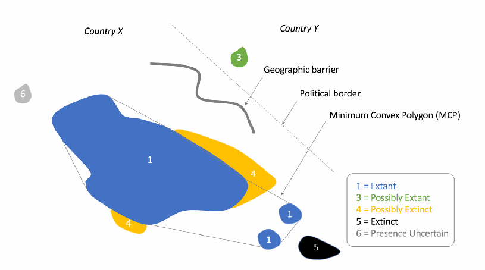
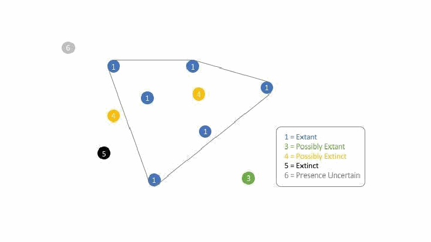

================================================================================
Page 1
================================================================================

Mapping Standards and Data Quality
for the IUCN Red List Spatial Data
Version 1.20
(January 2024)
Prepared by the IUCN SSC Red List Technical Working Group
THE IUCN RED LIST OF THREATENED SPECIES

================================================================================
Page 2
================================================================================

Contents
Contents 2
1 Spatial data and The IUCN Red List 4
1.1 Why spatial data are required 4
1.2 Reasons for a distribution map 4
1.3 IUCN Red List versus IUCN Green Status mapping 5
1.3.1 Historical range 5
1.3.2 Mapping of Subspecies, Varieties or Subpopulations versus Green Status
Spatial Units 6
2 What distribution data are needed for Red List assessments? 6
2.1 Species distribution text and map status in SIS 7
2.2 Countries of occurrence (COO) 7
2.3 Distribution map 8
3 Taxon and system differences 9
3.1 Terrestrial and marine taxa 9
3.2 Inland water taxa (freshwater) 9
4 Attributes for distribution maps 10
4.1 Polygon and point data 10
4.1.1 Required polygon and point attributes 10
4.1.2 Recommended polygon and point attributes 12
4.1.3 Optional data attributes 14
5 Coding of Presence, Origin and Seasonality for distribution maps 14
5.1 Presence codes 14
5.2 Origin Codes 16
5.3 Seasonality Codes 16
5.4 Presence, Origin and Seasonality quick reference 17
6 Countries of occurrence (COO) in SIS 18
6.1 Countries with multiple distribution codes in the spatial data 18
7 Extent of occurrence (EOO), area of occupancy (AOO) 19
7.1 Extent of occurrence (EOO) 19
7.1.1 How should EOO be calculated for polygon maps and point maps? 19
7.2 Area of occupancy (AOO) 21
8 Generating a distribution map 23
8.1 Software and formats 23
8.2 Tools 23
8.3 Standard GIS layers / basedata 24
2

================================================================================
Page 3
================================================================================

8.4 Mapping consistency 24
8.5 Sensitive species guidelines 26
8.5.1 Generalised polygon 26
9 What will happen to your map data? 27
9.1 Countries of occurrence (COO) data 27
9.2 Legend combinations from distribution codes 27
10 Updates regarding Spatial Data 28
10.1 Presence Codes (last updated 2024) 28
10.1.1 Implications of updated Presence for existing spatial data (2014) 28
10.1.2 Presence code Expected Additional Range (2024) 29
10.2 Origin code Assisted Colonisation (last updated 2016) 29
10.3 Legend Update (last updated 2016) 29
10.4 Spatial distributions for infra-rank assessments (last updated 2021) 29
11 Abbreviations, acronyms and definitions 30
3

================================================================================
Page 4
================================================================================

1 Spatial data and The IUCN Red List
Spatial data are a key component of The IUCN Red List of Threatened Species (hereafter
“IUCN Red List”). Several of the Red List criteria are based on measures of species’
distributions. Data are also used for spatial filtering on The IUCN Red List website, and
for spatial analyses to support conservation. This guidance document provides an overview
of the different elements of spatial data on The IUCN Red List and outlines what kinds of
spatial data Red List Assessors are required to provide with each assessment, along with
relevant formats and standards.
Note that spatial data are also a key component of IUCN Green Status of Species
assessments (hereafter “IUCN Green Status”). Aligning mapping processes between The
IUCN Red List and IUCN Green Status is increasingly important as the IUCN Green Status
assessment process is taking off to help both processes be as efficient as possible. While in
this document, we primarily focus on mapping guidance for the IUCN Red List, we
highlight where special consideration should be given to the IUCN Green Status process
and have started to integrate guidance specific to IUCN Green Status mapping. The
guidance given in this document to help align these two processes will evolve over time.
1.1 Why spatial data are required
Spatial data are some of the most frequently used data on The IUCN Red List. They are
crucial information for conservation planning and enable a broad variety of research in
support of conservation. They are essential for supporting Red List assessments under
criteria B and D2. Each assessment should provide spatial data in some form.
Assessors should produce the most accurate depiction of a taxon’s current and historic
distribution based on their knowledge and the available data, in a format that is
considered most appropriate to inform conservation action for the taxon. These maps
are also displayed and can be used for spatial searches on The IUCN Red List website.
1.2 Reasons for a distribution map
A key component of spatial data is the distribution map (see section 2.3), which is a
depiction of a taxon’s distribution; this does not equate to either the spread of extinction
risk (i.e., extent of occurrence) or the occupied range area (i.e., area of occupancy) as
defined by the IUCN Red List Categories and Criteria.
There are three main reasons for creating a distribution map for a taxon being assessed
for the IUCN Red List:
● Informing Red List assessments: Distribution maps can help to inform Red List
assessments by supporting calculations of some parameters used in the assessment
process, such as the extent of occurrence (EOO).
4

================================================================================
Page 5
================================================================================

● Helping to identify conservation priorities: Spatial data can be used for analyses,
which can inform conservation planning and policy, identify priority areas for
conservation, identify gaps in scientific knowledge, and help inform business
decisions (for example, where not to expand development).
● Visual representation: A distribution map provides a visual representation of a
taxon’s distribution. By combining spatial data for many taxa and analysing these
alongside other Red List data (such as Red List category), informative maps can be
prepared to, for example, highlight areas with high numbers of threatened species.
1.3 IUCN Red List versus IUCN Green Status mapping
Note that for an IUCN Green Status assessment, assessors are asked to map three things:
● the historical (indigenous) part of the range, back to the benchmark date
determined in the Green Status assessment;
● the expected additional range; and
● the delineated spatial units (although this is not compulsory).
Since both IUCN Red List and IUCN Green Status assessments will be displayed on the
IUCN Red List website with an accompanying map, it is important to be mindful of both
processes and align the maps as much as possible to ensure their usefulness to the Red
List end user.
Here are some key points to remember and be mindful of:
1.3.1 Historical range
In IUCN Red List assessments, assessors largely focus on mapping current known
limits of range. While they are also encouraged to map historical range where this is
relevant (e.g., to illustrate or provide context to local extirpations or range loss), in
practice, mapping of historical range is usually completed only for a limited group of
(often charismatic) species. With the exception of globally Extinct and Extinct in the
Wild species, mapping historical range is also not required or recommended
supporting information.
However, for an IUCN Green Status assessment, mapping historical range (as part of
indigenous range) is essential. Assessors must use the best available information to
construct a map that accurately reflects the historical range. Crucially, mapped
historical range in IUCN Green Status assessments is explicitly tied to a “benchmark
date” established as part of a IUCN Green Status assessment, which must be later
than 1500 and before 1950. In other words, mapped historical range represents, to
the best available knowledge, the limits of distribution of the species at that stated
point in time.
Thus, for IUCN Red List assessors, there are two aspects to be mindful of when
mapping historical range:
5

================================================================================
Page 6
================================================================================

a. Historical range should not be mapped to a date earlier than 1500 – this is
to ensure consistency with mapped historical range in IUCN Green Status
assessments, and also to ensure consistency with the 1500 cut-off date for species to
be considered as eligible for listing on the Red List. This means, for example, that a
map showing historical range of the lion would not show extirpated range in Greece,
since it far precedes the 1500 date.
b. If assessors want to map/show historical range, they should seriously
consider also carrying out a Green Status assessment; however, if this is not possible
(e.g. due to time constraints) then they should at least ensure that they map historical
range to an explicitly indicated benchmark date. This would have the advantage of
ensuring better interpretation of what historical / extirpated range in a Red List map
corresponds to, and increase the utility of these spatial data in subsequent IUCN
Green Status assessments.
1.3.2 Mapping of Subspecies, Varieties or Subpopulations versus Green Status
Spatial Units
In a Green Status assessment, a species’ range is subdivided into Spatial Units, in
which the state of the species is assessed as Absent, Present, Viable, or Functional.
Spatial units can be delineated by subpopulation, ecological and geographical
features, and location, or a combination of these. Because IUCN Red List spatial data
already have a data field “Tax_comm” that allows assessors to indicate subspecies,
varieties or subpopulations, the introduction of an additional field to capture spatial
units, especially where the spatial units do not conform with subpopulations, could
lead to issues when visualising the distribution maps on the IUCN Red List website.
It is also likely to add substantial complexity for any end users hoping to utilise the
spatial data for conservation purposes. Further guidance will be forthcoming to assist
assessors who wish to map Spatial Units in a GSS assessment in how to capture this
information in the attribute data.
2 What distribution data are needed for Red List assessments?
In addition to the textual description of the species’ distribution and its countries of
occurrence (COO; coded by presence, origin and seasonality) (see Supporting Information
Guidelines), spatial data are required to support all IUCN Red List assessments, except for
taxa of unknown provenance (see Annex 1 of the Rules of Procedure). These spatial data
come in the form of a distribution map that represents the best available depiction of the
historical, present and projected distribution of a taxon – also coded by presence, origin
and seasonality.
6

================================================================================
Page 7
================================================================================

2.1 Species distribution text and map status in SIS
SIS (Species Information Service) stores information on the geographic distribution,
how the distribution map was created, and the data sources/methods used. This is
recorded within the Geographic Range text and the Map Status fields in the Distribution
section of a taxon’s assessment.
Geographic Range: in this text field, a concise narrative of currently available
information on the geographic range of the taxon is required supporting information for
all taxa that are not assessed as Least Concern (Table 2 of Annex 1 of the Rules of
Procedure). For taxa that are particularly sensitive to collecting or hunting, it is prudent
to avoid providing information that allows people to see exactly where the taxon can be
found, but a less precise summary should be provided.
Map Status: It is mandatory to fill the Map Status field in SIS, which can take the values
below:
● Done – the map has been completed to the required standards and will be
provided as part of the assessment. It will be published unless the data are
marked as sensitive (see sections 4 and 8.5).
● Missing – the map is missing and needs to be located. An assessment with this
status cannot be submitted or published.
● Incomplete – the map will be provided, but it is known not to be complete, for
example there was not enough information to map certain parts of the range.
Incomplete maps will be published (unless the data are marked as sensitive, see
sections 4 and 8.5). A reason for the map being incomplete must be provided in
the justification box in SIS.
● Not Possible – making a distribution map for the species is not possible. For
example, the distribution is only known at a coarse country level, or is not known
(such as for some Data Deficient taxa). A reason must be provided in the
justification box in SIS. Red List assessments with this map status will be
published without a distribution map.
2.2 Countries of occurrence (COO)
The countries where the taxon occurs must be entered into SIS, with the appropriate
distribution codes for Presence, Origin and Seasonality (see section 5 for an explanation
of the Presence, Origin and Seasonality codes). Assessors need to ensure that the
Countries of Occurrence (COO) indicated on the spatial map are consistent with those
listed in SIS. See section 6 (Countries of occurrence (COO) in SIS) for more
information.
To minimize inconsistencies between SIS and the distribution map, it is also crucial to
make sure that the appropriate recommended country basemap dataset is used (this is
available from the GIS Tools, Software and Recommended Base data page on the IUCN
Red List website).
7

================================================================================
Page 8
================================================================================

2.3 Distribution map
We encourage Assessors to provide the best possible map they can make (i.e., as
accurate as possible considering the available data). To ensure efficiency and ease of
data management, it is preferable to submit the distribution map data in one or more of
the following:
1) Occurrence Data (Point/s): Each historical, present and possible occurrence of
a taxon is represented by a pair of coordinates known as a point locality.
2) Polygon Data (limits of distribution/field guide map): The historical, present
and possible distribution of a taxon’s occurrences is represented by a polygon or
set of polygons.
3) Polygon Data (basins): The historical, present and possible distribution of a
taxon’s occurrences is represented by a basin (HydroBASIN) or a set of basins.
‘Basin’ is used as a short term for HydroBASIN – more information can be found
here.
The recommended projection is WGS 1984 (World Geodetic Survey 1984,
EPSG:4326).
Polygon data are generally provided in form of a distribution map (commonly referred
to as “limits of distribution” or “field guide” map) which aims to represent the known
and possible present and historical distribution of a taxon within its native and
introduced range. The limits of distribution are determined by using known occurrences
of the taxon, along with knowledge of habitat, elevation limits, and other expert
knowledge of the taxon and its range. Essentially, a polygon displays the limits of a
taxon’s distribution, and is intended to communicate that the taxon probably only occurs
within the polygon, but it does not mean that it is distributed equally within that polygon
or occurs everywhere within that polygon.
Options 1, 2 and 3 above are not mutually exclusive; an assessment can be supported by
a combination of the three. Independent of the method used, a minimum set of attribute
data (metadata) should be provided; the attribute information is described further in
section 4.
For assessments that are accompanied by points only, it is recommended, if possible and
appropriate, that a polygon map representing the distribution is also provided. Plausible
options include, for example, the Minimum Convex Polygon (MCP) map (equivalent to
the maximum EOO as defined in this document). Such a polygon should be marked in
the polygon attribute table as generalisd = 1 (see Table 2 in section 4.1.2). It would be
used for display on the IUCN Red List website along with the points, and could also be
used for analysis purposes.
8

================================================================================
Page 9
================================================================================

3 Taxon and system differences
There are preferred approaches (polygons, basins, points) for different taxonomic groups
and systems. These are not intended to be strict rules; for any deviations, please contact the
GIS team within the IUCN Red List Unit.
3.1 Terrestrial and marine taxa
A taxon’s distribution can be provided either as point or polygon data or both; in the
case of species occurring in both terrestrial and freshwater habitats (e.g. Odonata),
distribution can also be mapped as basins. For polygons, areas of unsuitable habitat,
climate or physical geography (e.g., altitude, bathymetry, hydrology) should be removed
to provide a refined range.
3.2 Inland water taxa (freshwater)
It is highly recommended that the distribution maps for inland water taxa use the official
HydroBASIN sub-basin layer, available from the GIS Tools, Software and
Recommended Base data page on The IUCN Red List website. HydroBASINS are
available in different resolutions (size of sub-basins), with the smaller sub-basins (e.g.,
levels 10 and 12) being nested within larger sub-basins (e.g., level 8). The appropriate
resolution to use will depend on the level of knowledge of the taxon as well as size of
its distribution range.
For inland water taxa, as with other groups, the distribution map should represent the
best possible representation of the distribution. For those inland water taxa with
distributions more restricted than the finest scale HydroBASINS layer (such as the
location of a cave or small wetland to which a taxon is restricted), the range should be
mapped as a polygon reflecting the specific distribution, rather than generalising to the
finest scale HydroBASINS layer. If a coarser HydroBASINS layer is used (for example
where a taxon only occurs at an edge of the basin or only in a main channel), the
minimum convex polygon (MCP) will be inflated (see EOO description in section 7.1).
If point data are being provided for inland water taxa, Assessors are strongly encouraged
to provide the corresponding HydroBASINS data as well. HydroBASINS data are used
in multiple freshwater-focused projects coordinated by the IUCN Biodiversity
Assessment and Knowledge Team and providing these data will ensure the maps are
included as part of large-scale analyses using this type of spatial data.
More detailed information about mapping of inland water taxa can be found in the
Freshwater Mapping Protocol.
9

================================================================================
Page 10
================================================================================

4 Attributes for distribution maps
For the distribution map, there is a list of data attributes which must be recorded for both
polygon and point data. These attributes help describe the taxon’s distribution. Please refer
to the Excel file ‘IUCN Standard attributes for spatial data’ available from the Mapping
Standards and Data Quality for IUCN Red List Spatial Data page on The IUCN Red List
website. This file provides detailed guidance on required and recommended attribute data
fields, including definitions, field types, field lengths, and equivalent data fields in other
datasets.
Tables 1 and 2 list the standard attributes for spatial data; the codes used to indicate
Presence, Origin and Seasonality. These codes are also used to create legends for the
distribution map (see section 9.2).
Please note that only the Required and Recommended fields are displayed in Tables 1 and
2 – more information on these can be found in Mapping Standards and Data Quality for
IUCN Red List Spatial Data on The IUCN Red List website.
The spatial attributes’ field names are limited to 10 characters in order to match the
Shapefile format (the Shapefile format does not allow field lengths of greater than 10
characters).
4.1 Polygon and point data
4.1.1 Required polygon and point attributes
Table 1 lists the required attributes for polygon and point data. Note that some of
these attributes are taxon dependent: these are the attributes described as “[Required
(if relevant)]” in the Description column. For example, for a polygon depicting the
distribution of a subspecies (e.g., Panthera leo ssp. persica) the subspecies attribute
field must be completed.
10

================================================================================
Page 11
================================================================================

**Table 1 (Page 11)**

| Field      | Description                                                                                                                                               | Notes                                                                                                                                                                                                       |     | Polygons/ |     | Points |
| ---------- | --------------------------------------------------------------------------------------------------------------------------------------------------------- | ----------------------------------------------------------------------------------------------------------------------------------------------------------------------------------------------------------- | --- | --------- | --- | ------ |
|            |                                                                                                                                                           |                                                                                                                                                                                                             |     | Basins    |     |        |
| sci_name   | Scientific name of the taxon                                                                                                                           | This must match the corresponding field in SIS, e.g. “Panthera leo”; “Panthera leo ssp. persica”; “Veratrum mengtzeanum subsp. mengtzeanum”; "Cedrus libani var. brevifolia". Previously known as binomial. | ✔   |           |     | ✔      |
| hybas_id   | HydroBASIN ID [Required if HydroBASINS have been used for mapping the data]                                                                      | If HydroBASINS have been used to provide distribution data, the hybas_id, which is the unique identifier of that basin where the taxon has been mapped, should be provided.                  | ✔   |           |     |        |
| presence   | Is/Was the species in this area                                                                                                                        | See Presence codes (default is 1 if not indicated).                                                                                                                                                      | ✔   |           |     | ✔      |
| origin     | Why/ How the species is in this area                                                                                                                   | See Origin codes (default is 1 if not indicated).                                                                                                                                                        | ✔   |           |     | ✔      |
| seasonal   | What is the seasonal presence of the species in the area [Required if applicable]                                                                | See Seasonality codes (default is 1 if not indicated or not applicable).                                                                                                                                 | ✔   |           |     | ✔      |
| compiler   | Name of the individual/s or institution responsible for generating the point or polygon distribution, if not IUCN                             | Names should be given in full (e.g., “John Smith”; “NatureServe”; “World Conservation Monitoring Centre”). If not indicated, this will default to “IUCN (International Union for Conservation of Nature)”. | ✔   |           |     | ✔      |
| yrcompiled | Year in which the taxon distribution was mapped, compiled, or modified                                                                              | If not indicated, this will default to the current year.                                                                                                                                                 | ✔   |           |     | ✔      |
| citation   | Individual/s or institution/s responsible for providing the map data for the Red List assessment to IUCN. This field is used for the overall map citation | This must be the same throughout the file. It is how the map data will be credited on the IUCN Red List. If not indicated, this will default to "IUCN (International Union for Conservation of Nature)". | ✔   |           |     | ✔      |
| dec_lat    | The geographical latitude in decimal degrees                                                                                                           | E.g., -41.097. Positive values are north of the equator; negative values are south of it. Valid values lie between -90 and 90.                                                                     |     |           |     | ✔      |

Table 1: Required attributes for polygons and points ( ✔ indicates whether the field
applies to polygons and/or points)
Polygons/
Field Description Notes Points
Basins
This must match the corresponding
field in SIS, e.g. “Panthera leo”;
“Panthera leo ssp. persica”;
Scientific name of the
sci_name “Veratrum mengtzeanum subsp. ✔ ✔
taxon
mengtzeanum”; "Cedrus libani var.
brevifolia". Previously known as
binomial.
If HydroBASINS have been used to
HydroBASIN ID [Required provide distribution data, the
if HydroBASINS have been hybas_id, which is the unique
hybas_id ✔
used for mapping the identifier of that basin where the
data] taxon has been mapped, should be
provided.
Is/Was the species in this See Presence codes (default is 1 if
presence ✔ ✔
area not indicated).
Why/ How the species is See Origin codes (default is 1 if not
origin ✔ ✔
in this area indicated).
What is the seasonal
presence of the species in See Seasonality codes (default is 1
seasonal ✔ ✔
the area [Required if if not indicated or not applicable).
applicable]
Names should be given in full (e.g.,
Name of the individual/s “John Smith”; “NatureServe”;
or institution responsible “World Conservation Monitoring
compiler for generating the point Centre”). If not indicated, this will ✔ ✔
or polygon distribution, if default to “IUCN (International
not IUCN Union for Conservation of
Nature)”.
Year in which the taxon
If not indicated, this will default to
yrcompiled distribution was mapped, ✔ ✔
the current year.
compiled, or modified
Individual/s or
This must be the same throughout
institution/s responsible
the file. It is how the map data will
for providing the map
be credited on the IUCN Red List. If
citation data for the Red List ✔ ✔
not indicated, this will default to
assessment to IUCN. This
"IUCN (International Union for
field is used for the overall
Conservation of Nature)".
map citation
E.g., -41.097. Positive values are
The geographical latitude north of the equator; negative
dec_lat ✔
in decimal degrees values are south of it. Valid values
lie between -90 and 90.
11

================================================================================
Page 12
================================================================================

**Table 1 (Page 12)**

| dec_long   | The geographical
longitude in decimal
degrees                                                                                                      | E.g., -121.25. Positive values are
east of the Greenwich Meridian;
negative values are west of it. Valid
values lie between -180 and 180.                                                                                                                       |     | ✔   |
| ---------- | -------------------------------------------------------------------------------------------------------------------------------------------------- | --------------------------------------------------------------------------------------------------------------------------------------------------------------------------------------------------------------------------------------------------------------- | --- | --- |
| spatialref | The ellipsoid, geodetic datum or spatial reference system (SRS) upon which the geographic coordinates (supplied in dec_lat and dec_long) are based | Data is preferred in WGS84. If blank, the default of WGS84 will be assumed. E.g.: “WGS84”; “EPSG:4326”; “NAD27”; “Campo Inchauspe”; “European 1950”; “Clarke 1866”.                                                                              |     | ✔   |
| subspecies | Subspecies Name/Epithet [Required if relevant]                                                                                                  | To indicate that the data relates to a specific subspecies (or variety) of the assessed taxon. This must then match the infra name in SIS, e.g., “persica”, “brevifolia".                                                                           | ✔   | ✔   |
| subpop     | Subpopulation Name/Epithet [Required if relevant]                                                                                            | To indicate that the data relates to a specific subpopulation of the assessed taxon, e.g., “Hawaiian subpopulation”.                                                                                                                                   | ✔   | ✔   |
| data_sens  | Flags up whether or not the polygon distribution/data point is sensitive. [Required if data is sensitive]                              | This is most likely to be the case if the polygon or point shows individual localities of a sensitive nature as determined by the Assessor. True or false field: 1 or 0. If 1 for true/yes, the field sens_comm should be completed. Default is 0 for false/no. | ✔   | ✔   |
| sens_comm  | Comments on why the data are considered sensitive [Required if data_sens is 1]                                                            | [Max. 254 characters]                                                                                                                                                                                                                                           | ✔   | ✔   |

E.g., -121.25. Positive values are
The geographical
east of the Greenwich Meridian;
dec_long longitude in decimal ✔
negative values are west of it. Valid
degrees
values lie between -180 and 180.
The ellipsoid, geodetic Data is preferred in WGS84. If
datum or spatial blank, the default of WGS84 will be
reference system (SRS) assumed. E.g.: “WGS84”;
spatialref upon which the “EPSG:4326”; “NAD27”; “Campo ✔
geographic coordinates Inchauspe”; “European 1950”;
(supplied in dec_lat and “Clarke 1866”.
dec_long) are based
To indicate that the data relates to
a specific subspecies (or variety) of
Subspecies Name/Epithet
subspecies the assessed taxon. This must then ✔ ✔
[Required if relevant]
match the infra name in SIS, e.g.,
“persica”, “brevifolia".
To indicate that the data relates to
Subpopulation
a specific subpopulation of the
subpop Name/Epithet [Required ✔ ✔
assessed taxon, e.g., “Hawaiian
if relevant]
subpopulation”.
This is most likely to be the case if
the polygon or point shows
Flags up whether or not
individual localities of a sensitive
the polygon
nature as determined by the
data_sens distribution/data point is ✔ ✔
Assessor. True or false field: 1 or 0.
sensitive. [Required if
If 1 for true/yes, the field
data is sensitive]
sens_comm should be completed.
Default is 0 for false/no.
Comments on why the
data are considered
sens_comm [Max. 254 characters] ✔ ✔
sensitive [Required if
data_sens is 1]
Notes:
1) The citation must be the same for all polygons, HydroBASINS and points for a given taxon.
2) Alongside coding of sensitive data via the data_sens field in the spatial data’s attribute table,
Assessors must code the species distribution as sensitive in SIS (Distribution tab -> Map Status tab
-> “Data Sensitive?” checkbox).
4.1.2 Recommended polygon and point attributes
The Recommended attributes are listed in Table 2. Although they are not required,
these attributes should be recorded whenever this information is available, so we
encourage effort being made to enter the relevant information into these fields as
much as possible.
12

================================================================================
Page 13
================================================================================

**Table 1 (Page 13)**

| Field      | Description                                                                                                      | Notes                                                                                                                                                                                                                                                                                                      |     | Polygons/ |     | Points |
| ---------- | ---------------------------------------------------------------------------------------------------------------- | ---------------------------------------------------------------------------------------------------------------------------------------------------------------------------------------------------------------------------------------------------------------------------------------------------------- | --- | --------- | --- | ------ |
|            |                                                                                                                  |                                                                                                                                                                                                                                                                                                            |     | Basins    |     |        |
| event_year | The four-digit year in which the Event (object or observation) occurred                                    | For example, 2008.                                                                                                                                                                                                                                                                                         |     |           |     | ✔      |
| source     | Source of the distribution range / point data                                                                 | Relates to the primary source used to compile each polygon or point, especially in a recently published range map, or a set of point data. References should be in the format “AuthorX and AuthorY, date” and the reference should be in the corresponding IUCN Red List assessment. [Max. 254 characters] | ✔   |           |     | ✔      |
| basisofrec | The specific nature of the data record. (reference valid Feb2021: https://dwc.tdwg.org/list/ #dwc_basisOfRecord) | Options: “PreservedSpecimen”, “FossilSpecimen”, “LivingSpecimen”, “HumanObservation”, “MachineObservation”, “StillImage”, “MovingImage”, “SoundRecording”                                                                                                                                |     |           |     | ✔      |
| catalog_no | An identifier (preferably unique) for the record within the data set or collection                      | Name of the museum or herbarium and the specimen number.                                                                                                                                                                                                                                             |     |           |     | ✔      |
| dist_comm  | Distribution comments that refer directly to the polygon or point                                          | Examples include whether the polygon represents the type locality, names of protected areas or geographical features, and so forth. May also include specific notes on presence, origin or seasonality. [Max. 254 characters]                                                            | ✔   |           |     | ✔      |
| island     | Name of the island on which the polygon or point is located                                                | This relates mainly to very small islands or atolls (e.g., “Midway Atoll”; “Meemu Atoll”; “Bohol”)                                                                                                                                                                                                   | ✔   |           |     | ✔      |
| tax_comm   | Taxonomic comments that refer directly to the polygon                                                      | Includes notes on polygons pertaining to subspecies, varieties or subpopulations. [Max. 254 characters]                                                                                                                                                                                           | ✔   |           |     | ✔      |
| generalisd | Flag to indicate whether the polygon is generalised                                                           | True or false field: 1 or 0. Set to 1 if the polygon shows a generalised distribution. Default is 0 for false/no.                                                                                                                                                                                 | ✔   |           |     |        |

Table 2: Recommended attributes for polygons and points
Polygons/
Field Description Notes Points
Basins
The four-digit year in
event_year which the Event (object or For example, 2008. ✔
observation) occurred
Relates to the primary source used
to compile each polygon or point,
especially in a recently published
Source of the distribution range map, or a set of point data.
source range / point data References should be in the format ✔ ✔
“AuthorX and AuthorY, date” and
the reference should be in the
corresponding IUCN Red List
assessment. [Max. 254 characters]
Options: “PreservedSpecimen”,
The specific nature of the “FossilSpecimen”,
data record. (reference “LivingSpecimen”,
basisofrec valid Feb2021: “HumanObservation”, ✔
https://dwc.tdwg.org/list/ “MachineObservation”,
#dwc_basisOfRecord) “StillImage”, “MovingImage”,
“SoundRecording”
An identifier (preferably Name of the museum or
catalog_no unique) for the record herbarium and the specimen ✔
within the data set or number.
collection
Examples include whether the
polygon represents the type
Distribution comments locality, names of protected areas
dist_comm that refer directly to the or geographical features, and so ✔ ✔
polygon or point forth. May also include specific
notes on presence, origin or
seasonality. [Max. 254 characters]
Name of the island on This relates mainly to very small
island which the polygon or islands or atolls (e.g., “Midway ✔ ✔
point is located Atoll”; “Meemu Atoll”; “Bohol”)
Includes notes on polygons
Taxonomic comments
pertaining to subspecies, varieties
tax_comm that refer directly to the ✔ ✔
or subpopulations. [Max. 254
polygon
characters]
True or false field: 1 or 0. Set to 1 if
generalisd Flag to indicate whether the polygon shows a generalised ✔
the polygon is generalised distribution. Default is 0 for
false/no.
Notes:
1) For entries in the source attribute field that approach the 254 character limit, apply standard
abbreviations and then define these within the reference list within SIS.
13

================================================================================
Page 14
================================================================================

4.1.3 Optional data attributes
Optional attributes may be used and some are taxon dependent. The list of optional
attributes can be found in the Excel file ‘IUCN Standard attributes for spatial data’,
available from the Mapping Standards and Data Quality for IUCN Red List Spatial
Data page on The IUCN Red List website).
Note: Please make sure to use the most recent ‘IUCN Standard attributes for spatial
data’ Excel file, as this will be regularly updated with the most recent information,
and includes a log to indicate what has changed.
5 Coding of Presence, Origin and Seasonality for distribution
maps
Every polygon and point occurrence in the distribution map requires Presence, Origin and
Seasonality to be recorded using the relevant codes from Tables 3, 4 and 5.
5.1 Presence codes
Table 3 outlines the definitions for the various coding options for a taxon’s Presence
within a particular area. These Presence codes and their definitions apply both to spatial
data (i.e., polygons and point data) and to non-spatial data (e.g., countries of occurrence
in SIS).
Note that the Presence codes were updated in February 2014, so please make sure that
you check the current definitions, and understand what implications this might have for
any existing spatial data if these have not yet been migrated (see section 10.1.1). See
section 7.1 to check how extent of occurrence (EOO) should be calculated using the
revised Presence codes.
14

================================================================================
Page 15
================================================================================

**Table 1 (Page 15)**

|     | CODE |     |                           | PRESENCE |     |                                                                                                                                                                                                                                                                                                                                                                                                                                                                                                                                                                                                                                                                                                            | DEFINITION |     |
| --- | ---- | --- | ------------------------- | -------- | --- | ---------------------------------------------------------------------------------------------------------------------------------------------------------------------------------------------------------------------------------------------------------------------------------------------------------------------------------------------------------------------------------------------------------------------------------------------------------------------------------------------------------------------------------------------------------------------------------------------------------------------------------------------------------------------------------------------------------- | ---------- | --- |
| 1   |      |     | Extant                    |          |     | The species is known or thought very likely to occur currently in the area, which encompasses localities with current or recent (last 20-30 years) records where suitable habitat at appropriate altitudes remains (see note 2). Extant polygons can include inferred or spatially projected sites of present occurrence (see the Guidelines for Using the IUCN Red List Categories and Criteria for further guidance). Extant ranges should be considered in the calculation of EOO or AOO. When mapping an “assisted colonisation” it is important to note that this range should be treated as Extant.                                                                             |            |     |
| 2   |      |     | Probably Extant           |          |     | This code value has been discontinued for reasons of ambiguity. It may exist in the spatial data but will gradually be phased out.                                                                                                                                                                                                                                                                                                                                                                                                                                                                                                                                                                      |            |     |
| 3   |      |     | Possibly Extant           |          |     | There is no record of the species in the area, but the species may possibly occur, based on the distribution of potentially suitable habitat at appropriate altitudes, although the area is beyond where the species is Extant (i.e., beyond the limits of known or likely records), and the degree of probability of the species occurring is lower (e.g., because the area is beyond a geographic barrier, or because the area represents a considerable extension beyond areas of known or probable occurrence). Identifying Possibly Extant areas is useful to flag up areas where the taxon should be searched for. Possibly Extant ranges should not be considered in the calculation of EOO or AOO. |            |     |
| 4   |      |     | Possibly Extinct          |          |     | The species was formerly known or thought very likely to occur in the area (post 1500 CE), but it is most likely now extirpated from the area because habitat loss and/or other threats are thought likely to have extirpated the species, and there have been no confirmed recent records despite searches. Possibly Extinct ranges should not be considered in the calculation of EOO or AOO.                                                                                                                                                                                                                                                                                                |            |     |
| 5   |      |     | Extinct                   |          |     | The species was formerly known or thought very likely to occur in the area (post 1500 CE), but it has been confirmed that the species no longer occurs because exhaustive searches have failed to produce recent records, and the intensity and timing of threats could plausibly have extirpated the taxon. Extinct ranges should not be considered in the calculation of EOO or AOO.                                                                                                                                                                                                                                                                                                         |            |     |
| 6   |      |     | Presence Uncertain        |          |     | A record exists of the species' presence in the area, but this record requires verification or is rendered questionable owing to uncertainty over the identity or authenticity of the record, or the accuracy of the location. Presence Uncertain records should not be considered in the calculation of EOO or AOO.                                                                                                                                                                                                                                                                                                                                                                              |            |     |
| 7   |      |     | Expected Additional Range |          |     | The species is not currently known to occur in the area, but this area is expected to (1) become suitable in the next 100 years, taking into account range shifts resulting from climate change, AND (2) to become occupied by the species, with or without human assistance. Expected additional range is only considered in a Green Status of Species assessment and not for point occurrences.                                                                                                                                                                                                                                                                                              |            |     |

Table 3: Codes for recording the Presence of a taxon within a polygon or for a point
occurrence.
CODE PRESENCE DEFINITION
The species is known or thought very likely to occur currently in the area, which
encompasses localities with current or recent (last 20-30 years) records where
suitable habitat at appropriate altitudes remains (see note 2). Extant polygons
can include inferred or spatially projected sites of present occurrence (see the
1 Extant
Guidelines for Using the IUCN Red List Categories and Criteria for further
guidance). Extant ranges should be considered in the calculation of EOO or AOO.
When mapping an “assisted colonisation” it is important to note that this range
should be treated as Extant.
This code value has been discontinued for reasons of ambiguity. It may exist in
2 Probably Extant
the spatial data but will gradually be phased out.
There is no record of the species in the area, but the species may possibly occur,
based on the distribution of potentially suitable habitat at appropriate altitudes,
although the area is beyond where the species is Extant (i.e., beyond the limits
of known or likely records), and the degree of probability of the species
3 Possibly Extant occurring is lower (e.g., because the area is beyond a geographic barrier, or
because the area represents a considerable extension beyond areas of known
or probable occurrence). Identifying Possibly Extant areas is useful to flag up
areas where the taxon should be searched for. Possibly Extant ranges should not
be considered in the calculation of EOO or AOO.
The species was formerly known or thought very likely to occur in the area (post
1500 CE), but it is most likely now extirpated from the area because habitat loss
4 Possibly Extinct and/or other threats are thought likely to have extirpated the species, and there
have been no confirmed recent records despite searches. Possibly Extinct
ranges should not be considered in the calculation of EOO or AOO.
The species was formerly known or thought very likely to occur in the area (post
1500 CE), but it has been confirmed that the species no longer occurs because
5 Extinct exhaustive searches have failed to produce recent records, and the intensity and
timing of threats could plausibly have extirpated the taxon. Extinct ranges
should not be considered in the calculation of EOO or AOO.
A record exists of the species' presence in the area, but this record requires
verification or is rendered questionable owing to uncertainty over the identity
6 Presence Uncertain
or authenticity of the record, or the accuracy of the location. Presence Uncertain
records should not be considered in the calculation of EOO or AOO.
The species is not currently known to occur in the area, but this area is expected
to (1) become suitable in the next 100 years, taking into account range shifts
Expected
7 resulting from climate change, AND (2) to become occupied by the species, with
Additional Range
or without human assistance. Expected additional range is only considered in
a Green Status of Species assessment and not for point occurrences.
Notes:
1) These codes are mutually exclusive, e.g., a polygon coded as “Extant” cannot also be coded as
“Extinct”.
2) When there is uncertainty as to whether or not a species still occurs in an area in which it was
formerly known to occur (usually because there have been no recent surveys), it is necessary for
Assessors to judge whether it is more appropriate to assign a coding of “Extant”, “Possibly Extant” or
“Possibly Extinct” (based on available knowledge of remaining habitat, intensity of threats, adequacy of
searches, and other evidence).
15

================================================================================
Page 16
================================================================================

**Table 1 (Page 16)**

|     | CODE |     |                       | ORIGIN |     |                                                                                                                                                                                                                                                                                                           | DEFINITION |     |
| --- | ---- | --- | --------------------- | ------ | --- | --------------------------------------------------------------------------------------------------------------------------------------------------------------------------------------------------------------------------------------------------------------------------------------------------------- | ---------- | --- |
|     | 1    |     | Native                |        |     | The species is/was native to the area.                                                                                                                                                                                                                                                                    |            |     |
| 2   |      |     | Reintroduced          |        |     | The species is/was reintroduced within its known historical range through either direct or indirect human activity.                                                                                                                                                                                    |            |     |
| 3   |      |     | Introduced            |        |     | The species is/was introduced outside of its known historical distribution range through either direct or indirect human activity. Does not include species subject to assisted colonisation. Includes species intentionally moved outside of its native range to perform a specific ecological function. |            |     |
| 4   |      |     | Vagrant               |        |     | The species is/was recorded once or sporadically, but it is known not to be native to the area.                                                                                                                                                                                                        |            |     |
| 5   |      |     | Origin Uncertain      |        |     | The species’ provenance in an area is not known (it may be native, reintroduced or introduced)                                                                                                                                                                                                         |            |     |
| 6   |      |     | Assisted Colonisation |        |     | Species subject to intentional movement and release outside its native range to reduce the extinction risk of the taxon.                                                                                                                                                                               |            |     |

3) EOO calculations should be based on polygons coded as “Extant” only.
4) The old Presence code 2 (“Probably Extant”) is now discontinued. See section 10.1.1 for more
information.
5) Note that Presence code 7 (“Expected Additional Range”) has been introduced for the purpose of
IUCN Green Status assessment processes. In mapping expected additional range, Green Status assessors
are effectively projecting forward in time to regions not currently occupied by the species, but that the
species is expected to occupy in 100 years. It is therefore a completely distinct mapped part of range that
is considered only in Green Status assessments.
5.2 Origin Codes
Table 4 outlines the definitions for the various coding options for a taxon’s Origin within
a particular area. These Origin codes and their definitions apply both to spatial data (i.e.,
polygons and point data) and to non-spatial data (e.g., Countries of occurrence in SIS)
Table 4: Codes for recording the Origin of a taxon within a polygon or for a point
occurrence.
CODE ORIGIN DEFINITION
1 Native The species is/was native to the area.
The species is/was reintroduced within its known historical range through
2 Reintroduced
either direct or indirect human activity.
The species is/was introduced outside of its known historical distribution
range through either direct or indirect human activity. Does not include
3 Introduced
species subject to assisted colonisation. Includes species intentionally
moved outside of its native range to perform a specific ecological function.
The species is/was recorded once or sporadically, but it is known not to be
4 Vagrant
native to the area.
The species’ provenance in an area is not known (it may be native,
5 Origin Uncertain
reintroduced or introduced)
Species subject to intentional movement and release outside its native
6 Assisted Colonisation
range to reduce the extinction risk of the taxon.
Notes:
1) EOO estimates should be based on Origin codes 1, 2, and 6.
2) The codes are mutually exclusive, for example, a polygon coded as “Introduced” cannot also be
coded as “Native”.
3) Point or polygon occurrences resulting from reintroduction or assisted colonisation should only be
included in a species’ distribution map when those subpopulations satisfy the conditions for inclusion in
a Red List Assessment (see Section 2.1.3 in the Guidelines for Using the IUCN Red List Categories and
Criteria for further guidance).
5.3 Seasonality Codes
Table 5 outlines the definitions for the various coding options for a taxon’s Seasonality
within a particular area. These Seasonality codes and their definitions apply both to
spatial data (i.e., polygons and point data) and to non-spatial data (e.g., Countries of
occurrence in SIS).
16

================================================================================
Page 17
================================================================================

**Table 1 (Page 17)**

|     | CODE |     |                               | SEASONALITY |     |                                                                                                                                                                            | DEFINITION |     |
| --- | ---- | --- | ----------------------------- | ----------- | --- | -------------------------------------------------------------------------------------------------------------------------------------------------------------------------- | ---------- | --- |
| 1   |      |     | Resident                      |             |     | The species is/was known or thought very likely to be resident throughout the year.                                                                                     |            |     |
| 2   |      |     | Breeding Season               |             |     | The species is/was known or thought very likely to occur regularly during the breeding season and to breed or capable of breeding.                                   |            |     |
| 3   |      |     | Non-breeding Season           |             |     | The species is/was known or thought very likely to occur regularly during the non-breeding season. In the Eurasian and North American contexts, this encompasses ‘winter’. |            |     |
| 4   |      |     | Passage                       |             |     | The species is/was known or thought very likely to occur regularly during a relatively short period(s) of the year on migration between breeding and non-breeding ranges. |            |     |
| 5   |      |     | Seasonal Occurrence Uncertain |             |     | The species is/was present, but it is not known if it is present during part or all of the year.                                                                        |            |     |

Table 5: Codes for recording the Seasonality of a taxon within a polygon or for a point
occurrence.
CODE SEASONALITY DEFINITION
The species is/was known or thought very likely to be
1 Resident
resident throughout the year.
The species is/was known or thought very likely to occur
2 Breeding Season regularly during the breeding season and to breed or
capable of breeding.
The species is/was known or thought very likely to occur
3 Non-breeding Season regularly during the non-breeding season. In the Eurasian
and North American contexts, this encompasses ‘winter’.
The species is/was known or thought very likely to occur
4 Passage regularly during a relatively short period(s) of the year on
migration between breeding and non-breeding ranges.
Seasonal Occurrence The species is/was present, but it is not known if it is
5
Uncertain present during part or all of the year.
Notes:
1) ‘Regularly’ means known or thought to occur in at least 30% of years. Where it is deemed important
to record the occurrence of breeding/passage etc. for a species which occurs less often than 30% of years
(for example because the population is now tiny), the category can be ticked, but a comment added to
the dist_comm field (e.g., “Only recorded in 2 years during 1985-2000”).
2) If the species does not regularly breed, but there are occasional breeding records, this can be noted
in the dist_comm field.
3) If there is insufficient information to be confident of assigning Non-breeding Season vs. Passage
categories, a best guess should be made, and a comment entered in the dist_comm field that some
ambiguity exists. Where there is extreme uncertainty, the “Seasonal Occurrence Uncertain” value should
be used.
5.4 Presence, Origin and Seasonality quick reference
Table 6 presents a “quick reference” summary of the Presence, Origin and
Seasonality codes from Tables 3, 4 and 5.
Please note that these codes are mutually exclusive within the columns. For example,
a polygon coded as Presence 1 (“Extant”) cannot also be coded as Presence 5
(“Extinct”); however, Presence can be coded as 1 (“Extant”) and Origin as 5 (“Origin
uncertain”) for the same polygon.
17

================================================================================
Page 18
================================================================================

**Table 1 (Page 18)**

|     | Code |     |                           | Presence |     |                       | Origin |     |                               | Seasonality |     |
| --- | ---- | --- | ------------------------- | -------- | --- | --------------------- | ------ | --- | ----------------------------- | ----------- | --- |
|     | 1    |     | Extant                    |          |     | Native                |        |     | Resident                      |             |     |
|     | 2    |     | Probably Extant           |          |     | Reintroduced          |        |     | Breeding season               |             |     |
|     | 3    |     | Possibly Extant           |          |     | Introduced            |        |     | Non-breeding season           |             |     |
|     | 4    |     | Possibly Extinct          |          |     | Vagrant               |        |     | Passage                       |             |     |
|     | 5    |     | Extinct (post 1500)       |          |     | Origin uncertain      |        |     | Seasonal Occurrence Uncertain |             |     |
|     | 6    |     | Presence uncertain        |          |     | Assisted Colonisation |        |     |                               |             |     |
|     | 7    |     | Expected Additional Range |          |     |                       |        |     |                               |             |     |

Table 6: Summary of Presence, Origin and Seasonality codes.
Code Presence Origin Seasonality
1 Extant Native Resident
2 Probably Extant Reintroduced Breeding season
3 Possibly Extant Introduced Non-breeding season
4 Possibly Extinct Vagrant Passage
5 Extinct (post 1500) Origin uncertain Seasonal Occurrence Uncertain
6 Presence uncertain Assisted Colonisation
7 Expected Additional Range
6 Countries of occurrence (COO) in SIS
Assessors need to ensure that the Countries of Occurrence (COO) indicated on the spatial
map are consistent with those listed in SIS. In future, there may be some functionality to
help automate this process – but it will still be the Assessor’s responsibility to ensure that
the COO recorded in SIS correspond to those displayed on the distribution map.
To minimize inconsistencies between SIS and the distribution map, it is also crucial to
make sure that the appropriate recommended country basemap dataset is used (this is
available from the GIS Tools, Software and Recommended Base data page on the IUCN
Red List website).
6.1 Countries with multiple distribution codes in the spatial data
In the selections for Countries of Occurrence (COO) in SIS there is only one entry
recorded for each country where the taxon occurs. However, since it can happen that
within a country there are multiple polygons or points with different distribution codes,
it is important that the appropriate corresponding code is captured for the non-spatial
data. Below are the rules to guide this coding to ensure correspondence between the
spatial and non-spatial data.
● Presence codes ( > means has precedence over):
1. Extant > 3. Possibly Extant > 4. Possibly Extinct > 5. Extinct > 6. Presence
Uncertain
● Origin codes:
1. Native > (2. Reintroduced / 6. Assisted Colonisation) > 3. Introduced > 4.
Vagrant > 5. Origin Uncertain
18

================================================================================
Page 19
================================================================================

For example, if a taxon has two polygons (A and B) for Country X, where polygon A is
coded as presence 1 and origin 5, and polygon B is coded as presence 3 and origin 3,
then when recording the COO for Country X, presence should be 1 and origin should
be 3.
It is possible to select multiple codes for Seasonality for each country, so no such rule
is necessary for Seasonality coding.
Note that in recording Countries of Occurrence in SIS, it is possible for a country to
have multiple sub-countries which may have different Presence, Origin and Seasonality
codes. The same rules as above apply. For example, if a taxon occurs in two sub-
countries (A and B) for Country X, where sub-country A is coded as presence 1 and
origin 5, and sub-country B is coded as presence 3 and origin 3, then when recording
the COO for Country X, presence should be 1 and origin should be 3.
7 Extent of occurrence (EOO), area of occupancy (AOO)
7.1 Extent of occurrence (EOO)
Extent of occurrence (EOO) is defined as "the area contained within the shortest
continuous imaginary boundary which can be drawn to encompass all the known,
inferred or projected sites of present occurrence of a taxon, excluding cases of
vagrancy".
EOO is a parameter that measures the spatial spread of the areas currently occupied by
the taxon. It is included in the IUCN Red List Criteria as a measure of the degree to
which risks from threats are spread spatially across the taxon’s geographical distribution
(see section 4.9 of the Guidelines for Using the IUCN Red List Categories and Criteria).
7.1.1 How should EOO be calculated for polygon maps and point maps?
EOO should be calculated by applying a Minimum Convex Polygon (MCP) (the
smallest polygon in which no internal angle exceeds 180 degrees and which contains
all the sites of occurrence) around the mapped range, which should be mapped as
accurately as possible based on all of the available data.
More information on EOO can be found in Joppa, L. N., Butchart, S. H. M.,
Hoffmann, M., Bachman, S. P., Akçakaya, H. R., Moat, J. F., Böhm, M., Holland, R.
A., Newton, A., Polidoro, B. and Hughes, A. 2016. Impact of alternative metrics on
estimates of extent of occurrence for extinction risk assessment. Conservation
Biology 30: 362–370. doi:10.1111/cobi.12591.
Exceptions will not be allowed for taxa with:
1. 'Doughnut distributions', for example aquatic species confined to the margins
of a lake. (Such distributions should reduce, not increase, extinction risk for
threats that are also restricted to similar distributions).
19

================================================================================
Page 20
================================================================================

2. Small and highly disjunct subpopulations (e.g., for which the majority of the
population occurs on a mainland with an additional subpopulation on a small
and distant island, the inclusion of which within the MCP would considerably
increase the EOO estimate). Note this contradicts what is stated in the Mace et
al. (2008) paper.
3. Curved linear distributions that are shaped in an arc. (Most of the increase in
EOO estimate for such taxa would be as a result of joining up the various
"blobs" into a single polygon, rather than from including the area within the
inside of the curve).
Note that MCPs are in some cases considered less suitable as a method for comparing
two or more temporal estimates of EOO for assessing reductions or continuing
declines. Therefore, a method such as the α-hull (a generalization of a convex hull)
is recommended for assessing reductions in EOO. For further information, refer to
Section 4.9 in the Guidelines for Using the IUCN Red List Categories and Criteria.
In the case of migratory species, EOO should be based on the minimum of the
breeding or nonbreeding (wintering) areas, but not both, because such species are
dependent on both areas, and the bulk of the population is found in only one of these
areas at any time. If EOO is less than AOO, EOO should be changed to make it equal
to AOO to ensure consistency with the definition of AOO as an area within the EOO.
For more information on EOO, see section 4.9 in the Guidelines for Using the IUCN
Red List Categories and Criteria.
The IUCN Red List EOO Calculator tool, which runs in ArcGIS (downloadable from
the GIS Tools, Software and Recommended Base data page on the IUCN Red List
website) calculates EOO using only polygons and points of presence 1 (“Extant”)
(see Figure 1 and 2) and origin 1, 2 or 6 (“Native”, “Reintroduced”, “Assisted
colonisation”), and it does so separately for Seasonality codes 1 and 2 (if present) or
1 and 3 (if present), with EOO being taken as the lower of these two values.
It is recommended that area or geometry calculations are performed in Cylindrical
Equal Area (world) projection (but other map projections can also be used if they
provide better results e.g., for specific locations)
20

================================================================================
Page 21
================================================================================

Figure 1: Schematic representation of polygon presence coding and
calculation of EOO.
Figure 2: Schematic representation of point presence coding and
calculation of EOO.
7.2 Area of occupancy (AOO)
Area of occupancy (AOO) is a scaled metric that represents the area of suitable habitat
currently occupied by the taxon. Area of occupancy is included in the IUCN Red List
Criteria for two main reasons:
21

================================================================================
Page 22
================================================================================

1. AOO is a measure of the ‘insurance effect,’ whereby taxa that occur within
many patches or large patches across a landscape or seascape are ‘insured’
against risks from spatially explicit threats. In such cases, there is only a small
risk that the threat will affect all occupied patches within a specified time
frame. In contrast, taxa that occur within few small patches are exposed to
elevated extinction risks because there is a greater chance that one or few
threats will affect all or most of the distribution within a given time frame.
2. There is generally a positive correlation between AOO and population size.
AOO can therefore be a useful metric for identifying species at risk of
extinction because of small population sizes when no data are available to
estimate population size and structure.
To ensure valid use of the criteria and maintain consistency of Red List assessments
across taxa it is essential to scale estimates of AOO using 2 x 2 km grid cells. Estimates
of AOO are highly sensitive to the spatial scale at which AOO is measured. Thus, it is
possible to arrive at very different estimates of AOO from the same distribution data if
they were calculated at different scales. The thresholds of AOO that delineate different
categories of threat in criteria B2 and D2 are designed to assess threats that affect areas
in the order of 10-2,000 km², and therefore assume that AOO is estimated at a particular
spatial scale. The Red List Guidelines require that AOO is scaled using 2 x 2 km grid
cells (i.e., with area of 4 km²) to ensure that estimates of AOO are commensurate with
the implicit scale of the thresholds. Use of the smallest available scale (finest grain) to
estimate AOO (sometimes erroneously called "actual area" or "actual AOO") is not
permitted, even though mapping a species' distribution at the finest scale may be
desirable for purposes other than calculating AOO. Habitat maps with higher resolutions
can be used for other aspects of a Red List assessment, such as calculating reduction in
habitat quality as a basis of population reduction for criterion A2(c) or estimating
continuing decline in habitat area for B2(b), as well as for conservation planning.
For more information on AOO, see section 4.10 in the Guidelines for Using the IUCN
Red List Categories and Criteria.
22

================================================================================
Page 23
================================================================================

8 Generating a distribution map
8.1 Software and formats
There are several ways in which maps can be generated, and the preference is always to
generate digital maps (such as maps in the form of Shapefiles, KML or ESRI File
Geodatabase). There is a suite of software that can be used to do this, including:
1. ArcGIS desktop – licensed software. IUCN can provide a license for this under
strict terms of use (contact the IUCN Red List for further information), provided
the software is being used for the assessment of a taxon, or for such similar
purpose.
2. QGIS – free open-source software
3. Google Earth Pro – free software.
4. Google My Maps in Google Drive – free software.
The IUCN Red List Unit and Red List Partners have developed a series of tools to make
the mapping process easy for Assessors. These resources can be found on the GIS Tools,
Software and Recommended Base data page on the IUCN Red List website.
8.2 Tools
The GIS Tools, Software and Recommended Base data page on the IUCN Red List
website provides access to a range of tools to help you to create distribution maps for
taxa being assessed for The IUCN Red List. Some important tools worth mentioning
here are:
● Red List Toolbox: This is designed for use with ArcGIS Desktop, and includes
documentation to help Assessors generate a digital map in the appropriate format
and structure.
● GeoCAT: The Royal Botanic Gardens, Kew developed this free, online tool to
allow users to create maps using point data. It supports the IUCN Points
standards, and also includes tools that automatically calculate EOO and AOO
(based on the point data).
● IUCN Freshwater Mapping Application (FWMA): This free, online mapping
tool was developed for creating distribution maps for inland water species. It is
integrated with SIS (i.e., it links to taxa within existing working sets in SIS) and
it includes HydroBASINS, allowing users to map to those areas. Please contact
the IUCN Biodiversity Assessment and Knowledge Team for more information.
● Tool profiles: Several researchers have developed tools to aid mapping of
spatial data and estimation of Red List metrics such as EOO and AOO from
spatial data. Tool profiles have been developed by the Red List Technical
Working Group to give a brief overview of each tool, and detail developer
information, links to help files, support networks and associated research
23

================================================================================
Page 24
================================================================================

publications. The profiles are available on the GIS Tools, Software and
Recommended Base data page on the IUCN Red List website.
8.3 Standard GIS layers / basedata
A recommended list of GIS layers (or ‘spatial basedata’) is available for Assessors to
use when they are creating distribution maps. These layers include, for example, the
Country layer, which should be used as the base-layer for mapping taxa to countries. It
is important that Assessors use these recommended spatial data layers (basedata maps)
to ensure that the generated maps comply with other tools within the Red List, and also
to standardise the maps displayed on the IUCN Red List.
More information on these basedata can be found on the GIS Tools, Software and
Recommended Base data page on the IUCN Red List website.
These basedata may change, or decisions may be taken by the IUCN SSC Red List
Technical Working Group to recommend different basedata; therefore, it is strongly
recommended that Assessors check the IUCN Red List website for current guidance and
information.
8.4 Mapping consistency
The following recommendations are provided to ensure consistency between taxa being
mapped:
1. How to convert points to polygon ranges: it is at the Assessor’s discretion to
decide on the method of creating a polygon from points, should they wish to do
so. Some suggestions (that can be used singly or in combination) are:
a) Buffering the points to a distance appropriate for the taxon. The buffer
distance may be selected with consideration of aspects of the taxon’s life
history, such as roaming range, feeding range, breeding or migration.
b) Using habitat as a guide to map areas around the points.
c) Using spatial data of other taxa, for example a prey or host species.
d) Bathymetry and altitude selection. Note that raster files cannot be
submitted but conversion from raster to polygon is possible in ArcMap and
QGIS software.
2. Overlapping polygons within a taxon’s range: whilst it is entirely feasible for a
species to have overlapping polygons with different combinations of attributes
(e.g. where breeding and migrating parts of the population overlap), it is important
to ensure that this is actually intended, and not a mistake during the mapping
process. In order to prevent discrepancies, check whether adjoining polygons
overlap each other. The ranges of a taxon’s subspecies, varieties and
subpopulations may overlap. Overlapping polygons can introduce geometry
challenges, including during analysis.
24

================================================================================
Page 25
================================================================================

3. Mapping subspecies, varieties and subpopulations: Infra-rank level
assessments should be accompanied by their own individual map. Distributions of
subspecies, varieties and subpopulations can also be designated within the
species’ distribution map.
4. Restricted ranges: when mapping a small area, such as a cave, small
HydroBASIN or island it is import to keep in mind the scope of the taxon and its
habitat and ecology, while not generalising the range as this may inflate the
Minimum Convex Polygon (MCP) and change the extent of occurrence. For
inland water assessments, as with other groups, the map should be the best
possible representation of the distribution. For those inland water taxa with
distributions more restricted than the finest scale HydroBASIN layer, the range
should be mapped as a polygon reflecting, for example, the location of a cave or
small wetland to which a taxon is restricted, rather than generalising to the finest
scale HydroBASIN layer.
5. Island taxa: When a taxon is present on an island it is important to state the island
in the attributes due to organisations using different global country basedata, some
of which may not have the island you have selected.
6. Marine taxa: Bathymetry is important to consider when generating maps for
marine taxa, combined with knowledge of the species habitat preferences, position
in the water column, and whether it occurs in coastal waters or the open ocean.
For example, if a benthic or demersal marine species is found between 5-25 m
depth, the polygon could be restricted to where the depth is between 5 and 25
depth. A bathymetry raster can be found on the GIS Tools, Software and
Recommended Base data page to help guide mapping decisions.
7. Projections: Each taxon’s spatial data is required to have a specified coordinate
system. This enables the taxon’s spatial data to be integrated with other spatial
datasets. The recommended coordinate system for the IUCN Red List is WGS84
(EPSG: 4326). To check the projection of a file in ArcMap, go to the file’s
properties and check the Source tab. If the “Geographic Coordinate System” says
<Undefined>, you can use the Define Projection (Data Management) tool. If the
“Geographic Coordinate System” is something other than the WGS_1984
projection you can convert it using the Project tool.
8. Smoothing: Smoothing a polygon removes sharp angles in the polygon and is
used for aesthetic reasons. If this tool is used, please ensure that it does not affect
the coverage of the taxon’s spatial range.
9. Citation: this must be the same for all polygons, points or basins for a given taxon
assessment
25

================================================================================
Page 26
================================================================================

For tools, general guidance and information on best practices for mapping ranges please
refer to the ‘Spatial Data & Mapping Resources’ section of the Resources &
Publications page.
8.5 Sensitive species guidelines
A taxon’s map (or part of a map) will not be shown or made publicly available when the
data_sens field contains a 1 (this means that the specific taxon polygon or point is
marked as being sensitive). Information on why this polygon or point is sensitive should
be recorded in the sens_comm attribute (see Tables 1 and 2). A generalised polygon
may be used instead, or may be supplied alongside a non-generalised map marked as
sensitive. This will enable the sensitive species’ generalised location to be shown and
made publicly available without disclosing the species’ precise location.
In addition, Assessors must ensure that the species distribution is marked as sensitive in
SIS (Distribution tab -> Map Status tab -> “Data Sensitive?” checkbox).
8.5.1 Generalised polygon
A generalised polygon may be used to give an approximate indication of a taxon’s
location. There are two methods to consider depending on the situation:
● Buffer: a buffer of a minimum of 10 km when more than one point is available
(the buffer distance can be larger, for example the range could be mapped to
country-level).
● Irregular polygon: if only one point is provided then a round buffer would show
the species to be in the centre. An irregular shaped polygon would therefore
show approximately where the taxon is distributed but generalised enough to
avoid giving away its exact location.
The use of a generalised polygon to calculate the EOO and AOO may lead to inflated
figures; in such cases, a non-generalised polygon should be used to calculate these
parameters.
A new field, generalisd, has been added to indicate if a polygon is generalised.
Please ensure that this field is present and that generalisd = 1 for all generalised
polygons.
For further details see the Sensitive Data Access Restrictions Policy for the IUCN Red
List.
26

================================================================================
Page 27
================================================================================

9 What will happen to your map data?
Once distribution map data have been checked and processed, and are part of assessments
that are being published on the IUCN Red List, the data are used in the following ways:
● IUCN Red List website: Points and polygons are displayed on the IUCN Red
List website, as an interactive tool.
o The spatial data is projected to WGS84/ Mercator for display on the map.
● PDF of assessment: The map is used in the PDF which has a DOI (Digital Object
Identifier) attached to it, and therefore exists like a publication.
● Integrated Biodiversity Assessment Tool (IBAT): The data are submitted to
IBAT which provides a basic risk screening of biodiversity. It draws together
globally recognised biodiversity information from a number of IUCN’s
Knowledge Products. The IUCN Red List of Threatened Species spatial data are
provided in a hexagonal grid format, and are made available as a full download
for certain categories of user access.
● Data download from IUCN Red List website: Spatial data are made available
for download individually or in bulk.
o If downloaded data is used in data analyses (e.g., species richness maps,
climate change vulnerability projections) the spatial data used should be
referenced and credited appropriately.
o The points and polygons may be used to generate images of the maps, for
example using the Map Batcher tool to present maps in a format for use in
workshops, presentations, etc.
● API: The data are made available through an API (which is an interface through
which the Red List data can be queried and used programmatically). Access to the
API is granted, for non-commercial use, through a token, to provide some level of
control.
● Sensitive data: Maps, or parts of maps, that are marked as Sensitive in the map
attribute data (i.e., data_sens field is 1) are not displayed on the IUCN Red List
website, or made available, unless special permission has been granted.
9.1 Countries of occurrence (COO) data
Countries of occurrence (COO) information is displayed on the IUCN Red List website.
This information is used to support the website’s functionality (especially country
searches) and to allow basic analyses (e.g., endemism).
9.2 Legend combinations from distribution codes
Different combinations of the Presence, Origin and Seasonality codes are used to create
legends for the final distribution maps.
Please refer to the list of Presence, Origin and Seasonality codes given in section 5
above.
27

================================================================================
Page 28
================================================================================

10 Updates regarding Spatial Data
10.1 Presence Codes (last updated 2024)
Presence codes were updated with new definitions in 2014, and a new Presence Code
was added in 2024. Data prior to these changes will remain and be updated as re-
assessments take place.
10.1.1 Implications of updated Presence for existing spatial data (2014)
Some distribution maps published on the IUCN Red List were created using a
previous version of the Presence codes. The implications of the current Presence
codes (as defined in Table 3) on existing spatial data that have not been migrated yet
are outlined below.
1. All polygons or points currently coded using the old presence 2 (“Probably
Extant”) should be recoded as presence 1 (“Extant”) or presence 3 (“Possibly
Extant”).
2. For inland water taxa:
(i) HydroBASINS coded as presence 2 should be recoded as presence 1
if they fall within an MCP drawn around all existing presence 1s, or
as presence 3 (“Possibly Extant”) if they fall outside this MCP.
(ii) If all HydroBASINS in the map are coded as presence 2 (for example
where point locality data are unavailable and distributions have been
inferred), you will need to decide which Presence code (1 or 3) is
appropriate for the occurrence of the taxon in each of these areas.
Please note that if presence 3 is used for all HydroBASINS on the
map, this may have consequences for the taxon’s Red List assessment
(for example EOO cannot be calculated if no records exist for the
taxon, which will affect any taxa currently assessed under criterion
B1); in such cases a reassessment will be required.
If unsure about the above, please contact the Red List Unit for further
clarification.
3. Some polygons or points currently coded as 3 may need review to see whether
they should be recoded as 1 (because they may actually represent inferred or
projected sites of occurrence). This would not affect EOO estimation if such
records are within the current MCP, but obviously would if such records fall
beyond the current MCP.
4. Some polygons or points currently coded as presence 6 (“Presence
Uncertain”) may need to be reassigned to 1 or 3 or 4 (see Note 2 attached to
Table 3).
See Figures 1 and 2 in section 7 for more information on recoding Presence codes
and on using the Presence codes for EOO calculations.
28

================================================================================
Page 29
================================================================================

10.1.2 Presence code Expected Additional Range (2024)
In 2024, a new Presence code (7) was added to account for mapping of Expected
Additional Range in Green Status of Species assessments. See Table 3 for definition
and short summary of use.
10.2 Origin code Assisted Colonisation (last updated 2016)
New Origin code (6) added for species subject to intentional movement and release
outside its native range to reduce the extinction risk of the taxon.
10.3 Legend Update (last updated 2016)
The legend was improved to contain all the combinations of values for Presence, Origin
and Seasonal. The new list can be found in the ‘Spatial Data & Mapping Resources’
section of the Resources & Publications page. Previously, all the different legends (or
distribution codes combinations) were not being displayed on the website, but now they
all are. Please download the latest version from the website to ensure that you are using
the latest codes.
10.4 Spatial distributions for infra-rank assessments (last updated
2021)
Guidance was included on infra-rank level assessments which should now be
accompanied by their own individual map. Note that distributions of subspecies,
varieties and subpopulations can also still be designated within the species’ distribution
map.
29

================================================================================
Page 30
================================================================================

11 Abbreviations, acronyms and definitions
AOO: Area of occupancy. A parameter used in the IUCN Red List Categories and Criteria
to measure the area within the 'extent of occurrence' that is occupied by a taxon, excluding
cases of vagrancy (see section 4.10 of the Guidelines for Using the IUCN Red List
Categories and Criteria).
Assisted colonisation: The intentional movement and release of an organism outside its
indigenous range to reduce the extinction risk of the focal taxon. Within the mapping
process, the assisted colonisation range should be coded in the attributes as “Extant”
(presence = 1 “Extant”, origin = 6 “Assisted Colonisation”).
EOO: Extent of occurrence. A parameter used in the IUCN Red List Categories and
Criteria to measure the spatial spread of the areas currently occupied by the taxon (see
section 4.9 of the Guidelines for Using the IUCN Red List Categories and Criteria).
MCP: Minimum convex polygon. This is the smallest polygon in which no internal angle
exceeds 180 degrees and which contains all sites of known, inferred and projected
occurrence.
Polygon: A map feature that bounds an area at a given scale, such as a country on a world
map or a district on a city map.
Projection: A projection uses the datum as a point of reference, its location on Earth.
In GIS, there are two types of "coordinate systems": Geographic Coordinate System: a
georeference or location of the map on the globe and Projected Coordinate System: how
the map is displayed. The standard Geographical Coordinate System the IUCN Red List
uses is WGS 1984.
SIS: Species Information Service.
30

================================================================================
Page 31
================================================================================

**Table 1 (Page 31)**

|             |                                                |
| ----------- | ---------------------------------------------- |
| 12/11/2 012 | J.Able / A.Joolia                              |
|             | Jemma Able                                     |
| 02/02/2 015 | Jemma Able                                     |
| 01/06/2 016 | Ackbar Joolia/Jemma Able/ Steven Bachman/ Axel |
| 01/12/2 016 | Ackbar Joolia/Jemma Able                    |
| 15/01/2 017 | Ackbar Joolia                                  |
| 05/06/2 017 | Caroline Pollock and Craig Hilton-Taylor    |
| 23/03/1 7 | Jemma Window                                   |
| 13/06/1 7 | Jemma Window                                   |
| 16/06/1 7 | Jemma Window                                   |
| 23/06/2 017 | Ackbar Joolia / Jemma Window                |
| 05/03/2 018 | Jemma Window / Ackbar Joolia                |
| 04/2018     | RLTWG                                          |
| 07/2018     | A.Joolia/K.Harding                             |
| 08/2019     | K Harding, A.Joolia, M.Rivers               |
| 11/2020     | RLTWG                                          |

Internal document versioning
Versions Dates Authors Changes
1.0
12/11/2 Introduction, and re-arranging
1.1 J.Able / A.Joolia
012 sections
Added comments about which
additions are relatable to which
1.1 Jemma Able rows from the Action points from
the RLTWG (in
MappingStandardsGeneral folder)
02/02/2 Shared document with Adrian,
1.2 Jemma Able
015 Ackbar and Craig for comments.
Ackbar Joolia/Jemma
01/06/2
1.5 Able/ Steven Bachman/ Multiple changes post RLTWG
016
Axel
01/12/2 Ackbar Joolia/Jemma More edits, links to online
1.6
016 Able resources
15/01/2 More editing, comment
1.7 Ackbar Joolia
017 incorporate, document clean
05/06/2 Caroline Pollock and
1.8 Editing, numbering, formatting, etc.
017 Craig Hilton-Taylor
23/03/1
1.9 Jemma Window Editing text for Spatial Updates
7
13/06/1 Combined versions 1.8 and 1.9.
1.10 Jemma Window
7 Made edits to comments.
16/06/1 Added IBAT description and
1.11 Jemma Window
7 changed projection definition
23/06/2 Ackbar Joolia / Jemma
1.12 Finalise edits
017 Window
Added comments to Axel’s
05/03/2 Jemma Window / Ackbar
1.13 comments
018 Joolia
1.14 04/2018 RLTWG Multiple updates on document
Check feedback from RLTWG,
1.15 07/2018 A.Joolia/K.Harding integrate new diagram, final check
before publication
Changes to field specifications:
‘yrcompiled’; max characters 254;
id_no no longer recommended;
seasonal required if applicable;
K Harding, A.Joolia,
1.18 08/2019 basisofrec moved in order. Field
M.Rivers
names lower case. Amendments to
text. Links updated.
‘generalisd’ field added;
reformatting
Multiple updates on document,
1.19 11/2020 RLTWG
such as text editing for clarity and
31

================================================================================
Page 32
================================================================================

update of broken or faulty
hyperlinks; addition of subspecies
range mapping requirements
Integrated guidance on alignment
between IUCN Red List and IUCN
23/01/2 Green Status assessment mapping,
1.20 RLTWG
024 including a new section 1.3 and
Presence code for Expected
Additional Range (7).
32
