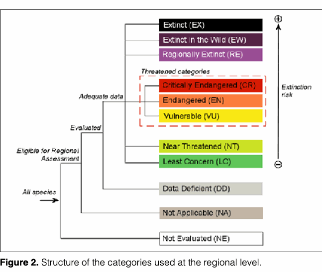

================================================================================
Page 1
================================================================================

GUIDELINES FOR APPLICATION
OF IUCN RED LIST CRITERIA AT
REGIONAL AND NATIONAL LEVELS
Version 4.0
The IUCN Red List of Threatened Species™

================================================================================
Page 2
================================================================================

GUIDELINES FOR APPLICATION
OF IUCN RED LIST CRITERIA AT
REGIONAL AND NATIONAL LEVELS
Version 4.0
Prepared by the IUCN Species Survival Commission
Revised by the National Red List Working Group of the
IUCN SSC Red List Committee
January 2010
These guidelines should be used in conjunction with the IUCN Red List
Categories and Criteria: Version 3.1 (IUCN 2001, 2012) and the latest version
of the Guidelines for Using the IUCN Red List Categories and Criteria. Both
documents are freely available to download from the IUCN Red List website
(http://www.iucnredlist.org/technical-documents/categories-and-criteria).
IUCN (International Union for Conservation of Nature)
2012

================================================================================
Page 3
================================================================================

**Table 1 (Page 3)**

| Front cover photos                                                                                                                                                                                                                                                                                                                                                                                                                                                                                                                                                                | Back cover photos                                                                                                                                                                                                                                                                                                          |
| --------------------------------------------------------------------------------------------------------------------------------------------------------------------------------------------------------------------------------------------------------------------------------------------------------------------------------------------------------------------------------------------------------------------------------------------------------------------------------------------------------------------------------------------------------------------------------- | -------------------------------------------------------------------------------------------------------------------------------------------------------------------------------------------------------------------------------------------------------------------------------------------------------------------------- |
| Siberian Sturgeon Acipenser baerii. © Tony Gilbert Sulawesi Dwarf Kingfisher Ceyx fallax. © Nigel Voaden Dyeing Poison Frog Dendrobates tinctorius. © Russ Mittermeier Lyre Head Lizard Lyriocephalus scutatus. © Ruchira Somaweera Reef Manta Ray Manta alfredi. © Thomas P. Peschak / www.thomaspeschak.com Micranthocereus polyanthus. © Barbara Goettsch Paramuricea clavata. © Andrea Molinari Western Prairie Fringed Orchid Platanthera praeclara. © James A. Fowler Rosalia Longicorn Rosalia alpina. © Gouix Nicolas Siau Island Tarsier Tarsius tumpara. © Geoff Deehan | Amanita garabitoana. © Greg Mueller Cycas tansachana. © John S. Donaldson Beautiful Demoiselle Calopteryx virgo. © Jean-Pierre Boudot Tree Hole Crab Globonautes macropus. © Neil Cumberlidge Philippine Eagle Pithecophaga jefferyi. © Nigel Voaden Queen of the Andes Puya raimondii. © Antionio Lambe, Acción Ambiental |

The designation of geographical entities in this book, and the presentation of the material, do not imply the
expression of any opinion whatsoever on the part of IUCN concerning the legal status
of any country, territory, or area, or of its authorities, or concerning the delimitation of its
frontiers or boundaries.
The views expressed in this publication do not necessarily reflect those of IUCN.
Published by: IUCN, Gland, Switzerland
Red List logo: © 2008
Copyright: © 2012 International Union for Conservation of Nature and Natural Resources
Reproduction of this publication for educational or other non-commercial uses is
authorized without prior written permission from the copyright holder provided the source
is fully acknowledged.
Reproduction of this publication for resale or other commercial purposes is prohibited
without prior written permission of the copyright holder.
Citation: IUCN. (2012). Guidelines for Application of IUCN Red List Criteria at Regional and National
Levels: Version 4.0. Gland, Switzerland and Cambridge, UK: IUCN. iii + 41pp.
ISBN: 978-2-8317-1247-5
Cover design: Chadi Abi Faraj, IUCN Centre for Mediterranean Cooperation
Layout by: Chadi Abi Faraj
Printed by: Colchester Print Group
Available from: IUCN (International Union for Conservation of Nature)
Rue Mauverney 28
1196 Gland, Switzerland
Tel +41 22 999 0000 - Fax +41 22 999 0002
www.iucn.org/publications
All photographs used in this publication remain the property of the original copyright holder (see individual captions
for details). Photographs should not be reproduced or used in other contexts without written permission from the
copyright holder.
Front cover photos Back cover photos
Siberian Sturgeon Acipenser baerii. © Tony Gilbert Amanita garabitoana. © Greg Mueller
Sulawesi Dwarf Kingfisher Ceyx fallax. © Nigel Voaden Cycas tansachana. © John S. Donaldson
Dyeing Poison Frog Dendrobates tinctorius. © Russ Mittermeier Beautiful Demoiselle Calopteryx virgo. © Jean-Pierre Boudot
Lyre Head Lizard Lyriocephalus scutatus. © Ruchira Somaweera Tree Hole Crab Globonautes macropus. © Neil Cumberlidge
Reef Manta Ray Manta alfredi. © Thomas P. Peschak / Philippine Eagle Pithecophaga jefferyi. © Nigel Voaden
www.thomaspeschak.com Queen of the Andes Puya raimondii. © Antionio Lambe,
Micranthocereus polyanthus. © Barbara Goettsch Acción Ambiental
Paramuricea clavata. © Andrea Molinari
Western Prairie Fringed Orchid Platanthera praeclara. © James A.
Fowler
Rosalia Longicorn Rosalia alpina. © Gouix Nicolas
Siau Island Tarsier Tarsius tumpara. © Geoff Deehan
The text of this book is printed on 115 gsm 50-50 recycled silk paper made from wood fibre from well-managed
forests certified in accordance with the rules of the Forest Stewardship Council (FSC).

================================================================================
Page 4
================================================================================

Acknowledgments
IUCN gratefully acknowledges the dedication and efforts of the Regional Application
Working Group (RAWG) for the initial development of the Guidelines for Application of
IUCN Red List Criteria at Regional Levels: Version 3.0 (IUCN 2003), and the National Red
List Working Group (NRLWG) for reviewing this document. The process for developing and
reviewing these regional guidelines included workshops in Montreal (1998), Washington,
D.C. (2002), and Venezuela (2005), correspondence among members of the group, and
discussions with a great many individual members of the Species Survival Commission
(SSC) and others. The members of the RAWG were Resit Akçakaya (Turkey/USA), Leon
Bennun (Kenya/UK), Tom DiBenedetto (USA), Ulf Gärdenfors (Sweden), Craig Hilton-
Taylor (South Africa/UK), C. Hyslop (Canada), Georgina M. Mace (UK), Ana Virginia Mata
(Costa Rica), Sanjay Molur (India), Jon Paul Rodríguez (Venezuela), S. Poss (USA), Alison
Stattersfield (UK), and Simon Stuart (Switzerland/UK/USA). The members of NRLWG,
who were involved in the review process, were Theresa Aniskowicz-Fowler (Canada),
Channa Bambaradeniya (Sri Lanka), Ruben Boles (Canada), Mark A. Eaton (UK), Ulf
Gärdenfors (Sweden), Verena Keller (Switzerland), Rebecca M. Miller (US/Venezuela),
Sanjay Molur (India), Caroline M. Pollock (UK), Jon Paul Rodríguez (Venezuela), and Sally
Walker (India). Particular thanks must go to Ulf Gärdenfors, who chaired the RAWG, and
to Jon Paul Rodríguez, who chaired the NRLWG.
Comments on this version and earlier drafts of the regional guidelines were received from
A. Alanen, H.-G. Bauer, D. Callaghan, G. Carron, N. Collar, C. Dauphine, M. Gimenez
Dixon, J. Golding, T. Hallingbäck, N. Hodgetts, V. Keller, O. Kindvall, A. Kreuzberg, I.
McLean, S. Mainka, B. Makinson, D. P. Mallon, I. Mannerkoski, L. Master, G. Micali,
L. Morse, M. Palmer, C.M. Pollock, W. Ponder, D. Procter, A. Punt, J. Rabinovich, K.
Schmidt, M. Schnittler, L.A.K. Singh, P. Skoberne, A.T. Smith, M. Tjernberg, J.Y. Wang, J.
West, R.H. Wickramasinghe, and B. Young. Furthermore many participants in national and
regional Red List training workshops have contributed by testing the regional guidelines
on local species and through subsequent discussions on the results.
The work of the RAWG and NRLWG, and the hosting of the meetings leading up to
this version of the regional guidelines, were made possible through generous financial
support from the Canadian Wildlife Service; The Ocean Conservancy; Swedish Species
Information Centre; Conservation International; Fondo Nacional de Ciencia, Tecnología e
Investigación (FONACIT); Royal Society for the Protection of Birds (RSPB); IUCN Species
Survival Commission (SSC); and the Zoological Outreach Organisation (ZOO).
iii

================================================================================
Page 5
================================================================================

I. INTRODUCTION
The IUCN Red List Categories and Criteria (IUCN 2001, 2012; see also www.iucnredlist.
org/technical-documents/categories-and-criteria) were developed for classifying species
at high risk of global extinction, i.e. for assessment at the global level. At regional, national
and local levels (hereafter referred to as regional level) there are essentially two options: (1)
to publish an unaltered subset of the global IUCN Red List encompassing those species
that reproduce in the region or at any stage regularly visit the region. This may be a feasible
option, particularly when the region has a high number of endemics or threatened near-
endemics, or when there currently is a pronounced overall deficiency of data pertaining to
species’ status within the region; or (2) to assess species’ extinction risk and publish Red
Lists within the specific region. For the purposes of regional conservation assessments
there are important reasons to assess species’ extinction risk and publish Red Lists within
specific geographically defined areas.
While the first option is straightforward, the second involves a number of issues not
encountered at the global level, including the assessment of populations across geopolitical
borders, non-breeding phases of populations and non-indigenous taxa. When making
assessments at regional levels it is also particularly important to recognize that while IUCN
Red List Categories reflect the relative extinction risk of species, the process of setting
priorities for conservation actions may require several additional considerations. As a
consequence, the following guidelines were produced to assist in the application of the
IUCN Red List Categories and Criteria at regional levels.
Recognizing the need for coherent guidelines for the application of IUCN Red List
Categories at regional levels, the First World Conservation Congress held in Montreal in
1996, adopted a resolution (WCC Res. D. 1.25) that “Requests the SSC, within available
resources, to complete the development of guidelines for using the IUCN Red List
Categories at the regional level as soon as it is practicable...”.
As part of the process to resolve these issues, the Regional Application Working Group
(RAWG) was formed under the auspices of the Species Survival Commission’s (SSC) Red
List Programme. The membership of RAWG included people with technical experience in
the development of the IUCN Red List Criteria, as well as those with practical experience
producing Red Lists at regional levels. The group consulted many different regional and
national groups, participated in regional Red List assessment workshops, published
draft versions of the regional guidelines (Gärdenfors et al. 1999, 2001) and undertook a
process of ongoing modification and improvement to the earlier drafts.
1

================================================================================
Page 6
================================================================================

IUCN adopted the guidelines resulting from the above process and these were published
in 2003 (Version 3.0: IUCN 2003). Although many of the problems encountered in regional
Red Listing (such as dealing with a wide diversity of natural systems and taxa, and different
political and social contexts) were taken into account, some issues proved especially
difficult to resolve to everyone’s satisfaction. Nevertheless, the regional guidelines were
based on sound general principles and were recommended to anyone wanting to
undertake Red List assessments at the regional level.
In 2003, the National Red List Working Group (NRLWG) was formed to collate the
experiences of countries using the regional guidelines and to use these to inform a review
process. A questionnaire about existing and planned national Red Lists and use of the
regional guidelines document was sent to Convention on Biological Diversity (CBD) focal
points around the world, and several countries were selected to test the application
of the guidelines. A further workshop discussed the results of these processes and
recommended revisions to the guidelines.
The reviewed regional guidelines are presented here. Most of the revisions focus on
how the guidelines are presented (e.g. more case studies based on real experiences are
included, more guidance on decision-making processes, examples of where to find extra-
regional information, etc.) rather than on procedural issues. The majority of assessments
that used Version 3.0 (IUCN 2003) therefore should be compatible with assessments
using the current version of the guidelines.
2

================================================================================
Page 7
================================================================================

II. PREAMBLE
1. Application of the regional guidelines
Any country, or other region, using the IUCN Red List Categories and Criteria for listing
species must follow these guidelines without deviation or modification, if they wish to
state that their assessment follows the IUCN system.
2. The regional concept
The word regional is used here to indicate any subglobal geographically defined area,
such as a continent, country, state, or province.
Within any region there will be taxa with different distribution histories, ranging from those
that are indigenous (native to the area), and have been there since pre-human settlement,
to those introduced more recently. There may also be breeding and non-breeding taxa.
The latter are those that do not reproduce in the region but may still be dependent upon
its resources for their survival. There may also be formerly native taxa that are now extinct
in the region, but which are still extant in other parts of the world.
3. IUCN Red List Criteria versus Regional Guidelines
All the rules and definitions in the IUCN Red List Categories and Criteria: Version 3.1
(IUCN 2001, 2012) apply at regional levels, unless otherwise indicated here. Similarly,
the current version of the Guidelines for Using the IUCN Red List Categories and Criteria
(available at www.iucnredlist.org/technical-documents/categories-and-criteria; check the
IUCN Red List website for regular updates of this document), and the IUCN Guidelines
for Re-introductions (IUCN 1998) also apply at regional levels. Consequently, a careful
study of all these documents is highly recommended before application of the regional
guidelines, and they should be constantly referred to when using this document. The
guidelines for regional application are hereafter referred to as the Guidelines.
4. Scale applicability
Provided that the regional population to be assessed is isolated from conspecific
populations outside the region, the IUCN Red List Categories and Criteria (IUCN 2001,
2012) can be used without modification within any geographically defined area. The
extinction risk of such an isolated population is identical to that of an endemic taxon.
However, when the criteria are applied to part of a population defined by a geopolitical
border, or to a regional population where individuals move to or from other populations
beyond the border, the threshold values listed under each criterion may be inappropriate,
because the unit being assessed is not the same as the whole population or subpopulation.
As a result, the estimate of extinction risk may be inaccurate. These Guidelines present
methods for adjusting the initial category obtained by evaluating a taxon using the IUCN
3

================================================================================
Page 8
================================================================================

Red List Criteria to obtain a final Red List Category that adequately reflects a taxon’s risk
of extinction within the region.
Although the Guidelines may in principle be applied at any geographical scale, application
within very restricted geographical areas is strongly discouraged. The smaller the region,
and the more wide-ranging the taxon under consideration, the more often the regional
population will interchange individuals with neighbouring populations. Therefore the
assessment of extinction risk becomes increasingly unreliable. It is not possible to provide
any specific guidance on the precise lower limit for sensible application as this depends
on the nature of the region, and especially the barriers to dispersal that exist.
5. Regionally determined applications and modifications
Given the wide range of circumstances encountered in assessing different taxonomic
groups in different countries, it is impossible to be prescriptive in every aspect of the
Guidelines. Variable interpretation of certain definitions and applications of the Guidelines
is inevitable, and these are left to the discretion of regional Red List compilers. For example,
the delimitation of natural range, time limits for regional extinction, and the nature of an
initial filter for breeding and/or non-breeding taxa, are left open for the regional Red List
authorities to decide. Such regional decisions must be clearly recorded and documented,
for example as part of an introductory text to the listings.
6. Taxonomy
Regional Red List authorities are encouraged to follow the same taxonomic checklists
as used by the global IUCN Red List (see www.iucnredlist.org/technical-documents/
information-sources-and-quality). For other taxonomic groups or any deviations from the
recommended lists, the differences and the taxonomic authorities followed should be
specified.
7. Scaling up assessments
Red List assessments from several smaller regions, such as countries on a continent,
cannot be combined or scaled-up in any way to provide Red List Categories for the entire
larger region. Assessments of extinction risk for the larger region require new evaluations
using the pooled data from across the entire region. Data collected from individual smaller
regions may be essential for the assessment of the larger region, and are often important
for conservation planning.
8. Red List versus priority for conservation action
Assessment of extinction risk and setting conservation priorities are two related but
different processes. Assessment of extinction risk, such as the assignment of IUCN
Red List Categories, generally precedes the setting of priorities. The purpose of the Red
List categorization is to produce a relative estimate of the likelihood of extinction of the
4

================================================================================
Page 9
================================================================================

taxon. Setting conservation priorities, on the other hand, which normally includes the
assessment of extinction risk, also takes into account other factors such as ecological,
phylogenetic, historical, or cultural preferences for some taxa over others, as well as
the probability of success of conservation actions, availability of funds or personnel to
carry out such actions, and legal frameworks for conservation of threatened taxa (Miller
et al. 2006, Miller et al. 2007). In the context of regional risk assessments, a number
of additional pieces of information are valuable for setting conservation priorities. For
example, it is important to consider not only conditions within the region but also the
status of the taxon from a global perspective and the proportion of the global population
that occurs within the region. Consequently, it is recommended that any publication that
results from a regional assessment process should include at least three measures: (1)
the regional Red List Category, (2) the global Red List Category, and (3) an estimate of
the proportion (%) of the global population occurring within the region (see section V.
Documentation and Publication).
Decisions on how these three variables, as well as other factors, are used for establishing
conservation priorities is a matter for the regional authorities to determine. The authorities
may also wish to consider other variables in setting priorities, which are to a large degree
region-specific and therefore not covered by the Guidelines. However, one particular
situation merits special attention. The application of the Red List Criteria, particularly
criterion A, may under some circumstances result in a taxon qualifying for listing in a
higher category at the global level than the regional level. This may be the case when the
regional population is more or less stable but constitutes only a small percentage of the
global population, which is experiencing a net decline (see Annex 2, Example 8). Such
taxa should be given particular attention at the regional level because of their significance
for global status.
We do not recommend including a list of taxa of high regional conservation priority in a
regional Red List publication, as a Red List indicates extinction risk only while conservation
priority setting involves evaluating many other factors, as described above. We encourage
regional authorities to establish a list of taxa of high regional conservation priority; however,
this list should be published separately from the regional Red List.
Regional Red List authorities should be aware that the view that a Red List based on the
IUCN Criteria is not automatically a list of priorities for conservation actions, may conflict
with current legislation in some regions.
9. Data Availability
It is important that no criteria be ignored during the assessment process, even if it is
unlikely that data for those criteria exist for the taxon being evaluated. Only one criterion
needs to be met to assign a threatened category (although data should be gathered for
5

================================================================================
Page 10
================================================================================

as many criteria as possible) and when little or no observed data are available, assessors
are encouraged make use of estimation, inference, projection and suspicion (IUCN 2001,
2012). The process of conducting regional assessments can generate data and stimulate
data collection in the field. More information on data availability and uncertainty can be
found in the Guidelines for Using the IUCN Red List Categories and Criteria (available
from www.iucnredlist.org/technical-documents/categories-and-criteria; check the IUCN
Red List website for regular updates of this document); see also Example 1 (i and ii) in
Annex 2.
6

================================================================================
Page 11
================================================================================

III. DEFINITIONS
1. Benign introduction
An attempt to establish a taxon, for the purpose of conservation, outside its recorded
distribution but within an appropriate habitat and ecogeographical area; a feasible
conservation tool only when there is no remaining area left within a taxon’s historic range
(IUCN 1998).
2. Breeding population
A (sub)population that reproduces within the region, whether this involves the entire
reproductive cycle or any essential part of it.
3. Conspecific population
Populations of the same species; here applied to any taxonomic unit at or below the
species level.
4. Downlisting and uplisting
The process for adjusting the Red List Category of a regional population according to a
decreased or increased risk of extinction; downlisting refers to a reduced extinction risk
and uplisting to an increased extinction risk.
5. Endemic taxon
A taxon naturally found in any specific area and nowhere else; this is a relative term in that
a taxon can be endemic to a small island, to a country, or to a continent.
6. Global population
Total number of individuals of a taxon (see Population).
7. Metapopulation
A collection of subpopulations of a taxon, each occupying a suitable patch of habitat
in a landscape of otherwise unsuitable habitat. The survival of the metapopulation is
dependent on the rate of local extinctions of occupied patches and the rate of (re-)
colonization of empty patches (Levins 1969, Hanski 1999).
8. Natural range
Range of a taxon, excluding any portion that is the result of an introduction to a region
or neighbouring region. The delimitation between wild and introduced populations within
a region may be based on a preset year or event, but this decision is left to the regional
Red List authority.
7

================================================================================
Page 12
================================================================================

9. Not Applicable (NA)
Category for a taxon deemed to be ineligible for assessment at a regional level. A taxon
may be NA because it is not a wild population or not within its natural range in the region,
or because it is a vagrant to the region. It may also be NA because it occurs at very low
numbers in the region (i.e. when the regional Red List authority has decided to use a
“filter” to exclude taxa before the assessment procedure) or the taxon may be classified
at a lower taxonomic level (e.g. below the level of species or subspecies) than considered
eligible by the regional Red List authority. In contrast to other Red List Categories, it is not
mandatory to use NA for all taxa to which it applies; but is recommended for taxa where
its use is informative.
10. Population
This term is used in a specific sense in the IUCN Red List Criteria (IUCN 2001, 2012),
different from its common biological usage. Population is defined as the total number of
individuals of the taxon. Within the context of a regional assessment, it may be advisable
to use the term global population for this. In the Guidelines the term population is used
for convenience, when reference is made to a group of individuals of a given taxon that
may or may not interchange propagules with other such entities (see Regional population
and Subpopulations).
11. Propagule
A living entity capable of dispersal and of producing a new mature individual (e.g. a spore,
seed, fruit, egg, larva, or part of or an entire individual). Gametes and pollen are not
considered propagules in this context.
12. Region
A subglobal geographical area, such as a continent, country, state, or province.
13. Regional assessment
Process for determining the relative extinction risk of a regional population according to
the Guidelines.
14. Regionally Extinct (RE)
Category for a taxon when there is no reasonable doubt that the last individual potentially
capable of reproduction within the region has died or has disappeared from the wild
in the region, or when, if it is a former visiting taxon, the last individual has died or
disappeared in the wild from the region. The setting of any time limit for listing under RE
is left to the discretion of the regional Red List authority, but should not normally pre-date
1500 AD.
8

================================================================================
Page 13
================================================================================

15. Regional population
The portion of the global population within the area being studied, which may comprise
one or more subpopulations.
16. Rescue effect
Process by which immigrating propagules result in a lower extinction risk for the target
population.
17. Sink
An area where the local reproduction of a taxon is lower than local mortality. The term
is normally used for a subpopulation experiencing immigration from a source where the
local reproduction is higher than the local mortality (see Pulliam 1988).
18. Subpopulations
Geographically or otherwise distinct groups in the (global) population between which there
is little demographic or genetic exchange (typically one successful migrant individual or
gamete per year or less; IUCN 2001, 2012); a subpopulation may or may not be restricted
to a region.
19. Taxon
A species or infraspecific entity whose extinction risk is being assessed.
20. Vagrant
A taxon that is currently found only occasionally within the boundaries of a region (see
Visitor).
21. Visitor (also, visiting taxon)
A taxon that does not reproduce within a region but regularly occurs within its boundaries
either now or during some period of the last century. Regions have several options on how
to decide the boundaries between visitors and vagrants, e.g. using a preset percentage
of the global population found in the region or predictability of occurrence.
22. Wild population
A population within its natural range in which the individuals are the result of natural
reproduction (i.e. not the result of human-mediated release or translocation); if a population
is the result of a benign introduction that is now or has previously been successful (i.e.
self-sustaining), the population is considered wild.
9

================================================================================
Page 14
================================================================================

IV. THE ASSESSMENT
1. Overview of the assessment process
Regional assessments should be carried out in a three-step process, separate from the
establishment of conservation priorities (Figure 1). First, assessors must determine which
taxa and which regional populations to assess (step one). Next, the regional population
for each taxon is evaluated according to the IUCN Red List Categories and Criteria (IUCN
2001, 2012), and a preliminary category is assigned (step two). The effect of populations
of the same taxon in neighbouring regions on the regional population is then considered,
and the preliminary category is up- or downlisted if appropriate (step three). Thus, the final
categorization reflects the extinction risk for the taxon within the region being evaluated,
having considered potential interactions with populations outside that region.
Regional Red Listing Process
Step One Step Two Step Three
Decide which Apply the IUCN Red Apply the IUCN
regional taxa and List Criteria to the Regional Guidelines
populations to regional population to the regional
assess. to determine the population to
preliminary estimate of determine the final
extinction risk within the estimate extinction
region. risk within the region.
(See Fig. 2, the IUCN
(See flowchart in Red List Categories and (See Fig. 3 and
Annex 3) Criteria: Version 3.1, and Table 1)
the Guidelines for Using
the IUCN Red List
Categories and Criteria)
Conservation Priority Setting Process
Assessment of extinction risk (e.g. Red List status) alone is not sufficient to determine conservation
priorities. Other factors must also be considered, such as the status and population size of the
taxon at the global level, ecological traits, economics, cultural values, practicality of recovery
action, etc.
(See point 8 in the Preamble of the Regional Guidelines)
Figure 1. The process of assessing the extinction risk of taxa at the regional level. It
is important to follow each step in order, and to refer to all listed documents, to obtain an
appropriate regional assessment of extinction risk. Conservation priority setting is
a process separate from regional Red Listing.
10

================================================================================
Page 15
================================================================================

2. Taxa to be assessed
There are several issues to consider when determining which taxa to include or to exclude
from a regional assessment (e.g. is the taxon native to the region, do breeding and non-
breeding populations exist in the region, does the taxon occur only marginally within the
region, etc). A flowchart to help guide regional Red List authorities through this decision
process can be found in Annex 3.
The categorization process should be applied only to wild populations inside their natural
range and to populations resulting from benign introductions (IUCN 1998, 2001, 2012).
All taxa should be assessed for which an important part of any stage of their life cycle
(breeding, wintering, migrating, etc.) takes place in the region. Taxa only marginally within
the region should also enter the assessment process (unless excluded by an optional
filter, see below). But a taxon that occasionally breeds under favourable circumstances in
the region but regularly becomes (regionally) extinct should not be considered. Similarly,
a taxon that is currently expanding its distributional range outside the region and appears
to be in a colonization phase within the region should not be considered for regional
assessment until the taxon has reproduced within the region for several years (typically
for at least 10 consecutive years). The regional Red List should include all globally red
listed taxa present within the region, including those that are Not Applicable (NA) at
the regional level, and the global category should be displayed alongside the regional
assessment.
Taxa formerly considered Regionally Extinct (RE) that naturally re-colonize the region may
be assessed after the first year of reproduction. Re-introduced, formerly RE taxa may be
assessed as soon as at least a part of the population successfully reproduces without
direct support and the offspring are shown to be viable.
Assessors are encouraged to assess visiting taxa. The definition of a visitor for purposes
of this assessment must be explicitly defined within the documentation prepared for the
regional Red List. Vagrant taxa should NOT be assessed.
If breeding and visiting (non-breeding) populations can be distinguished, they should be
assessed separately. Breeding and visiting populations may be distinguishable because
they:
ƒ are clearly separated by range or habitat use;
ƒ are isolated temporally (e.g. the breeding population is migratory, and so is absent
when the visiting population is present);
ƒ are clearly identifiable based on phenotype;
11

================================================================================
Page 16
================================================================================

ƒ differ greatly in population size. For example, if the breeding population is very
small compared to the visiting population, the two populations can be assessed
separately. Although data collected on the visiting population may still include
individuals from the breeding population, any influence these breeding individuals
have on the assessment will be marginal. However, if the visiting population is
relatively small compared to the breeding population, it should be filtered from
assessment before this stage (see below).
If members of the breeding and visiting populations cannot be differentiated, estimates for
the visiting population will have to include information from the breeding population (see
Annex 2, Example 2), and vice-versa. Alternately, one assessment could be made for the
taxon, without differentiating between breeding and visiting populations.
The regional Red List authority may decide to apply a filter, e.g. a preset threshold of global
or continental population share, to the assessment of breeding and/or visiting taxa. For
instance, a regional Red List authority may decide that they will not assess taxa where less
than 1% of the global population occurs, or has occurred within the last century, within the
region. All such filters applied must be clearly specified in the supporting documentation.
Due to the many different geographic contexts in which regional assessments will be
conducted, it is impossible to define a specific recommended filter threshold. It should
be kept in mind that if the threshold above which taxa are assessed is set too low, many
marginal taxa will be considered highly threatened due to their small population sizes. For
examples of how filters have been set for different countries, see Annex 2, Examples 3
and 4.
Once the threshold for assessment of a taxon is determined (e.g. the fraction of the
global or continental population of a taxon that is present in the region, predictability that
a visiting taxon will be present in any given year, etc.), any taxa falling below that threshold
should be assigned the category Not Applicable (see point 3, below), with the global
category (if there is one) also shown.
3. The Categories
The IUCN Red List Categories (IUCN 2001, 2012) should be used unaltered at regional
levels, with three exceptions or adjustments.
1. Taxa extinct within the region but extant in other parts of the world should be classified
as Regionally Extinct (RE). A taxon is RE when there is no reasonable doubt that
the last individual potentially capable of reproduction within the region has died or
disappeared from the region or, in the case of a former visiting taxon, individuals no
longer visit the region. It is not possible to set any general rules for a time period since
12

================================================================================
Page 17
================================================================================

the last observation before taxa are classified as RE. This will depend on how much
effort has been devoted to searches for the taxon, which in turn will vary, both with
organism and region. If the regional authority decides to adopt any time frames for RE
assessments, these should be clearly specified.
Populations of long-lived individuals that have ceased to reproduce within the region
(e.g. as a result of a deteriorating environment) should be regarded as potentially
capable of reproduction and consequently should not be classified as RE. On the
other hand, vagrant individuals of a formerly regionally breeding taxon that reach the
region should not be regarded as potentially capable of reproduction.
2. The category of Extinct in the Wild (EW) should be assigned only to taxa that are extinct
in the wild across their entire natural range, including the region, but that are extant
in cultivation, in captivity, or as a naturalized population (or populations) outside the
past range. If a taxon is (globally) EW but extant as a naturalized population within the
region, the regional population should not be evaluated according to the IUCN Criteria,
but should still be considered of conservation importance and preserved as a relict of
a taxon which is Extinct in the Wild. It may also be considered an important source of
individuals for re-introduction efforts within its natural range.
3. Taxa not eligible for assessment at the regional level (mainly introduced taxa and
vagrants) should be assigned the category Not Applicable (NA).
The addition of the categories Regionally Extinct and Not Applicable means that there are
11 possible categories for regional assessments (Figure 2).
4. The assessment procedure
After determining which taxa to assess in step one, there may be distinct breeding and
visiting populations to evaluate. The regional assessment process differs slightly for
breeding and non-breeding populations (Table 1, Figure 3).
Breeding populations
In step two, the IUCN Red List Criteria are applied to the regional population of the taxon
(as specified by IUCN 2001, 2012), resulting in a preliminary categorization. All data used
in this initial assessment – such as number of mature individuals and parameters relating
to area, reduction, decline, fluctuations, subpopulations, locations, and fragmentation
– should be from the regional population, NOT the global population. However, it must
be noted that taxa migrating to other regions during part of the year may be affected by
conditions there. It may be essential to take such conditions into account, particularly
when applying criteria pertaining to decline and area (criteria A, B and C).
13

================================================================================
Page 18
================================================================================

Figure 2. Structure of the categories used at the regional level.
In step three, the existence and status of any conspecific populations outside the region
that may affect the risk of extinction within the region should be investigated. If the taxon is
endemic to the region or the regional population is isolated, the Red List Category defined
by the criteria should be adopted unaltered. If, on the other hand, conspecific populations
outside the region are judged to affect the regional extinction risk, the regional Red List
Category should be changed to a more appropriate level that reflects the extinction risk
as defined by criterion E (IUCN 2001, 2012). In most cases, this will mean downlisting the
category obtained in step two, because populations within the region may experience
a “rescue effect” from populations outside the region (Brown and Kodric-Brown 1977,
Hanski and Gyllenberg 1993). In other words, immigration from outside the region will
tend to decrease extinction risk within the region.
Normally, such a downlisting will involve a one-step change in category, such as changing
the category from Endangered (EN) to Vulnerable (VU) or from VU to Near Threatened (NT).
For expanding populations, whose global range barely touches the edge of the region,
a downlisting of the category by two steps may be appropriate (see Annex 2, Example
7). Likewise, if the region is very small and not isolated by barriers from surrounding
14

================================================================================
Page 19
================================================================================

Breeding populations:
3b. Is the immigration NO / UNLIKELY Downlist
category
expected to decrease?
from step 2
YES / LIKELY
YES / DO NOT KNOW
3a. Does the regional
population experience any 3c. Is the regional YES / LIKELY Uplist
significant immigration category
population a sink?
of propagules likely to from step 2
reproduce in the region?
NO / DO NOT KNOW
NO / DO NOT KNOW No
change
from step 2
Visiting populations:
3d. Are the NO / 3e. Are the NO / 3f. Can the YES / Downlist
conditions conditions breeding category
outside UNLIKELY within the UNLIKELY population LIKELY from step 2
the region region rescue the
deteriorating? deteriorating? regional
population
should it
YES / YES / decline?
DO NOT DO NOT
KNOW KNOW NO / DO
NOT KNOW
No
change
from step 2
Figure 3. Conceptual scheme of the procedure for adjusting the preliminary IUCN
Red List Category to the final regional Red List Category. This refers to step three of
the assessment process (see Figure 1); numbers and letters in the diagram represent
the different sub-steps within step three. See Table 1 for further details on following the
procedure, particularly how to answer the questions and examples of where to find
extra-regional information.
regions, downlisting by two steps may be necessary. In extremely rare cases, a taxon
may be downlisted by more than two categories, but in most situations this will not be
appropriate.
Conversely, if the population within the region is a demographic sink (Pulliam 1988) that
is unable to sustain itself without immigration from populations outside the region, AND
15

================================================================================
Page 20
================================================================================

if the extra-regional source is expected to decrease, the extinction risk of the regional
population may be underestimated by the criteria. In such exceptional cases, an uplisting
of the category may be appropriate. If it is unknown whether or not extra-regional
populations influence the extinction risk of the regional population, the category from
step two should be kept unaltered.
Thorough documentation of the reasoning behind such category changes, including
all decisions made and the number of categories up- or downlisted, is required.
Heterogeneity in the amount and type of data available to inform these decisions is
unavoidable; for this reason it is particularly important to be as consistent as possible
between taxa when up- and downlisting, and to document thoroughly the decision-
making process.
Visiting populations
The distinction between a visitor and a vagrant should be noted because the latter cannot
be assessed.
As with breeding populations, data used in step two of the assessment process
– such as number of individuals and parameters relating to area, reduction, decline,
fluctuations, subpopulations, and locations – should be from the regional population,
not the global population. To be able to correctly project a population reduction (criteria
A3 and A4) or a continued decline (criteria B and C) it may, however, be necessary to
examine the conditions outside the region, and particularly in the population’s breeding
area. It is also essential to distinguish true population changes and fluctuations from
transient changes, which may be due to unsuitable weather or other factors and may
result in visitors temporarily favouring other regions. Observed population numbers will
expectedly fluctuate more in non-breeding than in breeding populations. This must be
carefully considered when evaluating the parameters of reduction, continuing decline
and extreme fluctuations.
In step three, the environmental conditions outside (Figure 3, box 3d) and inside (box
3e) the region should be examined. Because past or projected population reductions
outside the region, as well as deteriorating environmental conditions inside the region,
have already been accounted for in the second step, such changes will not lead to any
adjustments in the third step. There may be reasons to downlist the category met in step
two only when environmental conditions are stable or improving. Note that taxa which
are globally very rare, for example if assessed on the IUCN Red List under criterion D,
should not be downlisted because a very small global population would not be expected
to produce any notable rescue effect within the region (see box 3f in both Figure 3 and
Table 1).
16

================================================================================
Page 21
================================================================================

**Table 1 (Page 21)**

| Questions to consider                                                                                                                                                                                                                                                                                                                                                                                                         | Comments                                                                                                                                                                                                                                                                                                                                                                                                                                                                                                                                               |
| ----------------------------------------------------------------------------------------------------------------------------------------------------------------------------------------------------------------------------------------------------------------------------------------------------------------------------------------------------------------------------------------------------------------------------- | ------------------------------------------------------------------------------------------------------------------------------------------------------------------------------------------------------------------------------------------------------------------------------------------------------------------------------------------------------------------------------------------------------------------------------------------------------------------------------------------------------------------------------------------------------ |
| Breeding populations                                                                                                                                                                                                                                                                                                                                                                                                          |                                                                                                                                                                                                                                                                                                                                                                                                                                                                                                                                                        |
| 3A. DOES THE REGIONAL POPULATION EXPERIENCE ANY SIGNIFICANT IMMIGRATION OF PROPAGULES LIKELY TO REPRODUCE IN THE REGION? The regional population may experience some immigration from neighbouring regions, but in order to determine if that immigration is “significant”, several factors must be considered:                                                                                                      |                                                                                                                                                                                                                                                                                                                                                                                                                                                                                                                                                        |
| Likelihood of propagule migration: Are there any conspecific populations outside the region within a distance from which propagules could reach the region? Is the regional population part of a larger metapopulation involving extra- regional patches? Are there any effective barriers preventing dispersal to and from neighbouring populations? Is the taxon capable of long- distance dispersal? Is it known to do so? | If there are no conspecific populations in neighbouring regions or if propagules are unable to disperse to the region, the regional population behaves as an endemic and the category should be left unchanged. If immigration does occur, it is important to consider whether the numbers arriving in the region are sufficient to rescue the regional population, and whether the immigration occurs regularly and over a time period relevant to the threats facing the regional population, such that rescue is feasible (see Annex 2, Example 5). |
| Evidence for the existence of local adaptations: Are there any known differences reflecting local adaptations between regional and extra-regional populations, i.e. is it probable that individuals from extra-regional populations are adapted to survive and/or reproduce within the region?                                                                                                              | If regional populations express unique physical, behavioural, genetic, or other adaptations to local conditions that extra-regional populations do not express, it may be unlikely that individuals from outside the region would be able to survive and/or reproduce within the region. The extra-regional population would therefore be unable to rescue the regional population, and the category should be left unchanged (see Annex 2, Example 6).                                                                     |

Adjustments to categories
Adjustments can be made to all the categories except for Extinct (EX), Extinct in the Wild
(EW), Regionally Extinct (RE), Data Deficient (DD), Not Evaluated (NE), and Not Applicable
(NA), which cannot logically be up- or downlisted.
Table 1. Checklist for judging whether extra-regional populations may affect the
extinction risk of the regional population (the question numbers refer to the boxes
in Figure 3). In answering the questions in the boxes in Figure 3, refer to each of the
points and their accompanying questions below.
Questions to consider Comments
Breeding populations
3A. DOES THE REGIONAL POPULATION EXPERIENCE ANY SIGNIFICANT IMMIGRATION
OF PROPAGULES LIKELY TO REPRODUCE IN THE REGION?
The regional population may experience some immigration from neighbouring regions, but in order
to determine if that immigration is “significant”, several factors must be considered:
Likelihood of propagule migration: If there are no conspecific populations in
Are there any conspecific populations outside the neighbouring regions or if propagules are unable
region within a distance from which propagules to disperse to the region, the regional population
could reach the region? Is the regional population behaves as an endemic and the category
part of a larger metapopulation involving extra- should be left unchanged. If immigration does
regional patches? Are there any effective barriers occur, it is important to consider whether the
preventing dispersal to and from neighbouring numbers arriving in the region are sufficient to
populations? Is the taxon capable of long- rescue the regional population, and whether the
distance dispersal? Is it known to do so? immigration occurs regularly and over a time
period relevant to the threats facing the regional
population, such that rescue is feasible (see
Annex 2, Example 5).
Evidence for the existence of local If regional populations express unique physical,
adaptations: behavioural, genetic, or other adaptations to
Are there any known differences reflecting local local conditions that extra-regional populations
adaptations between regional and extra-regional do not express, it may be unlikely that
populations, i.e. is it probable that individuals individuals from outside the region would be
from extra-regional populations are adapted able to survive and/or reproduce within the
to survive and/or reproduce within the region? region. The extra-regional population would
therefore be unable to rescue the regional
population, and the category should be
left unchanged (see Annex 2, Example 6).
17

================================================================================
Page 22
================================================================================

**Table 1 (Page 22)**

| Questions to consider                                                                                                                                                                                                                                                                                                                                                             | Comments                                                                                                                                                                                                                                                                                                                                                                                                                                                                                                                                                                                                                                                                                                                                                                                                                                                                                                                                                                                                                                                                                                                                                                                                                                                                                                                                                                                            |
| --------------------------------------------------------------------------------------------------------------------------------------------------------------------------------------------------------------------------------------------------------------------------------------------------------------------------------------------------------------------------------- | --------------------------------------------------------------------------------------------------------------------------------------------------------------------------------------------------------------------------------------------------------------------------------------------------------------------------------------------------------------------------------------------------------------------------------------------------------------------------------------------------------------------------------------------------------------------------------------------------------------------------------------------------------------------------------------------------------------------------------------------------------------------------------------------------------------------------------------------------------------------------------------------------------------------------------------------------------------------------------------------------------------------------------------------------------------------------------------------------------------------------------------------------------------------------------------------------------------------------------------------------------------------------------------------------------------------------------------------------------------------------------------------------- |
| Availability of suitable habitat: Are current conditions of habitats and/or other environmental (including climatological) requirements of the taxon in the region such that immigrating propagules are able to establish themselves successfully (i.e. are there habitable areas?), or has the taxon disappeared from the region because conditions were not favourable? | If there is not enough suitable habitat and if current conservation measures are not leading to an improvement in the quality and/or quantity of habitat within the foreseeable future, there will be no sites where immigrating individuals and/or propagules can successfully establish themselves. Thus, immigration from outside the region will not decrease extinction risk and the category should be left unchanged.                                                                                                                                                                                                                                                                                                                                                                                                                                                                                                                                                                                                                                                                                                                                                                                                                                                                                                                                                |
| 3B. IS THE IMMIGRATION EXPECTED TO DECREASE?                                                                                                                                                                                                                                                                                                                                      |                                                                                                                                                                                                                                                                                                                                                                                                                                                                                                                                                                                                                                                                                                                                                                                                                                                                                                                                                                                                                                                                                                                                                                                                                                                                                                                                                                                                     |
| Status of extra-regional populations: How abundant is the taxon in neighbouring regions? Are the populations there stable, increasing or decreasing? Is it Red Listed in any of those regions? Are there any significant threats to those populations? Is it probable that they produce an appreciable amount of emigrants and will continue to do so for the foreseeable future? | If the taxon is relatively common outside the region and there are no signs of population decline, and if the taxon is capable of dispersing to and likely to establish in the region, and if there is (or soon will be) available habitat, downlisting the category is appropriate. If the taxon is currently decreasing in neighbouring regions, the “rescue effect” is less likely to occur, so downlisting the category may not be appropriate. Information to answer this question can be obtained from a number of sources, including (but not limited to): the IUCN Red List of Threatened Species (if information on the status of the taxon in different regions is available in the online documentation); national red lists from neighbouring and nearby countries; regional status or conservation publications such as the Species of European Conservation Concern (SPEC), the NatureServe Explorer website (for information on the plants, animals and ecosystems of the United States and Canada), the InfoNatura website (for information on the animals and ecosystems of Latin America and the Caribbean) and the network of Conservation Data Centres/Natural Heritage Information Centres; proxies from which the status of extra- regional populations can be inferred, such as habitat status, estimates of annual harvest, population trends in neighbouring regions, etc. |

Questions to consider Comments
Availability of suitable habitat: If there is not enough suitable habitat and if
Are current conditions of habitats and/or current conservation measures are not leading
other environmental (including climatological) to an improvement in the quality and/or quantity
requirements of the taxon in the region such of habitat within the foreseeable future, there
that immigrating propagules are able to will be no sites where immigrating individuals
establish themselves successfully (i.e. are there and/or propagules can successfully establish
habitable areas?), or has the taxon disappeared themselves. Thus, immigration from outside
from the region because conditions were not the region will not decrease extinction risk and
favourable? the category should be left unchanged.
3B. IS THE IMMIGRATION EXPECTED TO DECREASE?
Status of extra-regional populations: If the taxon is relatively common outside the
How abundant is the taxon in neighbouring region and there are no signs of population
regions? Are the populations there stable, decline, and if the taxon is capable of
increasing or decreasing? Is it Red Listed in dispersing to and likely to establish in
any of those regions? Are there any significant the region, and if there is (or soon will be)
threats to those populations? Is it probable available habitat, downlisting the category is
that they produce an appreciable amount of appropriate. If the taxon is currently decreasing
emigrants and will continue to do so for the in neighbouring regions, the “rescue
foreseeable future? effect” is less likely to occur, so downlisting
the category may not be appropriate.
Information to answer this question can be
obtained from a number of sources, including
(but not limited to): the IUCN Red List of
Threatened Species (if information on the status
of the taxon in different regions is available in the
online documentation); national red lists from
neighbouring and nearby countries; regional
status or conservation publications such as the
Species of European Conservation Concern
(SPEC), the NatureServe Explorer website
(for information on the plants, animals and
ecosystems of the United States and Canada),
the InfoNatura website (for information on the
animals and ecosystems of Latin America and
the Caribbean) and the network of Conservation
Data Centres/Natural Heritage Information
Centres; proxies from which the status of extra-
regional populations can be inferred, such as
habitat status, estimates of annual harvest,
population trends in neighbouring regions, etc.
18

================================================================================
Page 23
================================================================================

**Table 1 (Page 23)**

| Questions to consider                                                                                                                                                                                                                                                                                                                                    | Comments                                                                                                                                                                                                                                                                                                                                                                                                                                                                                                                                                                                                                                                                                                                                                                                                                                                                                                                                                                                                                                                                           |
| -------------------------------------------------------------------------------------------------------------------------------------------------------------------------------------------------------------------------------------------------------------------------------------------------------------------------------------------------------- | ---------------------------------------------------------------------------------------------------------------------------------------------------------------------------------------------------------------------------------------------------------------------------------------------------------------------------------------------------------------------------------------------------------------------------------------------------------------------------------------------------------------------------------------------------------------------------------------------------------------------------------------------------------------------------------------------------------------------------------------------------------------------------------------------------------------------------------------------------------------------------------------------------------------------------------------------------------------------------------------------------------------------------------------------------------------------------------- |
| 3C. IS THE REGIONAL POPULATION A SINK?                                                                                                                                                                                                                                                                                                                   |                                                                                                                                                                                                                                                                                                                                                                                                                                                                                                                                                                                                                                                                                                                                                                                                                                                                                                                                                                                                                                                                                    |
| Degree of dependence on extra-regional populations: Are extant regional populations self-sustaining, showing a positive reproductive rate over the years, or are they dependent on immigration for long-term survival (i.e. are the regional populations sinks)?                                                                       | If there is evidence that a substantial number of propagules regularly reach the region and the population still has a poor chance of survival, the regional population may be a sink. If so, AND if there are indications that the immigration will soon cease, uplisting the category may be appropriate. In reality, very few populations are known well-enough to be considered obvious sinks dependent on a foreign source for individuals. If there is poor local breeding success or survival AND there is steady and significant immigration, the population may be a sink. If there is sufficient evidence to suggest that the population is a sink AND immigration is expected to decrease, it may be appropriate to uplist the status. All reasoning must be fully explained in the documentation.                                                                                                                                                                                                                      |
| Visiting populations                                                                                                                                                                                                                                                                                                                                     |                                                                                                                                                                                                                                                                                                                                                                                                                                                                                                                                                                                                                                                                                                                                                                                                                                                                                                                                                                                                                                                                                    |
| 3D. ARE THE CONDITIONS OUTSIDE THE REGION DETERIORATING?                                                                                                                                                                                                                                                                                                 |                                                                                                                                                                                                                                                                                                                                                                                                                                                                                                                                                                                                                                                                                                                                                                                                                                                                                                                                                                                                                                                                                    |
| Environmental conditions outside the region: Are the population status, habitat or other conditions of the taxon deteriorating, or are they projected to do so, in the breeding area or in other areas outside the region (e.g. are conditions outside the region negatively affecting the number of individuals that are expected to visit the region)? | If yes, the taxon will experience a reduction or continuing decline, either current or projected, which will affect the classification in step two. Consequently, such conditions should not be accounted for once again in the third step, thus leaving the category unchanged. Information to answer this question can be obtained from a number of sources, including (but not limited to): the IUCN Red List of Threatened Species (if information on the status of the taxon in different regions is available in the online documentation); national red lists from neighbouring and nearby countries; regional status or conservation publications such as the Species of European Conservation Concern (SPEC), the NatureServe Explorer website (for information on the plants, animals and ecosystems of the United States and Canada), the InfoNatura website (for information on the animals and ecosystems of Latin America and the Caribbean) and the network of Conservation Data Centres/Natural Heritage Information Centres; proxies from which the status of the |

Questions to consider Comments
3C. IS THE REGIONAL POPULATION A SINK?
Degree of dependence on extra-regional If there is evidence that a substantial number of
populations: propagules regularly reach the region and the
Are extant regional populations self-sustaining, population still has a poor chance of survival,
showing a positive reproductive rate over the the regional population may be a sink. If so,
years, or are they dependent on immigration AND if there are indications that the immigration
for long-term survival (i.e. are the regional will soon cease, uplisting the category may be
populations sinks)? appropriate. In reality, very few populations
are known well-enough to be considered
obvious sinks dependent on a foreign source
for individuals. If there is poor local breeding
success or survival AND there is steady and
significant immigration, the population may be
a sink. If there is sufficient evidence to suggest
that the population is a sink AND immigration
is expected to decrease, it may be appropriate
to uplist the status. All reasoning must be fully
explained in the documentation.
Visiting populations
3D. ARE THE CONDITIONS OUTSIDE THE REGION DETERIORATING?
Environmental conditions outside the If yes, the taxon will experience a reduction or
region: continuing decline, either current or projected,
Are the population status, habitat or other which will affect the classification in step
conditions of the taxon deteriorating, or are two. Consequently, such conditions should
they projected to do so, in the breeding area not be accounted for once again in the third
or in other areas outside the region (e.g. are step, thus leaving the category unchanged.
conditions outside the region negatively
affecting the number of individuals that are Information to answer this question can be
expected to visit the region)? obtained from a number of sources, including
(but not limited to): the IUCN Red List of
Threatened Species (if information on the status
of the taxon in different regions is available in the
online documentation); national red lists from
neighbouring and nearby countries; regional
status or conservation publications such as the
Species of European Conservation Concern
(SPEC), the NatureServe Explorer website
(for information on the plants, animals and
ecosystems of the United States and Canada),
the InfoNatura website (for information on the
animals and ecosystems of Latin America and
the Caribbean) and the network of Conservation
Data Centres/Natural Heritage Information
Centres; proxies from which the status of the
19

================================================================================
Page 24
================================================================================

**Table 1 (Page 24)**

| Questions to consider                                                                                                                                                                                                                                             | Comments                                                                                                                                                                                                                                                                                                                                                                                                                                                                                                                                                                                                                                   |
| ----------------------------------------------------------------------------------------------------------------------------------------------------------------------------------------------------------------------------------------------------------------- | ------------------------------------------------------------------------------------------------------------------------------------------------------------------------------------------------------------------------------------------------------------------------------------------------------------------------------------------------------------------------------------------------------------------------------------------------------------------------------------------------------------------------------------------------------------------------------------------------------------------------------------------ |
|                                                                                                                                                                                                                                                                   | taxon outside the region can be inferred, such as habitat status, estimates of annual harvest, population trends in neighbouring regions, etc.                                                                                                                                                                                                                                                                                                                                                                                                                                                                                       |
| 3E. ARE THE CONDITIONS WITHIN THE REGION DETERIORATING?                                                                                                                                                                                                           |                                                                                                                                                                                                                                                                                                                                                                                                                                                                                                                                                                                                                                            |
| Environmental conditions inside the region: Are the population status, habitat or other conditions for the taxon deteriorating, or are they projected to do so, within the region?                                                                       | If yes, the taxon will experience a reduction or continuing decline, either current or projected, which will affect the classification in step two. Consequently, such conditions should not be accounted for once again in the third step, thus leaving the category unchanged.                                                                                                                                                                                                                                                                                                                                            |
| 3F. CAN THE BREEDING POPULATION RESCUE THE REGIONAL POPULATION SHOULD IT DECLINE?                                                                                                                                                                              |                                                                                                                                                                                                                                                                                                                                                                                                                                                                                                                                                                                                                                            |
| Plausibility of a rescue effect: Is the taxon globally very small and/or restricted, e.g. classified as threatened according to criterion D, or as Near Threatened because it almost meets VU D, or globally Not Evaluated but judged likely to meet criterion D? | If the breeding population is very small and/ or restricted, it is unlikely that it will be able to rescue the regional population visiting the region, thus leaving the category for the visiting regional population unchanged. If, on the other hand, the breeding population is quite substantial and conditions are not deteriorating within or outside the region, there is a higher chance that the breeding population will be able to rescue the regional population. The probability of regional extinction is therefore less likely than suggested by the criteria in step two; consequently, a downlisting may be appropriate. |

Questions to consider Comments
taxon outside the region can be inferred, such
as habitat status, estimates of annual harvest,
population trends in neighbouring regions, etc.
3E. ARE THE CONDITIONS WITHIN THE REGION DETERIORATING?
Environmental conditions inside the region: If yes, the taxon will experience a reduction or
Are the population status, habitat or other continuing decline, either current or projected,
conditions for the taxon deteriorating, or are they which will affect the classification in step two.
projected to do so, within the region? Consequently, such conditions should not be
accounted for once again in the third step, thus
leaving the category unchanged.
3F. CAN THE BREEDING POPULATION RESCUE THE REGIONAL POPULATION SHOULD
IT DECLINE?
Plausibility of a rescue effect: If the breeding population is very small and/
Is the taxon globally very small and/or restricted, or restricted, it is unlikely that it will be able
e.g. classified as threatened according to to rescue the regional population visiting the
criterion D, or as Near Threatened because it region, thus leaving the category for the visiting
almost meets VU D, or globally Not Evaluated regional population unchanged. If, on the
but judged likely to meet criterion D? other hand, the breeding population is quite
substantial and conditions are not deteriorating
within or outside the region, there is a higher
chance that the breeding population will be
able to rescue the regional population. The
probability of regional extinction is therefore
less likely than suggested by the criteria in
step two; consequently, a downlisting may be
appropriate.
20

================================================================================
Page 25
================================================================================

V. DOCUMENTATION AND PUBLICATION
1. IUCN Red List Criteria and guidelines must be followed in order to facilitate the
exchange of information between assessors in different regions and between regional
and taxonomic Red List Authorities. It is recommended that all regional (and global)
assessment exercises follow the global documentation standards described in the
Documentation Standards and Consistency Checks for IUCN Red List Assessments
and Species Accounts (regularly updated and available from www.iucnredlist.org/
technical-documents/categories-and-criteria), as outlined in Annexes 2 and 3 in IUCN
2012. See Annex 1 for shortened examples.
2. The introductory sections should include a list of the taxonomic groups that have
been evaluated against the Red List Criteria as well as what taxonomic standards
have been followed. Any regionally determined settings, filters, etc. should also be
clearly reported.
3. Taxa that have been up- or downlisted in the regional Red List should be clearly
indicated, for example by a degree sign after the category (VU°). The category of such
a taxon should be interpreted as being equivalent to the same category that has not
been changed (i.e. VU°=VU). The degree sign is comparable to a footnote and is used
merely to flag the special history of the categorization process. Any up- or downlisting
must be fully accounted for in the documentation, where the number of steps up or
down also must be stated.
4. A printed regional Red List should present at least the scientific name and the
authorship of the taxon, the regional Red List Category (using the English abbreviated
forms) and Criteria met, the global IUCN Red List Category and Criteria, and the
proportion (%) of the global population occurring within the region (Table 2). If the
proportion of the global population is unknown, this should be noted with a question
mark. The region may also wish to present the proportion (%) of other geographical
scales (e.g. a continent), or any other additional data fields; this is up to the regional
Red List authority to decide. It should be noted that the taxonomic classification
level of a taxon, i.e. whether an entire species or a single subspecies with a more
restricted distribution is under consideration, will influence the proportion occurring
within a region. If possible, the vernacular name (in the national language) and a short
summary of the supporting documentation for each taxon should also be included.
Visiting taxa should preferably be listed in a separate section, but if they are included
in a list of breeding taxa, it should be clearly indicated that they are visitors.
21

================================================================================
Page 26
================================================================================

**Table 1 (Page 26)**

| Taxon name                                                                     | Breeder
Visitor | Regional Red
List Category | Global Red
List Category | Proportion (%) of
Global Population |
| ------------------------------------------------------------------------------ | --------------- | -------------------------- | ------------------------ | ----------------------------------- |
| Aus australis B CR D VU D1 7 (Linnaeus, 1759) Eastern Angel              |                 |                            |                          |                                     |
| Bus borealis V NT° – ? Smith, 1954 Northern Boxer                        |                 |                            |                          |                                     |
| Cus communis B EN A3c; NT 15 (Alvarez, 1814) B1ab(iii)+2ab(iii) Common Clipper |                 |                            |                          |                                     |
| Dus domesticus B NT – 2 Liu, 1888 Native Delta                           |                 |                            |                          |                                     |
| Dus domesticus V VU A2bc – 6 Liu, 1888 Native Delta                      |                 |                            |                          |                                     |

Table 2. Example of a regional Red List, presenting fictional species. The regional
Red List authorities may wish to present additional information, such as proportion
at other geographical scales or conditions pertaining to legislation or international
conventions. Visiting taxa should preferably be listed in a separate section; if – as
in this example – they are included in the same list as the breeding taxa, it should
be clearly indicated that they are visitors. The data and rationale behind each listing
should be fully documented according to Annex 3 in IUCN 2012, and updates
published on the IUCN Red List website (www.iucnredlist.org). Such documentation
can easily be presented for example on the World Wide Web.
Taxon name Breeder Regional Red Global Red Proportion (%) of
Visitor List Category List Category Global Population
Aus australis B CR D VU D1 7
(Linnaeus, 1759)
Eastern Angel
Bus borealis V NT° – ?
Smith, 1954
Northern Boxer
Cus communis B EN A3c; NT 15
(Alvarez, 1814) B1ab(iii)+2ab(iii)
Common Clipper
Dus domesticus B NT – 2
Liu, 1888
Native Delta
Dus domesticus V VU A2bc – 6
Liu, 1888
Native Delta
5. The global Red List Category should follow published IUCN Red Lists (for the current
IUCN Red List of Threatened Species see www.iucnredlist.org; for plants also refer
to Walter and Gillett 1998). If a globally Red Listed taxon is endemic to the region
and the regional assessors have come to a different conclusion about the category
than the global assessors, then the appropriate authority on the global Red List
should be contacted and the status of the taxon re-examined (contact details for Red
List authorities are available from www.iucn.org/about/work/programmes/species/
who_we_are/ssc_specialist_groups_and_red_list_authorities_directory/ or contact
the Red List Unit at redlist@iucn.org). If agreement is reached to change the global
assessment, the new global category may be used in the regional Red List even if it
will be published before the next update of the global IUCN Red List (updated annually
22

================================================================================
Page 27
================================================================================

from 2002). If no agreement is reached, the regional authority may submit an appeal
based on the Red List Criteria (to redlist@iucn.org) for judgment by the Standards and
Petitions Subcommittee (SPSC) of the IUCN Species Survival Commission (for further
details see www.iucnredlist.org/documents/petitions_process.pdf). If no conclusion
is reached before the finalization of the regional Red List, the category determined by
the regional assessment may be used as the regional category, and the IUCN global
Red List Category should be used as the global category. In all three cases, the issues
must be documented under the listing for the taxon concerned.
6. The application of the Red List Criteria, particularly criterion A, may under some
circumstances result in a taxon qualifying for listing at the global but not at the regional
level (see Preamble, point 8). Such taxa should be included in the regional Red List
(in the main list or in an annex), and their regional category should be denoted as LC.
The inclusion of globally Red Listed taxa is important, not the least, in the process of
setting priorities for conservation action on the regional level.
7. In addition to a printed Red List, which is normally written in the national language(s),
publication on the World Wide Web in English (and the national language) is
recommended. The web version could include the full documentation, which might be
difficult to include in the printed version unless it is published as a full Red Data Book.
Full documentation should follow the Documentation Standards and Consistency
Checks for IUCN Red List Assessments and Species Accounts (regularly updated
and available from www.iucnredlist.org/technical-documents/categories-and-
criteria), as outlined in Annexes 2 and 3 in IUCN 2012, plus information about up- and
downlisting. A web version may also include the extensive listing and documentation
of taxa assessed as LC. A publication on the web may be a particularly important
tool in the process of transferring information from the regional to the global scale
(Rodríguez et al. 2000).
8. If the full documentation is not included in the printed Red List or on a web-based
version, this information should be formally recorded for later reference. The reasoning
behind each decision in the assessment process should be explained so that the
rationale for the final assessment can be understood at a later date. Full documentation
should follow the Documentation Standards and Consistency Checks for IUCN Red
List Assessments and Species Accounts (regularly updated and available from www.
iucnredlist.org/technical-documents/categories-and-criteria), as outlined in Annexes
2 and 3 in IUCN 2012, plus information about up- and downlisting.
9. Recording the reasons that taxa change categories between regional Red Lists is
recommended, in order to distinguish taxa that change category due to a genuine
23

================================================================================
Page 28
================================================================================

change in threat status from those that change category as a result of new information,
taxonomic changes, a different interpretation of the available data and/or the IUCN
Red List Categories and Criteria, etc. Trends in the status of biodiversity over time
can then be evaluated using Red List information from taxa whose threat status has
genuinely changed (Butchart et al. 2004, 2005).
10. We do not recommend including a list of taxa of high regional priority for conservation
action in a regional Red List publication, as a Red List indicates extinction risk only
while conservation priority setting involves the consideration of many additional factors
(see Preamble, point 8 for further information).
24

================================================================================
Page 29
================================================================================

VI. REFERENCES
Brown, J.H. and Kodric-Brown, A. 1977. Turnover rates in insular biogeography: effect of
immigration on extinction. Ecology 58: 445-449.
Butchart, S.H.M., Stattersfield, A.J., Bennun, L.A., Shutes, S.M., Akçakaya, H.R., Baillie,
J.E.M., Stuart, S.N., Hilton-Taylor, C. and Mace, G.M. 2004. Measuring Global Trends
in the Status of Biodiversity: Red List Indices for Birds. PLOS Biology 2(12): 0001-
0011.
Butchart, S.H.M., Stattersfield, A.J., Baillie, J., Bennun, L.A., Stuart, S.N., Akçakaya,
H.R., Hilton-Taylor, C. and Mace, G.M. 2005. Using Red List Indices to measure
progress towards the 2010 and beyond. Philosophical Transactions of the Royal
Society. B: Biological Sciences 360(1454): 255-268.
Gärdenfors, U., Hilton-Taylor, C., Mace, G. and Rodríguez, J.P. 2001. The application of
IUCN Red List Criteria at Regional levels. Conservation Biology 15(5): 1206-1212.
Gärdenfors, U., Rodríguez, J.P., Hilton-Taylor, C., Hyslop, C., Mace, G., Molur, S. and
Poss, S. 1999. Draft guidelines for the application of IUCN Red List criteria at national
and regional levels. Species 31-32: 58-70.
Hanski, I. 1999. Metapopulation Ecology. Oxford University Press, Oxford.
Hanski, I. and Gyllenberg, M. 1993. Two general metapopulation models and the core-
satellite species hypothesis. The American Naturalist 142: 17-41.
IUCN. 1998. IUCN Guidelines for Re-introductions. Prepared by the IUCN Species
Survival Commission Re-introduction Specialist Group. IUCN, Gland, Switzerland and
Cambridge, UK.
IUCN. 2001. IUCN Red List Categories and Criteria: Version 3.1. IUCN Species Survival
Commission. IUCN, Gland, Switzerland and Cambridge, UK. (Available online: www.
iucnredlist.org/technical-documents/categories-and-criteria)
IUCN. 2003. Guidelines for Application of IUCN Red List Criteria at Regional Levels: Version
3.0. IUCN Species Survival Commission. IUCN, Gland, Switzerland and Cambridge,
UK. (Available online: www.iucnredlist.org/technical-documents/categories-and-
criteria)
IUCN. 2012. IUCN Red List Categories and Criteria: Version 3.1. Second edition. Gland,
Switzerland and Cambridge, UK: IUCN. (Available online: www.iucnredlist.org/
technical-documents/categories-and-criteria)
25

================================================================================
Page 30
================================================================================

Levins, R. 1969. Some demographic and genetic consequences of environmental
heterogeneity for biological control. Bulletin of the Entomological Society of America
15: 237-240.
Miller, R.M., Rodríguez, J.P., Aniskowicz-Fowler, T., Bambaradeniya, C., Boles, R., Eaton,
M.A., Gärdenfors, U., Keller, V., Molur, S., Walker, S. and Pollock, C. 2006. Extinction
risk and conservation priorities. Science 313: 441.
Miller, R.M., Rodríguez, J.P., Aniskowicz-Fowler, T., Bambaradeniya, C., Boles, R., Eaton,
M.A., Gärdenfors, U., Keller, V., Molur, S., Walker, S. and Pollock, C. 2007. National
threatened species listing based on IUCN criteria and regional guidelines: current
status and future perspectives. Conservation Biology 21(3): 684-696.
Pulliam, H.R. 1988. Sources, sinks, and population regulation. The American Naturalist
132: 652-661.
Rodríguez, J.P., Ashenfelter, G., Rojas-Suárez, F., García Fernández, J.J., Suárez, L., and
Dobson, A.P. 2000. Local data are vital to worldwide conservation. Nature 403: 241.
Walter, K.S., and Gillett, H.J. (eds). 1998. 1997 IUCN Red List of Threatened Plants.
Compiled by the World Conservation Monitoring Centre. IUCN, Gland, Switzerland,
and Cambridge, UK.
26

================================================================================
Page 31
================================================================================

Annex 1: General Examples
The examples given below and in Annex 2 come from a range of sources, including
assessments carried out as exercises during IUCN Red List training workshops. Not all
examples are up to date. All of the Swedish examples are taken from the 2010 Red List of
Swedish Species. To find the current national assessments for these species, the relevant
national Red Lists should be consulted.
Eptesicus serotinus – Serotine Bat (Sweden)
The Serotine Bat was first observed in Sweden in 1982, when a number of individuals
were regularly seen in a limited area in northeastern Scania (southern Sweden). The bats
apparently disappeared from this specific site in 1987. However, from this time Serotine
Bats were observed at several scattered places in Scania, and there were also many
observations in four other provinces in southern Sweden. Breeding colonies have not
yet been found, but there is no doubt that the species regularly reproduces in Sweden.
The Serotine Bat is migratory in Sweden. Based on regular inventories, the number of
mature individuals is estimated to be 30 (plausibly ranging form 20-40). The extent of
occurrence (EOO) is estimated to be 36,000 km² and the area of occupancy (AOO) is
estimated to be 30 km² (plausibly ranging from 20-40 km²). Active searches for the species
at a large number of additional localities in southern Sweden have been unsuccessful,
indicating a rather low range of uncertainty in the measured parameters (e.g. AOO). There
are no indications of population decline or fluctuation, thus the subcriteria under B are not
met. Based on the most probable number of mature individuals, the species meets the
criterion for CR D. Since there is an obvious probability of recolonisation from neighbouring
countries, the category is downlisted to EN° D.
EN° D
Grus antigone – Sarus Crane (Viet Nam national assessment, 2003)
A migrant species that spends the winter months in Viet Nam, where it occurs in two
locations: Tram Chin and Logo Samat. The majority of the population is found in Tram
Chin, where it remains for three months each year; there has been >90% population
decline since 1990 (1990: 128 individuals; 2003: 2 individuals). Logo Samat is used as
a stopover point for individuals heading towards Cambodia; they remain here for 1 week
each year, though their occurrence is very irregular. However, there appears to be an
overall decline in Logo Samat as well (1992: 7 individuals; 1998: 48 individuals; 2003: 0
individuals). Population sizes are recorded by direct observation and by satellite tracking.
The generation length for this species is 15.6 years. The total extent of occurrence is
700-900 km2, and the total area of occupancy is estimated at 400 km2. The main threats
to the population are habitat loss and degradation in Tram Chin due to the construction
27

================================================================================
Page 32
================================================================================

of an irrigation channel, pollution, and fire; habitat loss and degradation in Logo Samat
due to encroachment from farmland, human disturbance, and hunting. This species
meets the criteria for VU D2, EN B1ab(iii,v)+2ab(iii,v); D and CR A2acd; C2a(ii). It is listed
preliminarily under the highest category of threat, CR A2acd; C2a(ii). Conditions are
deteriorating within Viet Nam but there is uncertainty about conditions outside the region
(e.g. in Cambodia); the global population is also in decline. The preliminary assessment
category is therefore unchanged.
CR A2acd; C2a(ii)
Limosa lapponica – Bar-tailed Godwit (Sweden)
The Bar-tailed Godwit is a rare breeder in wet, subalpine areas where Salix is present,
in the northernmost parts of Sweden. The number of mature individuals is estimated by
inventories to be 200 (potentially ranging from 140-260). Extent of occurrence (EOO) is
estimated to be 30,000 km² and area of occupancy (AOO) to be 200 km². There are no
signs of significant population changes. Although the AOO is only 200 km², the species
is not severely fragmented and there are no extreme fluctuations or continuing declines,
so it does not meet the thresholds for criterion B2. Depending on which values in the
plausible population size span are used, the criteria meet the category VU D1 or EN D,
of which EN D is the most plausible. Since immigration from neighbouring countries is
possible, the risk of extinction is probably less than if the subpopulation were isolated.
For instance, the Norwegian subpopulation is stable at 1000-3000 pairs. Accordingly, the
category is downlisted to VU° D1.
VU° D1
Limosa limosa – Black-tailed Godwit (Sweden)
The Black-tailed Godwit breeds at large, connected shore meadows or marshlands with
grass and sedges. It breeds on the Baltic islands of Öland and Gotland, and very locally in
the provinces of Scania, Halland and Östergötland. The number of mature individuals has
been estimated through detailed inventories to be 170 (160-180). The area of occupancy
(AOO) is estimated to be 250 km² (between 150 and 300 km²). According to monitoring,
the population has declined by 65% during the last 20 years (estimates range from 55-
75%), and by more than 25% during the last 8 years (8 years = 1 generation). The decline
pertains to the AOO, extent and quality of habitat, number of locations, and number of
mature individuals. The estimation is based on direct observation, a decline in AOO, quality
of habitat and levels of exploitation (substantial hunting in Western Europe, in particular
in France), and effects of predators and competitors, in particular by the Hooded Crow,
Raven and Red Fox. The highest category of threat this species meets is CR C1. Because
the species is decreasing in throughout Western Europe, no substantial rescue effect can
be expected and the category is left unchanged.
CR C1
28

================================================================================
Page 33
================================================================================

Oreochromis esculentus – Singidia Tilapia (East Africa)
A shoreline and bottom-dwelling freshwater fish, originally endemic to Lakes Victoria and
Kyoga and their satellite lakes. After the introduction of the Nile Perch (Lates niloticus)
in 1959, the population of O. esculentus declined and disappeared from Lakes Victoria
and Kyoga in the late 1970s. In Uganda, it is still present in two satellite lakes. It is
estimated that the population within the species’ natural range in Uganda has declined
by approximately 95% over the last three generations, mainly due to predation by the Nile
Perch, eutrophication and exploitation; therefore it is assessed as Critically Endangered
under criterion A2. As the species is endemic to the region there are no natural populations
existing outside the region to influence the regional assessment. O. esculentus has also
been introduced outside of its natural range into several lakes in Uganda and Tanzania for
commercial purposes. According to the IUCN Red List Criteria, the categorization process
only applies to wild populations inside their natural range, and to populations resulting
from benign introductions, therefore only the wild stock is evaluated for the East African
regional assessment. If the species became Extinct in the Wild (i.e. it disappeared from
all of its former natural range), but the introduced population still existed within the region,
the introduced population should not be assessed under the IUCN Red List Categories
and Criteria; instead it should be considered a relict population of an EW species.
CR A2acde
Paramesotriton deloustali – Tam Dao Salamander (Viet Nam)
This species was first recorded on Tam Dao mountain in 1934. It is now known from
five severely fragmented locations in northern Viet Nam. Habitat is freshwater streams
in hill evergreen forest above 300 m asl. It is also found in small natural and artificial
impoundments. Area of occupancy is estimated at less than 2,000 km2. It was common
before the 1990s, but it is now believed to be declining due to over-exploitation; the
species is used for domestic trade for medicinal purposes and is collected for the pet
trade. During surveys carried out in 2001 and 2002, population densities in streams were
observed to have reduced. There is continuing decline due to habitat loss and degradation
through infrastructure development. This salamander qualifies for Vulnerable B2ab(iii,v).
There is no known immigration from neighbouring regions therefore the preliminary
assessment is not changed.
VU B2ab(iii,v)
Amolops cremnobatus – a frog (Viet Nam)
Viet Nam has a breeding population of A. cremnobatus, known from only two locations
(Ha Tinh and Quang Binh). Area of occupancy (estimated from maps based on survey
information) is 1,400 km2 and extent of occurrence is estimated as 4,000 km2. Population
size is unknown. There is continuing decline due to direct exploitation and habitat loss
and degradation through water pollution, development and possibly logging activities.
29

================================================================================
Page 34
================================================================================

One subpopulation occurs inside a National Park area. This frog meets the criteria
for VU B1ab(iii,v)+2ab(iii,v) and for EN B1ab(iii,v). There is no known immigration from
neighbouring regions, therefore there is no change to the preliminary assessment.
EN B1ab(iii,v)
Harpalus griseus – a ground beetle (Sweden)
This species lives on open, dry ground with sparse vegetation, often on sandy fallow
fields inhabited by the grass Corynephorus canescens. In Sweden the species is known
from several provinces in the southern parts of the country. It has migratory tendencies,
and the Swedish population (including the number of subpopulations) exhibits extreme
fluctuations. During warm summers this species can spread over a large part of southern
Sweden, but stable, reproducing populations are known only from the southernmost
provinces (Scania and Halland). This beetle is threatened by changes in agricultural land-
use, such as overgrowth of sandy areas and decreased use of fallow fields. The estimated
number of locations is 50 (potentially 25-75); the estimated extent of occurrence (EOO) is
101,000 km² (plausible range 75,000-120,000 km²) and the area of occupancy (AOO) is
200 km² (plausibly ranging from 100-300 km²). There is an inferred continuing decline in
the area, extent and quality of suitable habitat. All estimated values meet the criteria for EN
B2b(iii)c(iii,iv). Because of the possibility of re-colonization from neighbouring countries,
the category is downlisted to VU° B2b(iii)c(iii,iv).
VU° B2b(iii)c(iii,iv)
Entalina tetragona – a Tusk shell, Scaphopoda (Sweden)
This species lives in soft sediments in deeper parts of the sea, in particular in Skagerrak,
but also closer to the coast in the northern part of Bohuslän province (Koster). It is most
commonly encountered between 250-500 m depth (though is occasionally found up to
100 m), in societies characterized by the ophiurid Amphilepis norvegica and the clam
Pecten vitreus. Outside Swedish waters, it occurs along most of the Norwegian coast,
and also in deep parts of the Mediterranean Sea and outside the coast of West Africa. It
feeds from meiofauna, such as foraminiferans and kinorhynchans.
The species was rather common in Swedish waters until the 1970s, but has thereafter
almost disappeared in areas relatively close to the coast. Environmental monitoring data
suggest that stable populations still exist in at least one location, at 300 m depth in
Skagerrak. It was encountered nine times during the Swedish Taxonomy Initiative marine
inventory (carried out from 2006-2009); all except one of these encounters were within
an area called Bratten. The number of locations can be estimated to be 3 (plausibly 2-3).
The extent of occurrence (EOO) is estimated to be 600 km² (between 300-1000 km²) and
the area of occupancy (AOO) is estimated to be 300 km² (between 150-500 km²). There
is an inferred continuing decline in the quality of habitat. The available data suggests the
30

================================================================================
Page 35
================================================================================

category EN B1ab(iii)+2ab(iii). However, since there are apparently good populations in
neighbouring Norwegian waters and some suitable habitat is considered to remain in
deeper parts of Swedish waters, and the species is capable of colonizing new areas,
the risk of extinction from Sweden is judged to be less than that suggested by the
Swedish data in isolation. Consequently, the species is downlisted by one category to
VU° B1ab(iii)+2ab(iii).
VU° B1ab(iii)+2ab(iii)
Botrychium simplex – Small Grape Fern (Sweden)
The Small Grape Fern is currently known from about eleven locations in the southern
provinces in Sweden. The species occurs in meadows or similar habitat by the sea
coast, except for a few occurrences in the province of Dalarna where it grows in grass
vegetation along old, small roads. The number of mature individuals is estimated to be
1000 (possibly ranging from 100-2000) based on detailed inventories. The extent of
occurrence (EOO) is larger than any Red List thresholds. The area of occupancy (AOO) is
estimated to be 44 km² (possibly ranging from 40-60 km²). There is an inferred continuing
decline in the area of occupancy, quality of habitat and number of locations. There are
extreme fluctuations in the number of mature individuals and the distribution is severely
fragmented. This results in a categorization of EN B2ab(ii,iii,iv)c(iv). Even though the
spores may be easily dispersed, the possibility of any rescue from neighbouring countries
is unknown. Consequently, the category is left unchanged.
EN B2ab(ii,iii,iv)c(iv)
Collema curtisporum – a lichen (Sweden)
This species grows primarily on middle-aged aspens in semi-open mixed forest with high
humidity in the boreal zone. A few thousand trees harbouring the lichen are known. The
number of mature individuals is estimated to be 4000 (ranging from 2000-6000), the extent
of occurrence (EOO) is estimated to be 160,000 km² (plausibly ranging from 150,000-
200,000 km²), and the area of occupancy (AOO) is estimated to be 780 km2 (plausibly
ranging from 700-1000 km²). The population is not severely fragmented and there are
no extreme fluctuations. Tree felling is an ongoing threat and lack of fire-regenerated
deciduous trees is a threat in a longer perspective. The extent of suitable habitat
has decreased greatly and is continuing to decline. The number of suitable trees has
decreased by 50% during the last 50 years according to forest inventories, corresponding
to a population decrease by 30-50% over the last three generations. This decrease is
projected to be 15% (plausible range 10-25%) in the coming three generations (the next
50 years). This results in the categorization VU A2bc; C1. The probability of immigration
from neighbouring countries is unknown, thus the category is not up- or downlisted.
VU A2bc; C1
31

================================================================================
Page 36
================================================================================

Annex 2: Specific Examples
Example 1: Assessing taxa with very little data available
A lack of high quality data should not deter assessors from attempting an assessment.
When the available information is reviewed against the criteria thresholds, it is often possible
to justify placing a species into a category other than Data Deficient. For example:
(i) The butterfly Redonda bordoni is endemic to Venezuela. Its taxonomy, morphology and
habitat requirements have been studied to some extent, but no quantitative population
data exist. Anecdotal observations indicate that the species is relatively abundant in the
region, especially males; the number of females is difficult to estimate as they remain
hidden in low-lying vegetation. The species is known only from the páramos El Batallón
and La Negra, from 3,000-3,800 m; it is found in open páramo, and it can also be found
in humid páramo in intermontane valleys. These páramos and the areas between them
make up the El Batallón and La Negra National Park, which has an area of 952 km2. The
total area inhabited by the species (based on the combined area of the two páramos at the
altitude in which the species occurs) has been reported to be around 180 km2. R. bordoni
is believed to be very fragile and particularly susceptible to environmental threats present
in the páramo. Current threats include habitat loss and degradation due to the loss of host
plants, trampling by grazing livestock, agriculture, and fire hazards during the dry season.
All of these threaten the larvae, and the females are also particularly vulnerable as they are
not very mobile.
Very little data exist by which to evaluate this species against the IUCN Red List Criteria.
The lack of population estimates prevents assessment against criteria A, C or D (except VU
D2). The effect of agriculture and grazing on the páramo has not been quantified, and the
precise response of the species to these threats is not known; therefore, indirect measures
of a population decline (using inference or suspicion, criterion A) cannot be made. No
quantitative analysis (criterion E) has been conducted. The known area inhabited by the
species is around 180 km2, and the total area of El Batallón and La Negra National Park
is 952 km2. So, although there are insufficient data to precisely estimate the extent of
occurrence (EOO) and area of occupancy (AOO), it is highly likely both these areas are
within the thresholds for Endangered (EOO < 5,000 km² and AOO < 500 km²). Threats
have been identified that indicate a continuing decline in habitat quality, and currently the
species is known from only two locations (fire being the threatening event capable of
rapidly affecting all individuals in each páramo). Therefore, it is assessed as Endangered
based on criterion B (EN B1ab(iii)+2ab(iii)).
32

================================================================================
Page 37
================================================================================

Since the species is endemic to Venezuela and there is no potential rescue effect from
outside the region, there is no need to consider adjusting the category for the regional
Red List.
(ii) The Orinoco Softtail (Thripophaga cherriei) is an extremely rare bird endemic to
Venezuela. It is known only from the type locality: the Caño Capuana area of the upper
Orinoco river basin in Amazonas state. Some experts believe it probably is also present
in neighbouring areas of Colombia, but this has not been confirmed. The species is
known only from specimens, one sighting of three individuals in 1999, and one sighting
of a presumed pair at the type locality in 2002. Other searches for the bird have proven
unsuccessful. Even the number of specimens is debatable: reports range from a total of
six specimens (a pair taken in February of 1899 and four individuals collected in March
1970), to 24 specimens in total (one collected in February 1890 plus 23 collected from
March-April 1970).
Shifting agriculture may be a potential threat, but it is not clear if this practice is actually
affecting this species. The proximity of the town of Puerto Ayacucho, 150 km to the north
of the type locality and the principle center of development of the Venezuelan Amazon,
could contribute to the degradation of the riverside habitats that this species seems to
require. Other related species are known to be especially sensitive to forest deterioration,
destruction and fragmentation, and T. cherriei may exhibit the same sensitivity. Although
the known distribution of this species is located within the Sipapo Forest Reserve, the
effectiveness of this reserve on the protection of riverside habitats is doubtful; indeed,
future logging of the Forest Reserve is a possibility.
There are no population data available for this species other than the few sightings reported
and collected specimens, which precludes the evaluation of the species against criteria
A, C, D (except VU D2) and E. Based on the available information, its currently known
range area is no more than 10 km2. However, so far there is no evidence of a continuing
decline in its range area, habitat, or population size, and extreme fluctuations of any kind
are unlikely; it is therefore not considered threatened based on criterion B. However, it is
known from only one location with a range area of < 10 km2, and there are plausible threats
from human activities that may negatively affect its habitat in the near future; should these
threats occur, the species would immediately qualify for listing as Critically Endangered
under criterion B (CR B1ab(iii)). The species therefore is assessed as Vulnerable based on
criterion D (VU D2). It is unknown whether the species occurs in neighbouring Colombia,
therefore the VU D2 assessment remains unchanged for the regional Red List.
Example 2: Distinguishing between breeding and visiting populations
Many common breeding bird species in the United Kingdom have their winter populations
supplemented by non-breeding birds arriving from continental Europe and the Arctic.
33

================================================================================
Page 38
================================================================================

Although for these species in the non-breeding season there may be some movement of
the breeding population out of the UK, many breeding individuals stay and will contribute
to data gathered to assess the non-breeding population. In such cases, it is often
impossible to distinguish trends, ranges and population sizes of the breeding population
from the non-breeding population.
In this situation, assessors in the UK conducted two separate assessments for (1) the
breeding population, and (2) the total population of birds present in the non-breeding
season (which includes the visiting individuals and some or all of the breeding population,
depending on whether the species is partially migratory or not). In these cases, the non-
breeding population must be sufficiently large compared to the breeding population that
data collected is largely informed by the status of the non-breeding population rather
than the breeding population. For the assessment of birds in the UK, a rule was applied
that the population size must at least double in the non-breeding season, hence at
least half the individuals contributing towards measures of status belonged to the non-
breeding population, in order to prevent the assessment from reflecting changes in the
breeding population more than in the non-breeding one.
Example 3: Using a filter to determine which taxa to evaluate
In Sweden, a breeding species (or other taxon) should only be assessed according to
the Red List Criteria if it is indigenous to the country. In this context, the definition of an
indigenous species is one that has colonized the country unaided by humans, or one that
was introduced by humans before 1800 AD and since then has become established and
is reproducing. Taxa that have immigrated unaided by humans (i.e. neither intentionally nor
unintentionally introduced through, e.g. transport activities) may be assessed as soon as
there is a population that has been reproducing continuously for a number of years (usually
10 years).
Visiting (wintering or migrating) taxa may be assessed if the part of the population occurring
in Sweden, now or during some period of the 20th century, represents at least 2% of the
entire European population.
Example 4: Using a filter to determine which taxa to evaluate
In Canada, the filter applied to determine which visiting taxa to assess is not the size of
the visiting population but rather the regularity of the taxon’s occurrence in the country and
whether Canada provides an important resource, such as wintering habitat or important
staging grounds during migrations. For example:
(i) The Leatherback Turtle (Dermochelys coriacea) is a migratory sea turtle that breeds
in tropical or subtropical waters. After nesting, individuals move to temperate waters in
search of food. The species occurs regularly off both the east and west coasts of Canada.
34

================================================================================
Page 39
================================================================================

Its regular occurrence and the fact that turtles spend considerable time feeding in Canadian
waters makes the species eligible for assessment in Canada.
(ii) The Pink-footed Shearwater (Puffinus creatopus) breeds on three islands off the coast of
Chile but occurs regularly along the Pacific Coast of British Columbia, Canada, during the
boreal spring and summer months (i.e. austral fall and winter). This means that Canadian
waters are included in the shearwater’s wintering range. The Pink-footed Shearwater is
the second most numerous species of shearwater off British Columbia. During the time
the shearwaters are in Canadian territory, they occur along the continental shelf and are
associated with areas of upwelling and high biological productivity. Again, because Pink-
footed Shearwaters regularly come to Canadian waters to spend their winter and feed
here, they are assessed.
Another consideration that has been used in filtering species in Canada is the global
status of the species. A taxon that is highly threatened globally requires evaluation even if
it spends little time in Canada. Although vagrants and occasional visitors are not normally
assessed, an exception is often made and they are assessed – as well as protected to
some extent – when they are globally threatened. For example:
(iii) The Pink Sand-verbena (Abronia umbellata) inhabits coastal sand dunes in western
North America and its seeds are most likely dispersed by ocean currents. The plant is not
common anywhere, but small, scattered populations occur(ed) along the outer coasts of
Washington (extirpated), Oregon (3 sites) and California (12 sites). It has been recorded
at only three sites on southern Vancouver Island in Canada in the early 1900s, 1915,
1927, 1941, 2000 and 2001 (only one site each year and only two or three plants at each
site). With this occurrence record, the Pink Sand-verbena can be considered a “vagrant”
that occasionally gets washed up and germinates on Canadian beaches. Although this
interpretation was not universally accepted by the assessor committee, the species was
ultimately assessed because, although it may be a vagrant, it is at risk throughout its
range.
Example 5: Likelihood of propagule migration
In some cases, although specific evidence of species migrating across regional borders is
not available, the general life history of the species can be used to infer a likely migration
from surrounding areas into the region being evaluated. For example:
(i) Aeshna caerulea - Azure Hawker (Regional assessment for the Mediterranean Basin):
The Azure Hawker (Aeshna caerulea) is a Eurasian alpine species that ranges from Scotland
to the Kamchatka Peninsula in the east. In the Mediterranean region, the population is
fragmented. In France, it is known with certainty only from four localities within a range
35

================================================================================
Page 40
================================================================================

of 1,700-2,200 m in the Haute-Savoie department (municipalities of Chamonix-Mont-
Blanc, Vallorcine and Samoëns); its EOO is 191 km² and AOO is 33 km². It is known
from one locality in Italy; two other localities require confirmation, and it may be present
in additional unknown localities. In Slovenia it is known from just one record, which may
have been a vagrant; to date, no populations have been found. Populations within the
Mediterranean are on the western and southern border of the species’ range. Outside
of the Mediterranean, it is common in Sweden, Norway and Finland; it occurs as a post
glacial relict in Scotland, in the central Alps and in the Caucasus. The species inhabits
Alpine and Arctic moors, heaths and tundra, and breeds in bog pools and sedge swamps
above the tree line. The Azure Hawker is adapted to live in areas with long, strong winters
and short summers with a low air temperature; in warmer areas it appears to be out-
competed by other dragonflies. Many of the habitats it occupies tend to be small, shallow
water bodies that are fed by snowmelt and rainfall and are vulnerable to climatic changes,
as they may dry up completely during dry years. Population sizes and trends are unknown.
Drying out of small ponds during some years is currently reported in the Alps, and this is
expected to worsen as global warming advances. Climate change is therefore considered
its main threat. Based on its limited AOO, its presence in <5 threat-defined locations, and
a continuing decline in habitat quality (drying out and alteration of habitats), the species
is given a preliminary assessment of Endangered (EN B2ab(iii)). However, as this species
has been observed to have high dispersal power, significant “reservoir” populations
in Switzerland are likely to provide immigrants that can repopulate the Mediterranean
localities in the event of local population declines. The entire European population is listed
as Least Concern. Given the good populations outside of the Mediterranean region, the
assessment was downlisted to Vulnerable (VU° B2ab(iii)).
(ii) Carex paniculata - Greater Tussock-sedge (Regional assessment for North Africa):
The Greater Tussock-sedge (Carex paniculata) is a Euro-Siberian species. Its world
distribution covers Europe, the Caucasus, Siberia, the Canary Islands and Morocco. In
the Mediterranean region it is very widespread, occurring in Portugal, Spain, France,
Italy, Sicily, former Yugoslavia, Albania, Greece, Bulgaria, Morocco and Algeria; its EOO
exceeds 4,500,000 km², with several locations and an AOO >150 km². In North Africa
it is very rare, found only in Morocco and Algeria, with a total EOO >20,000 km², four
threat-defined locations and an AOO of <20 km². In Morocco it is known from three
localities, namely Middle Atlas (Ouiouane lake) and northern Atlantic Morocco (in north
Gharb, specifically Oued Lakhal and Bou Charen swamp near Larache); the populations
are decreasing as their habitat is being drained, becoming unsuitable for this species. In
Algeria it is found in only 2 localities (Numidie and Jijel). Drainage, agricultural expansion,
water pollution, road infrastructures and urbanization are the major threats to the habitat
of this species in Morocco. In Algeria, deforestation is the main problem and the sites
where the species is present could easily disappear. A continuing decline in the quality
36

================================================================================
Page 41
================================================================================

and extent of the habitat is therefore expected. The North African populations meet the
criteria for Endangered under B2 (AOO <500 km², <5 locations, continuing decline).
However, the species is classified as Least Concern in Europe and the Mediterranean
and it is readily transported (e.g. by ducks), so a rescue effect from European populations
is expected. Therefore, the assessment is downlisted to Vulnerable (VU° B2ab(iii)).
Example 6: Evidence for the existence of local adaptations
In Canada, the Black-tailed Prairie Dog (Cynomys ludovicianus) occurs as a disjunct
northern outlier population, separated by a considerable distance from the species’ main
range. This prairie dog is not generally considered to be a hibernating species, but the
Canadian population hibernates to survive harsh winter conditions. Populations in the US
and Mexico do not hibernate and would be unlikely to survive Canadian winters. Thus,
due to this local adaptation, individuals immigrating into Canada from the US and Mexico
would be unlikely to survive and be able to rescue the Canadian population.
Example 7: Downlisting by more than one category
Savi’s Warbler (Locustella luscinioides) has recently begun to colonize Sweden and now
breeds in dense reeds. In particular, it occurs in the southernmost province Scania, but also
in lakes rich in Phragmites australis reeds in the provinces of Västergötland, Östergötland,
Southern Värmland, Närke, Västmanland and Uppland. The number of mature individuals
in Sweden is estimated to be 100 (possibly ranging from 60-150), based on the number
of singing males defending territories. The population in Sweden is increasing. The area of
occupancy (AOO) is estimated to be 150 km² (potentially from 100-200 km²). The extent
of occurrence (EOO) is larger than any Red List thresholds. The number of reproductive
individuals meets criterion D under Endangered (EN). Because there is an ongoing
immigration and expansion of the subpopulation in Sweden, the extinction risk is judged
to be substantially lower than what is reflected by the category EN based on the number
of mature individuals. This is also supported by the fact the Savi’s Warbler has large,
stable or even increasing subpopulations in the countries east and southeast of Sweden
to the Baltic Sea. Consequently, the Red List Category is downlisted by two steps, from
EN D to NT° D.
Example 8: Taxa having a higher threat status at the global level than at the
regional level
It is generally the case that taxa will be assessed in a higher threat category at the regional
level than at the global level. Criteria A and C, however, offer the potential for a taxon to
be less threatened at the regional level than it is at the global level, because of population
trends being inconsistent in different parts of the taxon’s range. For example:
The Dugong (Dugong dugon) has a global range that spans at least 48 countries. An
analysis of the data from across this range indicates that the species is declining or extinct
37

================================================================================
Page 42
================================================================================

in a least a third of its range, of unknown status in about half its range, and is possibly stable
in the remainder of its range, which is mainly in the remote coasts of the Northern Territory
and Western Australia. Although it is difficult to specifically determine the population trend
across its entire global range, there is evidence suggesting that its area of occupancy has
reduced throughout its range, in some areas to the point of extinction, and from this the
species is estimated to have undergone a global population reduction of at least 30%
over the last three generations. Therefore at the global scale, the Dugong is assessed as
Vulnerable (VU A2bcd).
In Australia, the Dugong is not listed as a threatened species. Although population
declines have been recorded in some parts of Australia (e.g. Queensland), other Australian
populations appear to be more stable. There are many management plans and protection
measures in place for the Australian Dugong population, and these are helping to maintain
a good population there.
38

================================================================================
Page 43
================================================================================

Annex 3: Flowchart to determine which taxa to include
in a regional Red List
Step one of the regional Red List assessment process involves determining which taxa
to assess, and which taxa to assign a Not Applicable (NA) category. The chart should
be followed by answering each question, beginning in the top left corner. For definitions
and explanations of terms used (e.g. occasional breeder, recent colonizer, optional filter,
etc.) see section III. Definitions, and point 2 “Taxa to be assessed” in section IV. The
Assessment.
39

================================================================================
Page 44
================================================================================

40
:TNIOP
GNITRATS
SSESSA
osla
ereht
sI
ti
seoD
gnideerb
eht
sI
a
ereht
sI
GNIDEERB
WONK
TON
OD
/
ON
-non
a
/
SEY
deecxe
/
ON
evitan-non
noitalupop
/
SEY
gnideerb
NOITALUPOP
rotisiv
gnideerb
na
lanoisacco
na
ro/dna
noitalupop
YLNO
?noitalupop
TON
OD
lanoitpo
TON
OD
a ro/dna
redeerb
TON
OD
eht
nihtiw
WONK
?retlfi
WONK
?rezinoloc
tnecer
WONK
?noiger
ON
SEY
SEY
ON
SEY
ON
SSESSA
ti
seoD
gnitisiv
eht
sI
/ SEY
/
ON
GNIDEERB
deecxe
-non
noitalupop
GNITISIV
&
TON
OD
na
TON
OD
ro/dna
evitan
SNOITALUPOP
WONK
lanoitpo
WONK
a
ro/dna
tnargav
YLETARAPES
?retlfi
?rezinoloc
tnecer
SSESSA
gnitisiv
eht
sI
ereht
sI
GNITISIV
WONK
TON
OD
/
SEY
na
deecxe
ti seoD
/
ON
-non
noitalupop
/
SEY
gnitisiv
a
NOITALUPOP
?retlfi
lanoitpo
ro/dna
evitan
noitalupop
YLNO
TON
OD
a ro/dna
tnargav
TON
OD
eht
nihtiw
WONK
?rezinoloc
tnecer
WONK
?noiger
ON
SEY
ON
AN
NGISSA
YROGETAC

================================================================================
Page 45
================================================================================

The IUCN Red List of Threatened Species™
The IUCN Red List of Threatened Species™ (or the IUCN Red List) is the world’s most comprehensive
information source on the global conservation status of plant, animal and fungi species. It is based
on an objective system for assessing the risk of extinction of a species should no conservation action
be taken.
Species are assigned to one of eight categories of threat based on whether they meet criteria linked
to population trend, population size and structure and geographic range. Species listed as Critically
Endangered, Endangered or Vulnerable are collectively described as ‘Threatened’.
The IUCN Red List is not just a register of names and associated threat categories. It is a rich
compendium of information on the threats to the species, their ecological requirements, where they
live, and information on conservation actions that can be used to reduce or prevent extinctions.
The IUCN Red List is a joint effort between IUCN and its Species Survival Commission, working
with its IUCN Red List partners BirdLife International; Botanic Gardens Conservation International;
Conservation International; Microsoft; NatureServe; Royal Botanic Gardens, Kew; Sapienza University
of Rome; Texas A&M University; Wildscreen; and Zoological Society of London.
www.iucnredlist.org Follow us on Twitter @amazingspecies and on Facebook at www.facebook.
com/iucn.red.list
About IUCN
IUCN, the International Union for Conservation of Nature, helps the world find pragmatic solutions
to our most pressing environment and development challenges by supporting scientific research;
managing field projects all over the world; and bringing governments, NGOs, the UN, international
conventions and companies together to develop policy, laws and best practice.
The world’s oldest and largest global environmental network, IUCN is a democratic membership
union with more than 1,000 government and NGO member organizations, and almost 11,000
volunteer scientists and experts in some 160 countries. IUCN’s work is supported by over 1,000
professional staff in 60 offices and hundreds of partners in public, NGO and private sectors around
the world. IUCN’s headquarters are located in Gland, near Geneva, in Switzerland.
www.iucn.org IUCN on Facebook IUCN on Twitter
About the Species Survival Commission
The Species Survival Commission (SSC) is the largest of IUCN’s six volunteer commissions with
a global membership of more than 7,500 experts. SSC advises IUCN and its members on the
wide range of technical and scientific aspects of species conservation, and is dedicated to securing
a future for biodiversity. SSC has significant input into the international agreements dealing with
biodiversity conservation.
Information on IUCN SSC Publications is available at: www.iucn.org/species/
41

================================================================================
Page 46
================================================================================

IUCN
Rue Mauverney 28
CH-1196 Gland
Switzerland
Tel: + 41 22 999 0000
Fax: + 41 22 999 0002
www.iucn.org/redlist
www.iucnredlist.org
