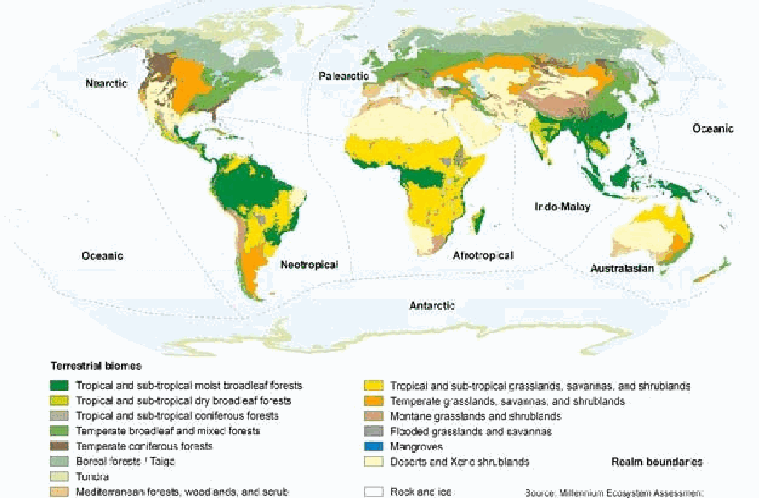
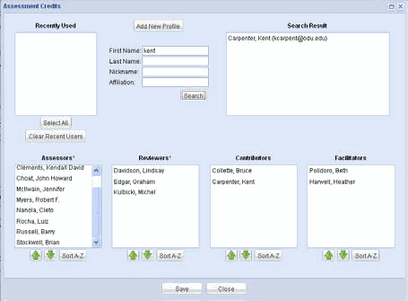
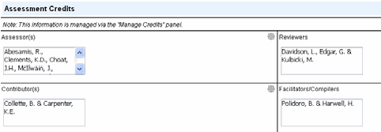
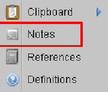

================================================================================
Page 1
================================================================================

DOCUMENTATION STANDARDS AND
CONSISTENCY CHECKS FOR
IUCN RED LIST ASSESSMENTS AND
SPECIES ACCOUNTS
Version 2 (September 2013)
A working document prepared by the IUCN Red List Unit, Cambridge, UK
Citation: IUCN. 2013. Documentation standards and consistency checks for IUCN Red List
assessments and species accounts. Version 2. Adopted by the IUCN Red List Committee and
IUCN SSC Steering Committee. Downloadable from:
http://www.iucnredlist.org/documents/RL_Standards_Consistency.pdf
THE IUCN RETDH LEI SIUTC ONF R TEHDR LEIASTTE ONFE DTH SRPEEACTIEESN™ED SPECIES™

================================================================================
Page 2
================================================================================

Table of Contents
Page
Introduction................................................................................................................... 1
1. Required and recommended supporting information for IUCN Red List
assessments..................................................................................................................... 2
Table 1. Required Supporting Information ...................................................... 3
Table 2. Required Supporting Information (under specific conditions) ........ 7
Table 3. Recommended Supporting Information ............................................. 11
2. Supporting Information for IUCN Red List assessments stored in SIS .............. 13
2.1. Taxonomy....................................................................................................... 13
2.2. Summary information text........................................................................... 15
2.3. Data fields....................................................................................................... 21
2.4. Classification Schemes.................................................................................. 24
2.5. Assessment Information................................................................................ 27
2.6. RAMAS® Red List ….....…………………………...........................…... 31
2.7. Distribution Map ………………………………………………………….. 32
2.8. Bibliography ……………………………………………………………….. 32
3. General Formatting and Style Guidelines .............................................................. 33
3.1. Language........................................................................................................ 33
3.2. General writing style..................................................................................... 33
3.3. Scientific and common names...................................................................... 34
3.4 Numbers and dates ...................................................................................…. 36
3.5. Brackets, dashes, hyphens, etc. .................................................................... 37
3.6. Abbreviations and common Latin terms..................................................... 39
3.7. Symbols and measurement units.................................................................. 41
3.8. IUCN and IUCN Red List terminology....................................................... 42
3.9. Geographical Information............................................................................ 43
3.10. Acronyms...................................................................................................... 44
3.11. References.................................................................................................... 45
4. Systematics.................................................................................................................. 52
4.1. Higher taxonomic levels................................................................................ 53
4.2. Genus, species and subspecies names.......................................................... 53
4.3. Taxonomic authorities................................................................................... 54
4.4. Synonyms........................................................................................................ 57
4.5. Taxonomic changes: splitting and merging taxa........................................ 57

================================================================================
Page 3
================================================================================

5. Pre-submission Checks............................................................................................. 59
5.1. Supporting Information Checks................................................................... 59
5.2. Consistency Checks....................................................................................... 62
Annex 1: Attributes for Spatial Data........................................................................... 63

================================================================================
Page 4
================================================================================

1
Introduction
Please note that this is a working document which is subject to modification and
addition; all future versions will be given a new version number. If you are
unsure whether you are working from the most recent version, please check the
IUCN Red List website or contact the IUCN Red List Unit (RLU).
This document provides detailed instructions for documenting species accounts held in the IUCN
Species Information Service (SIS) to support assessments for inclusion on The IUCN Red List of
Threatened Species TM (hereafter referred to as the IUCN Red List). The information presented here
builds on the required and recommended supporting information for IUCN Red List assessments,
and follows the IUCN SSC Style Guidelines (with some minor deviations), and the format of SIS.
It is important to follow the instructions and standards set out in this document closely to
maintain consistency and high standards within the IUCN Red List.
In addition to instructions for supporting information, this document includes a list of the standard
checks that need to be carried out BEFORE assessments are submitted for publication in the IUCN
Red List (note that SIS will soon include an automated integrity checker which will perform many
of the basic checks; once that functionality is made available these Guidelines will be updated to
reflect the changes).
For assessments being submitted from a major assessment project (e.g., comprehensive assessments
of major taxonomic groups, assessments of endemic species from regional projects) or assessments
submitted by Red List Authorities, it is the responsibility of Project Manager or relevant Red
List Authority Coordinator to ensure that all assessments have been checked (for supporting
information and consistency) before submitting them for publication on the IUCN Red List.
The RLU will carry out further consistency checks on submitted assessments, focusing particularly
on threatened and Near Threatened taxa, to check that the IUCN Red List Criteria have been
applied appropriately and consistently across species. The RLU cannot carry out thorough
supporting information checks for ALL submitted assessments; hence any indication that standards
have not been adequately followed will result in assessments being returned for correction and
resubmission later.
Please keep this document to hand for reference while entering information into species accounts in
SIS. If there is something you need to know which is not covered here, please contact the IUCN
Red List Unit (Craig Hilton-Taylor (craig.hilton-taylor@iucn.org) or Caroline Pollock
(caroline.pollock@iucn.org)).
Guidance on using SIS
The intention of this document is to provide guidance on documenting assessments for the IUCN
Red List. For guidance on how to use SIS, a self-teach tool has been developed (Microsoft
PowerPoint show) which users can download and refer to as needed. The SIS self-teach tool can
be downloaded from the IUCN Red List website (http://www.iucnredlist.org/technical-
documents/red-list-training/species-information-service) or from the SIS home page (after
logging in to SIS, scroll down through the SIS Updates panel in the bottom right hand corner).
The SIS self-teach tool will be updated as new features and tools are brought into SIS. Please
ensure you regularly check the SIS home page for the most recent update of this tool.
If you do not have a user account for SIS, please contact the IUCN Red List Unit.

================================================================================
Page 5
================================================================================

2
1. Required and Recommended Supporting Information for
IUCN Red List Assessments
An IUCN Red List assessment includes the Red List Category and Criteria, and a range of
supporting information (documentation). The purpose of providing supporting information with the
assessment is:
1. To support and justify adequately each Red List assessment.
2. To allow basic analysis of the Red List status across species, including calculating the Red
List Index.
3. To allow the Red List website (www.iucnredlist.org) to function properly (i.e., to allow users
to search and find information on the website).
The inclusion of relevant information in an assessment increases the utility of that assessment for all
three of the above purposes. Within the Species Information Service (SIS) there are many data
fields available to record a whole suite of information. Some of these data fields are essential to
support the Red List assessment, and some are there to capture additional information for analyses
and communication purposes.
IUCN has developed three tiers to identify the appropriate level of supporting information to
include in a Red List assessment:
1. Required Supporting Information
Supporting information required for ALL Red List assessments before they can be accepted for
publication on the IUCN Red List. There are two subsets of information for required supporting
information:
• Required supporting information under all conditions; see Table 1.
• Required supporting information under specific conditions; see Table 2.
2. Recommended Supporting information
Recommended supporting information is not essential for a Red List assessment to be accepted
for publication on the IUCN Red List but is strongly encouraged for all assessments for taxa
prioritized in the IUCN Red List Strategic Plan 2012-2020 and the IUCN Species Strategic Plan
2013-2016; see Table 3. IUCN Global Species Programme and Red List Partner-led assessments
always strive to achieve assessments according to the recommended level.
3. Discretionary (Optional) Supporting Information
Supporting information that is not essential for a Red List assessment to be accepted for
publication on the IUCN Red List, but specific projects or Assessors may wish to record this for
their own information or analysis purposes. Assessment project managers should clearly identify
which of these additional fields they want to include in assessments and inform Assessors
contributing to the project about this at the start of the project.
All fields in SIS that are not mentioned in Tables 1, 2 or 3 are considered to be discretionary (i.e.
optional) fields.

================================================================================
Page 6
================================================================================

3
Table 1: Required supporting information for all assessments submitted to the IUCN Red List
(in all conditions). Any assessments that do not include all of the information listed in this table
will be returned to Assessors.
Required Information Purpose Guidance Notes
1. Scientific name • To identify which taxon is being If the taxon is already in SIS, this
assessed information requires no additional
effort from the Assessors. If the taxon
• To support Red List website
is not yet recorded in SIS, Assessors
functionality
must provide this information to the
Red List Unit.
See sections 2.1 and 4.2.
2. Higher taxonomy details • To identify which taxon is being If the taxon details are already in SIS,
(Kingdom, Phylum, Class, assessed this requires no additional effort from
Order, Family) the Assessors. If the taxon details are
• To support Red List website
not yet recorded in SIS, Assessors
functionality
must provide this information to the
Red List Unit.
See sections 2.1 and 4.1.
3. Taxonomic authorities for all • To identify which taxon is being If the taxon authority details are
specific and infra-specific assessed already entered in SIS, this information
names used, following the requires no additional effort from the
appropriate nomenclatural Assessors. If the taxon authority details
rules are not yet recorded in SIS, Assessors
must provide this information to the
Red List Unit.
See sections 2.1 and 4.3.
4. IUCN Red List Category and • To identify the current status of The Red List Category and Criteria
Criteria (including the taxon represent the most fundamental
subcriteria) met at the • To support Red List website elements of a Red List assessment.
highest category of threat.
functionality Use of the categories and criteria must
• To allow basic analyses be in accordance with the IUCN Red
List Categories and Criteria. Version
3.1 and the current version of the
Guidelines for Using the IUCN Red
List Categories and Criteria. Both
documents are available to download
from the IUCN Red List website
(http://www.iucnredlist.org/technical-
documents/red-list-documents).
See section 2.5.1.
5. A rationale for the Red List • To justify the Red List Category Include any inferences or uncertainty
assessment. and Criteria selected. that relate to the interpretation of the
data and information in relation to the
criteria and their thresholds.
See sections 2.2.8 and 3.

================================================================================
Page 7
================================================================================

4
Required Information Purpose Guidance Notes
6. Data for parameters • To underpin and justify the Red Enter these data either into the relevant
triggering the Red List List Category and Criteria used. coded/numerical fields or in the
Criteria met at the highest relevant narrative (text) fields in SIS.
Category level.
If data are entered into the data fields,
this allows the Red List Criteria
calculator to be used in SIS, which
automatically checks for errors,
omissions and inconsistencies,
reducing the burden of manual
checking by Assessors, RLA
Coordinators and project coordinators.
If data are included within the narrative
(text) fields, the text must clearly
indicate all of the relevant sub-criteria
parameters and qualifiers (observed,
estimated, inferred, projected or
suspected) used.
See sections 2.2 and 2.3.2.
7. Countries of occurrence (for • To support Red List website SIS automatically records Presence =
native and reintroduced functionality (especially country Extant and Origin = Native by default
taxa), including Presence searches) as countries are selected.
and Origin coding.
• To allow basic analyses A tool will be developed to determine
countries of occurrence from GIS maps
and to auto-populate SIS with this
information, but some manual
checking and correcting will still be
required.
Countries of occurrence are not strictly
required for vagrant and introduced
ranges.
Subcountries may also be recorded, but
these are not strictly required (see
Table 3).
See section 2.4.7.

================================================================================
Page 8
================================================================================

5
Required Information Purpose Guidance Notes
8. Geo-referenced distribution • To support Red List website Spatial distribution data are not
data for all taxa with a functionality required for taxa of unknown
known distribution provenance (e.g. taxa assessed as Data
• To allow basic analyses
Deficient because their range is not
• Spatial distribution data are known).
essential for supporting
Spatial data may be geo-referenced
assessments under criteria B and
polygons or point localities, and may
D2 (and arguably also for
be provided in any format, including as
demonstrating that the thresholds
a paper map, text file of coordinates,
for these criteria are not met)
pdf, graphics file or GIS shapefile.
A GIS shapefile is preferred (but is not
strictly required), given their value for
conducting spatial analyses, visual
displays on the Red List website, and
future functionality on the Red List
website that will allow spatial searches.
Although additional distributional
documentation is desirable for taxa
qualifying under criterion B (e.g. 2x2
km grids showing occupancy), this is
not Required.
Note that any distributional data can be
coded as sensitive to avoid this being
distributed or displayed on the Red List
website.
See section 2.7.
9. Direction of current • To support Red List website See section 2.3.1.
population trend (stable, functionality
increasing, decreasing,
unknown) • To allow basic analyses
10. Coding for occurrence in • To support Red List website See section 2.3.1.
freshwater (= inland waters), functionality
terrestrial, and marine
ecosystems (i.e., “System” in
• To allow basic analyses
SIS)
11. Suitable habitats utilized • To support the assessment To speed up entering such coding in
(coded to lowest level in SIS, habitat suitability is set to
Habitats Classification • To support Red List website 'suitable' by default for any habitat
functionality
Scheme). selected.
• To allow basic analyses See section 2.4.1.
12. Bibliography (cited in full; • To underpin the assessment and References are stored centrally in SIS
including unpublished data provide all sources of data and and are managed and attached to
sources but not personal information used to support the assessments via the Reference
communications) Red List assessment functions.
See sections 2.8 and 3.11 for guidance
on formatting references for the
bibliography.

================================================================================
Page 9
================================================================================

6
Required Information Purpose Guidance Notes
13. Names and contact details of • To demonstrate that the Note that Contributor(s), Compiler(s),
the Assessor(s) and at least appropriate assessment and review and Facilitator(s) may also be recorded
one Reviewer process has been undertaken but are not strictly required. However,
recording them in the assessment does
• To acknowledge those involved in
allow these people to be acknowledged
the assessment.
on the Red List website.
• To allow Assessors and
All contact details are stored within
Reviewers to be contacted easily
SIS; only names (e.g. surname and
in the case of the assessment
initials) are displayed on the Red List
content being questioned
website.
• To support Red List website
More than one Reviewer is encouraged
functionality
for commercially significant species,
or those species for which assessments
may be contentious.
See section 2.5.3.

================================================================================
Page 10
================================================================================

7
Table 2: Required supporting information for Red List assessments under specific conditions. The
list of required supporting information (under specific conditions) is essential for all assessments
that meet the conditions outlined below. Any assessments for taxa meeting these conditions that do
not include all of the information listed below will be returned to Assessors.
Required Specific Condition Purpose Guidance Notes
Information (under
specific conditions)
1. Name of For subpopulation level • To identify what is See section 2.1.
subpopulation assessments being assessed below
the species level.
2. Major Synonyms For taxa with commonly • To support Red List Incorrect spellings of
used alternative names or website functionality scientific names on the Red
that have been treated List are included as
under different names in
• To identify which taxon
synonyms when the
is being assessed
the past on the Red List spellings are corrected.
See sections 2.1 and 4.4.
3. Plant growth forms For plants • To support Red List See section 2.3.1.
website functionality
• To allow basic analyses
4. Information on the For all taxa being • To distinguish up- or This should be coded
reason for change in reassessed down-listings resulting irrespective of whether a
Red List Category of from genuine taxon qualifies in the same
the taxon improvement or or for a different Red List
deterioration, from Category.
those resulting from See section 2.5.6.
revised taxonomy,
improved knowledge,
etc.
5. Date last recorded (in For Extinct and Extinct in • To justify use of the
the wild, if taxon the Wild taxa, and for categories Extinct or
survives in captivity) Critically Endangered taxa Extinct in the Wild, (to
and details of surveys tagged as Possibly Extinct underpin assessments in
which have been or Possibly Extinct in the which extinction is
conducted to search Wild. confirmed or thought
for the taxon highly likely)
• To allow basic analyses
6. Possibly Extinct or For Critically Endangered • To underpin See section 11.2 in the
Possibly Extinct in the taxa that considered highly assessments in which current version of the
Wild tag likely to be Extinct or extinction is thought Guidelines for Using the
Extinct in the Wild but for highly likely but which IUCN Red List Categories
which confirmation is requires confirmation and Criteria for more
required information on this.
• To allow basic analyses
• To support Red List
website functionality

================================================================================
Page 11
================================================================================

8
Required Specific Condition Purpose Guidance Notes
Information (under
specific conditions)
7. Documentation of For Data Deficient taxa • To justify use of the
available data, sources Data Deficient
of uncertainty and Category
justification for why
the criteria cannot be
applied; including,
where appropriate, one
or both of the Data
Deficient tags
Unknown provenance
and Uncertain
taxonomic status
explains lack of data
8. Coding as Severely Taxa listed as threatened • To justify the Red List For definitions of severely
Fragmented, or the using criteria B1a or B2a Category and Criteria fragmented and locations
number of locations used refer to the current version
of the Guidelines for Using
the IUCN Red List
Categories and Criteria.
9. Generation length For taxa listed as • To justify the Red List For definition of generation
threatened under criteria A Category and Criteria length refer to the current
and C1 used version of the Guidelines for
Using the IUCN Red List
Categories and Criteria.
10. Time period over For taxa listed as • To justify the Red List Record this as the start year
which 3-generation threatened under criterion Category and Criteria for the 3-generation time
decline is measured A4 used period.
around the present.
11. The data, assumptions, For taxa listed under • To justify the Red List
structural equations, Criterion E Category and Criteria
and Population used.
Viability Analysis
model if used.
12. Coding and For taxa listed as Near • To justify the Red List Include this information in
justification of the Threatened Category and Criteria the rationale for the
criteria that are nearly used assessment. A system for
met or the reasons for coding up criteria met or
the classification (e.g., nearly met will be
dependence on developed for SIS in future.
ongoing conservation
measures)

================================================================================
Page 12
================================================================================

9
Required Specific Condition Purpose Guidance Notes
Information (under
specific conditions)
13. Taxonomic notes • For taxa previously • To clarify which taxon See sections 2.2.1 and 3.
treated as a different concept is being
taxonomic concept assessed.
(e.g., “split” or
• To allow comparison of
“lumped”) on the Red
taxa previously assessed
List.
on the Red List.
• For taxa for which there
• To justify use of the
is widespread
Data Deficient Category.
taxonomic ambiguity or
uncertainty in the
literature.
• For species that may
represent a species
complex
• For taxa assessed as
Data Deficient because
of Taxonomic
uncertainty.
14. Major threats to the For taxa listed as Extinct, • To justify the Red List Only major threats to the
taxon (coded to lowest Extinct in the Wild, Category and Criteria species are required.
level in Threats Critically Endangered, used
Coding of timing and
Classification Scheme) Endangered, Vulnerable,
and Near Threatened • To support Red List stresses is not strictly
website functionality required for the Red List
assessment, but is
• To allow basic analyses
recommended.
Coding of scope and
severity are discretionary
(i.e., optional).
If Assessors decide to also
record minor threats, then
Scope and Severity must be
recorded for all threat
records for the taxon (to
allow major and minor
threats to be clearly
identified).
Major threats are not
required for Least Concern
or Data Deficient taxa, but
may be recorded if relevant
(but with appropriate
Timing, Scope and Severity
codes).
See section 2.4.2.

================================================================================
Page 13
================================================================================

10
Required Specific Condition Purpose Guidance Notes
Information (under
specific conditions)
15. Narrative text about For taxa listed as Extinct, • To justify the Red List Required for supporting the
the geographic range, Extinct in the Wild, Category and Criteria assessment with contextual
population, habitat and Critically Endangered, used and explanatory information
ecology, and threats Endangered, Vulnerable, covering, among other
Near Threatened, and Data things, the relevant data
Deficient sources, uncertainties,
subtleties and interpretations
of data made by Assessors.
Although general text would
also be helpful for Least
Concern taxa, this is not
required.
See sections 2.2 and 3.
16. Additional supporting If the RAMAS® Red List • To justify the Red List See section 2.6.
information as detailed software is used for the Category and Criteria
in section 2.6 of the assessment used
Documentation
Standards and
Consistency Checks
for IUCN Red List
Assessments and
Species Accounts

================================================================================
Page 14
================================================================================

11
Table 3: Recommended Supporting Information. While the list of recommended supporting
information is desirable, and strongly encouraged for all assessments for taxa prioritized in the
IUCN Red List Strategic Plan 2012-2020 and IUCN Species Strategic Plan 2013-2016, it is not
essential for other assessments being submitted to the IUCN Red List. Assessments that do not
include any of the information listed below are still acceptable for submission to the IUCN Red
List.
Recommended Specific Condition Purpose Guidance Notes
Supporting Information
1. GIS distribution map using • Facilitates spatial Although provision of
IUCN’s Standard Polygon analyses spatial distribution data is
and/or Point Attributes • Allows visualisation on required in any form (see #8
in Table 1), a GIS map is
the Red List website
recommended if possible.
(and possible spatial
queries) See section 2.7.
2. Qualifiers (estimated, • Useful for documenting
suspected, etc.) for uncertainty over the
direction of current population trend code
population trend selected
3. Occurrence in specified • Useful for searching by If a GIS map has been
sub-country units for large sub-country units on the prepared, a list can be pre-
countries and islands far Red List website populated by GIS overlay.
from mainland countries See section 2.4.7.
4. Occurrence in terrestrial For terrestrial and freshwater • Useful for searching on A GIS tool will be
and freshwater taxa the Red List website, and developed to facilitate
biogeographic realms for analyses automatic coding of this
from distribution maps. Note
that currently there is no
widely accepted equivalent
system for the marine realm.
See section 2.3.1.
5. Elevation or depth limits • Useful for supporting See section 2.3.1.
Assessments, describing
the distribution, and
particularly for
considering impacts of
climate change
6. Coding of Stresses and • Useful for demonstrating These are added to each
Timing for Threats the means by which threat after the relevant
threats impact taxa, and threats have been selected.
for distinguishing past, Timing, Scope and Severity
present and future threats are drop-down lists where
only one option can be
selected, whereas for
Stresses multiple options can
be selected.
See sections 2.4.2 and 2.4.3.
7. Narrative text about the For taxa listed as Extinct in • Useful to support and See section 2.2.7.
important conservation the Wild, Critically provide explanation and
measures in place and Endangered, Vulnerable, context for coding of
needed. Near Threatened, and where conservation actions
appropriate, Data Deficient

================================================================================
Page 15
================================================================================

12
Recommended Specific Condition Purpose Guidance Notes
Supporting Information
8. Coding of important For taxa listed as Extinct in • Useful for providing a These codes complement
conservation actions in the Wild, Critically high-level indication of rather than pre-empting or
place and needed Endangered, Endangered, the most important replacing more detailed
Vulnerable, Near actions in place and Action Planning or
Threatened, and where likely to be required, Systematic Conservation
appropriate, Data Deficient. both for individual Planning. Coding up
species and in multi- conservation actions is not
species analyses Required for Data Deficient
taxa, but if possible these
taxa should be coded where
appropriate.
See section 2.4.4.
9. Narrative text on the For utilized taxa • Useful to support and See section 2.2.5.
utilization of the taxon provide explanation and
context for coding of
utilization
10. Coding of the end use For utilized taxa • Useful for providing a See section 2.4.6.
(purpose) and scale of high-level indication of
utilization of the taxon the most important ways
in which species are
utilized, both for
individual species and in
multi-species analyses

================================================================================
Page 16
================================================================================

13
2. Supporting Information for IUCN Red List Assessments
stored in SIS
All assessments entering the IUCN Red List must include supporting information. This section
provides guidance on what to record in the species account text and data fields within SIS for
required and recommended supporting information (see section 1 for the full lists of required and
recommended supporting information). For guidance on writing styles, formats, etc. please refer to
section 3 and section 4 this document.
Box 1. An important note about copying and pasting text from Microsoft Word and PDF
documents
Before entering any text into an assessment account in SIS, it is important to know that certain
Microsoft programmes contain hidden non-standard HTML codes that can seriously affect how
text is displayed on the internet. This can also severely increase the file size on the web page and
affect the site’s functionality. For example, you may copy the following text from an MS Word
document:
...landing statistics are generally unavailable as all species of batoids are recorded as
“unidentified rays and skates”.
and paste this into SIS, where it looks correct. However, once transferred to the Red List website,
this text may be displayed as:
...landing statistics are generally unavailable as all species of batoids are recorded as
?unidentified rays and skates?.
This highlights the importance of avoiding copying and pasting directly from MS Word or PDF
documents wherever possible. If text must be copied from external sources into SIS, we
recommend that you first save the text as a text (.txt) file—you can use Notepad for this. This will
remove all format tags and styles (i.e., it removes all hidden codes), then the text can safely be
copied from the .txt file into SIS and reformatted within the system, if necessary.
2.1. Taxonomy
Taxonomic information is required supporting information. Higher taxonomy, scientific name, and
taxonomic authority are required for all Red List assessments (Table 1), and major synonyms are
required for taxa with commonly used alternative names and taxa that have been treated under
different names in past IUCN Red Lists (Table 2).
For taxonomy in SIS, Assessors are only permitted to edit synonyms. Adding new taxonomy to the
system or editing existing taxonomy is managed by the IUCN Red List Unit. If new taxonomy
needs to be added to SIS, the following information needs to be provided to the Red List Unit:
• Kingdom, phylum, class, order, family, genus and species (also subspecies, if this is the
level being assessed) following the appropriate standard taxonomic references (section 4).
Note that the IUCN Red List does not record taxonomy to the level of suborders,
subfamilies and subgenera.
• Taxonomic authority, in the appropriate format (section 4.3).
• Taxonomic source. This is the reference for the taxonomic concept being followed. For
example, Amphibian Species of the World is the taxonomic source for amphibians (e.g.,
Frost 2013). Where there is a deviation from a standard checklist, it is particularly important
to record the taxonomic source used. Where there is no standard checklist available, the

================================================================================
Page 17
================================================================================

14
taxonomic source may be the published reference for the taxon’s original description, or (if
the taxon has been revised since its description) reference to the publication where the
taxonomic concept was most recently revised.
All taxa assessed for the IUCN Red List must be validly published in accordance with the
appropriate international nomenclatural codes and should be currently accepted names. Standard
taxonomic checklists should be used wherever possible for scientific names. The standard lists
adopted by IUCN are periodically reviewed and listed on the IUCN Red List website
(http://www.iucnredlist.org/technical-documents/information-sources-and-quality#standards). For
many groups, no standards are available, or there may be a valid reason for adopting another
treatment. In such cases, the taxonomic treatment should be clearly indicated and, if this is not one
of the standards followed by IUCN the reference must be cited in full and a reason for the deviation
given.
For animals, the taxonomic authority should include the year of publication; plant names do not
include the publication year. Abbreviations used for plant author names should follow Brummit and
Powel (1992) and subsequent updates on the International Plant Names Index website
(http://www.ipni.org/index.html).
Box 2. Red List assessments and changing taxonomic concepts
When a species is being reassessed for the IUCN Red List, it is extremely important to consider
what taxonomic concept was used for the previous assessment (i.e., have there been any
taxonomic revisions resulting in the species being split into several species with smaller ranges
and population sizes, or being merged with other species to form a new concept with a much
larger range and population size?)
If the taxonomic concept has changed since the previous assessment, but the old species name
has been retained, then the previous Red List assessment will not be comparable to a new
assessment.
See section 4.5 for guidance on this issue.
Once the taxonomy has been entered into SIS, major synonyms (if any) must also be recorded. This
includes synonyms arising through recent taxonomic changes. More detailed guidance about
taxonomy and nomenclature is given in section 4.
Subpopulation Names
For subpopulation level assessments, an appropriate subpopulation name is required (Table 2).
Subpopulation names usually refer to the name of the geographic area, sea or river where the
subpopulation occurs. The word “subpopulation” is also included. For example:
Carcharhinus amboinensis Southwest Indian Ocean subpopulation
Neamblysomus julianae Bronberg Ridge subpopulation
Subpopulations can only be edited or added to SIS by the IUCN Red List Unit.
Common Names
Within SIS, in the General Information section for the taxon, fields are available to record common
names in most languages. Prior to September 2012, known common names (in English, French and

================================================================================
Page 18
================================================================================

15
Spanish), were required with a Red List assessment. While common names are very useful,
particularly for communication purposes, this information is now discretionary (optional) and can
be recorded if the Assessor wishes to do so, or if a specific project requests that this information be
recorded. Please refer to section 3.3 for guidance on preferred formatting for common names for a
Red List assessment.
2.2. Summary Information Text
For Red List assessments, narrative text about geographic range, population, habitat and ecology,
and threats is required supporting information for all taxa except those that are Least Concern
(Table 2). While this information is also useful for Least Concern taxa, it is not essential; Assessors
(or assessment Project Managers) can decide for themselves whether or not to record this for Least
Concern species.
Taxonomic notes are also required for taxa that were previously assessed under a different scientific
name, or until recently were treated as a different taxonomic concept (box 2 and section 4.5), and
taxa with taxonomic uncertainties or widespread ambiguities (Table 2).
General text about important conservation actions is recommended supporting information for all
taxa except those listed as Least Concern (Table 3). Similarly, general text on use and trade of all
taxa that are utilized is recommended, but is not strictly required for the assessment (Table 3).
Assessors may decide to also include data for parameters triggering the Red List Criteria within the
narrative text instead of (or in addition to) recording these in the data fields in SIS (Table 1). It is
advisable to record actual estimated values (e.g., 1,500 km², or 100-240 km²) in the text instead of
repeating the thresholds from the IUCN Red List Categories and Criteria; by doing this Assessors
will clearly demonstrate that the taxon falls within certain criteria thresholds. This also helps
Assessors for future reassessments to identify where parameter estimates have changed since the
previous assessment.
The summary documentation text in each of the sections noted below should be succinct but
informative, and should be based on the most recent information available for the taxon. Please try
to avoid one-word answers; when read together (i.e., in the species account published on the Red
List website) the different sections should merge to tell a story summarizing what the taxon is, its
current Red List status, where it occurs, what threats are affecting it, and what actions are being
done or need to be implemented to prevent it from moving closer to extinction. In each case, if there
is no information available on the taxon at all, please state this and explain why this is the case.
Box 3. Important note about the Data Entry Module (DEM)
The Data Entry Module (DEM) is now obsolete and should no longer be used for compiling IUCN Red
List assessments. The DEM is not fully compatible with the online SIS and if assessments are uploaded
from the DEM into SIS, there will still be a lot of work required to manually translate DEM
information into the appropriate codes used in SIS. Effectively, by using the DEM you will double the
time it takes to complete a Red List assessment.
If you are still relying on the DEM to store and submit your assessments, please contact the IUCN Red
List Unit to arrange for access to SIS to allow you to continue to assess taxa.
2.2.1 Taxonomic Notes
Taxonomic notes are required supporting information for taxa that have undergone recent
taxonomic changes or where there are any taxonomic doubts or debates about the validity or

================================================================================
Page 19
================================================================================

16
identity of the taxon (Table 2). In SIS, these notes are recorded in the Taxonomic Notes field (in the
General Information section for the taxon). This section should not be used to simply copy and
paste collection label notes into. See the Box 2, and section 4.5 for more information on taxonomic
changes.
Example:
Preferred style Try to avoid
Taxonomic Notes: Alethe diademata (following Dowsett and Forbes- Not the same taxonomic concept
Watson 1993) previously included populations from used for previous assessments.
Upper Guinea and Lower Guinea. However, only
individuals from Upper Guinea are now recognized as
A. diademata, while the Lower Guinea population is
accepted as the separate species, A. castanea.
Adding Taxonomic Notes to SIS
In SIS, the Taxonomic Notes field is attached to the Taxonomic information instead of to the
assessment itself. This allows Assessors to edit taxonomic notes at any time (e.g., if taxonomic
revisions are underway, but a reassessment is not yet underway). However, these notes are only
displayed on the IUCN Red List website when a new assessment (or reassessment) is published. If
an Assessor wishes updated taxonomic notes to be attached to a currently published assessment, it is
important that they contact the Red List Unit to arrange for this to happen.
For any references cited in the taxonomic notes, these should be directly attached to the Taxonomic
Notes field, and not to the Taxonomic Sources section or directly to the assessment (unless these
references are also cited within the reference itself).
2.2.2. Geographic Range
A summary of currently available information on geographic range is required supporting
information for all taxa that are not assessed as Least Concern (Table 2). For taxa that are
particularly sensitive to collecting or hunting, it is prudent to avoid providing information that
allows people to see exactly where the species can be found, but a less precise summary should be
provided.
For taxa listed under criteria B, all distribution data and qualifiers related to the thresholds met must
be recorded (Table 1). These may be recorded in the separate data fields in SIS (section 2.3.2), or
they may be included within the Geographic Range Information text field. If the information is
being recorded within the text field, ensure that the text clearly indicates all of the relevant
subcriteria parameters, and all qualifiers (observed, estimated, inferred, projected, or suspected)
used to justify the assessment.
For instance, if criteria B1ab(i,ii,iii)+2ab(i,ii,iii) are used in the assessment and the data are being
captured within the text, ensure that all of the following is included in the geographic range text
field:
1) Estimated extent of occurrence (EOO) in km², with an indication of how this was estimated.
2) Estimated area of occupancy (AOO) in km², with an indication of how this was estimated.
3) Estimated number of locations (if number of locations is the basis of using criteria B1a+2a)
with reference to major threats and how these affect the taxon to justify this estimate.
3) Justification of why the taxon is severely fragmented (if severe fragmentation is the basis of
using criteria B1a+2a).

================================================================================
Page 20
================================================================================

17
4) Justification for stating that there is continuing decline in EOO, AOO, and area, extent and/or
quality of habitat (including indication of the appropriate qualifiers used: observed, estimated,
projected, or inferred).
Examples:
Preferred style Try to avoid
Distribution: This species is known only from the Serra (or Brazil.
Maciço) de Baturité, in the State of Ceará, in
(where specific data and qualifiers
northeastern Brazil.
are recorded in separate data
fields in SIS)
Distribution: This species is known only from the Serra (or Brazil. EOO <5,000 km². AOO
Maciço) de Baturité, in the State of Ceará, in <500 km². 4 locations.
(where specific data and
northeastern Brazil. The species’ extent of
parameters are included in the
narrative text) occurrence (EOO) is estimated at 2,500 km²
(based on total area within a minimum convex
polygon around all known occurrences), but the
area occupied within this EOO is estimated at
550 km² (based on a 2x2 km² grid overlay on
the range map; see Smith et al. 2011). There are
four areas within the range where
concentrations of this species tend to occur (see
figure 3 in Smith et al. 2011). The main threat
(habitat loss) appears to affect each of these
areas relatively independently; therefore the
species is estimated to occur in only four
locations.
2.2.3. Population
A summary of the currently available population information is required supporting information for
all taxa that are not assessed as Least Concern (Table 2). In SIS, this is recorded in the Population
Information text field. The summary should include currently available information on the global
population size and trends. Information about the population structure (e.g., number, sizes, and
trends of subpopulations, and trends in particular regions within the taxon’s range) is also useful,
particularly if criterion C2 is used for the assessment. .
If there is no quantitative information on population sizes or trends, it is helpful to record whether
the species is common, abundant, rare, etc. If there really is no information at all about the
population, please note this and indicate why this is case (e.g., no surveys have been carried out
because the area isn’t safe to work in, no research has been undertaken for the species, etc.).
For taxa listed under criteria A or C, all population data and qualifiers related to the thresholds met
must be recorded (Table 1). These may be recorded in the separate data fields in SIS (section 2.3.2),
or they may be included within the Population Information text field. If these are recorded within
the text field, ensure that the text clearly indicates all of the relevant subcriteria parameters, and all
qualifiers used to justify the assessment.
For instance, if criteria A2ac; C2a(i) are used in the assessment and the data are being captured
within the text, ensure that all of the following information is included:
1) Rate of population reduction over the past ten years or three generations (note that for criteria
A and C1, generation length must also be recorded – Table 2 and section 2.3.2).
2) Qualifier for the stated reduction (i.e., observed, estimated, inferred or suspected reduction)

================================================================================
Page 21
================================================================================

18
3) Information supporting the use of direct observation and decline in AOO, EOO and/or quality
of habitat as the basis for the reduction.
4) Estimated current population size, with an indication of how this was estimated.
5) Justification for continuing decline in population size, and the qualifier for this (i.e., is
continuing decline observed, estimated, projected, or inferred?)
6) Estimated size of the largest subpopulation.
Examples:
Preferred style Try to avoid
Population: Until 2002, this frog was very common within Rare.
its small range; often it was found at numerous
(where specific data and qualifiers are
localities. Between 2002 and 2011 the same sites
recorded in separate data fields in SIS)
were surveyed 34 times; not a single individual
was found until in July 2012, when three
individuals were recorded. It is suspected that
the population is genuinely declining, but more
research is needed to investigate the possibility
of natural population fluctuations occurring.
Population: Until 2002, this frog was very common within This is a rare species. The
its small range; often it was found at numerous population has declined by
(where specific data and parameters are
localities. Between 2002 and 2011 the same sites >90% since 2002.
included only in the narrative text)
were surveyed 34 times; not a single individual
was found until in July 2012, when three
individuals were recorded. More research is
needed to investigate the possibility of natural
population fluctuations occurring for this
species, but based on existing information is
suspected that the population has genuinely
declined by at least 90% over the last ten years.
If this species still remains in the wild, it is
likely that the population is still declining. Based
on current evidence, the population size is
suspected to be less than 50; the species may
even already be extinct.
2.2.4. Habitats and Ecology
A summary of the taxon’s suitable habitats and ecological requirements is required supporting
information for all taxa that are not assessed as Least Concern (Table 2). In SIS, this is recorded in
the Habitats & ecology information field. This summary should include information on the essential
habitats and ecological conditions required by the taxon. This does not need to be extensive; for
example, it is not necessary to know the details of all behavioural traits, etc. unless these are
relevant to the taxon’s risk of extinction (e.g., it has a particular life cycle, growth pattern or
behaviour that makes it susceptible to specific threats).

================================================================================
Page 22
================================================================================

19
Example:
Preferred style Try to avoid
Habitats & Ecology: Most specimens have been found in reasonably Forest streams.
well-preserved closed forests in dry or moist leaf-
litter on the ground, in bromeliads, and in stream
margins. However, the species can also survive in
shaded coffee plantations. It is a diurnal species
that breeds by direct development, and it is likely
that the eggs are deposited in wet spots on the
ground.
2.2.5. Use and Trade
Prior to September 2012, Assessors were required to record text for use and trade of the taxon. This
is no longer strictly required for assessments to be published on the IUCN Red List. However, this
is very useful information therefore it is recommended that this be recorded for those taxa that are
utilized (Table 3), including taxa that are legally or illegally hunted or collected.
In SIS, this information is recorded in the General notes regarding trade and use of the species text
field. This text should summarize the information currently available for any utilization and/or trade
of the taxon (including legal and illegal hunting and collection, and for local, national and
international trade).
Example:
Preferred style Try to avoid
Use & Trade: Although this species is legally protected in all of Illegal collection.
its range countries, illegal collection continues in
many parts of its range. Hunters particularly target
young individuals for the international pet trade.
2.2.6. Threats
A summary of the main threats currently affecting or likely to affect the taxon is required
supporting information for all taxa that are not assessed as Least Concern|( Table 2). In SIS, this is
recorded in the Threats Information text field. Try to indicate whether these threats are historic,
current (and whether they are likely to continue into the future), or if these are threats that are
highly likely to occur in the near future (include a justification of why this is the case).
Often this text is used to inform the codes recorded in the Threats and Stresses Classification
Schemes; therefore it is helpful to document as much detail about the threats as possible, including
the main causes of the threat, the scale of the threat (is it affecting the entire global population or
does it occur in only specific parts of the taxon’s range), and the stress each threat places on the
species. For example, if deforestation is the main threat affecting the species, explain what is
driving the deforestation (e.g., large scale hardwood timber extraction for national and international
trade, ongoing forest clearance for expansion of coffee plantations, etc.) and how this is affecting
the species being assessed (e.g., removal of mature individuals and seeds from the wild population,
removing suitable habitat, altering the habitat to the extent that suitable breeding sites are becoming
increasingly scarce, etc.)

================================================================================
Page 23
================================================================================

20
Example:
Preferred style Try to avoid
Threats: The major threat affecting this species is Forest loss.
extensive habitat loss across its range caused by
logging, mainly for the timber trade, and to
convert forest areas to agricultural land (large-
scale plantations) and, urban expansion and
tourist area development. The region’s very
good soils and favourable climate encourages
agricultural expansion; the species cannot
survive in the banana plantations that are rapidly
taking over the area.
2.2.7. Conservation Actions
Prior to September 2012, Assessors were required to include a summary of conservation and actions
in place and needed for the taxon. This is no longer strictly required for assessments to be published
on the IUCN Red List, but it is recommended that this be recorded wherever possible for extant,
taxa that are not assessed as Least Concern (Table 3).
In SIS, this text is recorded in the Conservation Actions Information field. The text should include
conservation actions currently in place, and realistically achievable actions needed to mitigate the
current causes of declines (if any). Research actions (in place and needed) can also be recorded in
this section.
Example:
Preferred style Try to avoid
Conservation: The species is not known from any protected None in place.
areas, but clearly there is a need for improved
habitat protection at sites where it is known to
occur. Further survey work is required to
determine whether or not this species is
experiencing a genuine decline, or is undergoing
natural population fluctuations.
2.2.8. Assessment Rationale
All assessments published on the IUCN Red List require a rationale―sometimes also referred to as
the “justification” (Table 1). The rationale justifies the IUCN Red List Category and Criteria
selected for the taxon.
In SIS, this is recorded in the Rationale for the Red List Assessment field. The rationale should not
simply quote the Red List Criteria thresholds that are met (the criteria code already indicates these);
instead it should use the key issues highlighted in the other documentation sections to summarize
the reasons why the taxon qualifies for the assigned category. Include in the rationale any inferences
or uncertainty that relate to the interpretation of the available data and information in relation to the
criteria and their thresholds.
When including estimates for data related to the IUCN Red List thresholds within the rationale
(e.g., extent of occurrence (EOO), area of occupancy (AOO), number of locations, population size,
etc.) try to use the actual estimates instead of just stating the thresholds from the criteria. For

================================================================================
Page 24
================================================================================

21
example, use “estimated extent of occurrence (EOO) is 15,000 km²” rather than “EOO <20,000
km²”.
Example:
Preferred style Try to avoid
Assessment rationale: This is a range-restricted species, known from Vulnerable because EOO
6-8 locations in the Maciço de Baturité, <20,000 km², AOO <2,000
northeastern Brazil. Its extent of occurrence km², occurs in <10 locations,
(EOO) is around 2,500 km², and area of and habitat is declining.
occupancy (AOO) is 550 km². Its forest habitat
is declining due to logging and rapid expansion
of agriculture and human settlements. These
threats are likely to continue as the area is
favourable for agriculture and there is no
current protection for this frog’s habitat. The
species is listed as Vulnerable.
2.3. Data fields
Along with text fields to record narrative text to support the Red List assessment, SIS has a wide
range of data fields. Some of these must be completed before an assessment can be published on the
IUCN Red List (i.e., they are required supporting information; Table 1 and Table 2); some are not
required but are recommended supporting information (Table 3); and others are available in SIS to
be completed if Assessors or assessment Project Managers want this information recorded in the
assessment (i.e., they are discretionary (optional) fields).
2.3.1. Data fields for additional information
The following fields in SIS are used to record additional information that allows the Red List
website to function properly or allows data to be analysed and used for communication purposes.
a) Current Population Trend
Current population trend is required supporting information for all IUCN Red List assessments
(Table 1). The options for this are: Increasing, Decreasing, Stable, Unknown. It is also
recommended that the qualifier be recorded for this information (observed, estimated, inferred,
suspected) (Table 3).
“Current” population trend refers to trends over a period of ca. three years around the present. The
population narrative text should include clear justification for the current population trend recorded
in this field. If quantitative data are available, analysis of these data needs to be interpreted
carefully, taking account of uncertainty and variability in the dataset over the short time frame.
Although current population trend is not strictly necessary to support the Red List assessment, this
is valuable information for analyses of overall patterns of trends, for communication purposes.
b) System
Coding for occurrence of the taxon in freshwater (i.e., inland waters), terrestrial, and marine
ecosystems is required for all Red List assessments (Table 1). In SIS, this is recorded in the System
section, where all three options are available with a checkbox alongside.
For taxa occurring in brackish inland waters, select “Freshwater (inland waters)”.

================================================================================
Page 25
================================================================================

22
For estuarine taxa, the system recorded will depend on where in the estuary the taxon occurs. If it
occurs high up in the estuary (i.e., not at or near the coast), select “Freshwater (inland waters)”. If it
occurs at the mouth of the estuary only, select “Marine”. If it occurs widely throughout the estuary,
or if this information is not known, select both “Freshwater (inland waters)” and “Marine”.
Note that more detailed habitat description and coding can be recorded in the narrative text and in
the Habitats Classification Scheme.
This information is valuable for analyses, communications purposes, presenting Red List data to
various policy fora, calculating the Red List Index, and for searching on the Red List website.
c) Plant Growth Form
For all plant assessments, the plant growth form (e.g., annual, cycad, epiphyte, fern, shrub, tree,
etc.) is required information (Table 2).
This information is required to facilitate searches on the Red List website (e.g., for all threatened
trees), and to allow analyses of this information. Definitions for the terms used for Plant Growth
Forms can be found in the Classification Schemes page on the IUCN Red List website
(http://www.iucnredlist.org/technical-documents/classification-schemes).
d) Biogeographic Realms
Recording the Biogeographic Realms in which the taxon occurs (figure 1) is not required for the
Red List assessment, but it is recommended supporting information for terrestrial and freshwater
taxa (Table 3). In SIS, these are recorded in the Biogeographic Realm section (a series of tick
boxes). For marine taxa, currently there is no widely accepted equivalent of biogeographic realms.
A GIS tool will be developed to facilitate automatic coding of this from distribution maps.
Recording biogeographic realms is useful for searching on the IUCN Red List website, and for
analysing these data.

================================================================================
Page 26
================================================================================

23
Figure 1. The biogeographical realms (large spatial regions within which ecosystems share a broadly similar
evolutionary history). Although the biomes shown in this figure do not completely match the Habitat Classification
Scheme used for the Red List, there are some broad similarities, so they can be used as a rough guide.
e) Elevation or Depth Limits
Recording elevation or depth limits is not required, but is recommended supporting information
(Table 3) because this is very useful for supporting assessments, describing the distribution, and in
particular, for considering the impacts of climate change on the species. In SIS, the elevation and
depth limits fields can be found in the Distribution section.
SIS also includes data fields to record Depth Zones for aquatic species (shallow photic (0-50 m),
deep photic (51-200 m), Bathyl (201-4,000 m), etc.). These are discretionary (optional) fields,
which SIS users can use if they wish (e.g., to be able to analyse the status of marine species
occurring in these zones).
2.3.2 Data fields for the Red List Criteria calculator in SIS
SIS includes an expert system (the Red List Criteria calculator) which compares data fields holding
parameters related to the IUCN Red List Criteria against the criteria thresholds and automatically
assigns a Red List assessment for that taxon. Assessors should keep in mind that if they wish to use
the Red List Criteria calculator in SIS, then the data must be entered into the appropriate fields.
Recording all parameters and qualifiers that support the assessment (i.e., parameters for all criteria
and sub-criteria met at the highest Red List Category) is required supporting information (Table 1).
This may be recorded in the data fields in SIS for the Red List Criteria calculator, or they may be
included within the narrative text.
The Red List Criteria calculator data fields are attached to each of the various documentation
sections. For example, the Distribution section includes fields for recording area of occupancy

================================================================================
Page 27
================================================================================

24
(AOO), extent of occurrence (EOO), number of locations, etc., all of which are used to determine
whether the criterion B thresholds are met.
SIS also includes a Criteria Factor View, which displays all of the data fields used by the Red List
Criteria calculator; often it is easier to use that view to ensure all of the appropriate data fields have
been completed for the calculator to work properly.
In each case, the measurement units are displayed alongside the data field; SIS will not allow units,
or any other text or punctuation (e.g., commas, full stops) to be entered into the data fields. In many
cases, you will not have a single figure for a particular parameter, but will know that true figure is
within a specific range or is greater than or less than a specific figure. You can still enter this
information into SIS.
For example:
Data to be entered Format to use in SIS
500 km² 500
10,000 10000
< 2,000 0-2000 or 1-2000
> 10,000 10000-1000000
Somewhere between 3 and 9 3-9
Between 500 and 10,000, but best estimate is
500-10000, 650
650
Certainly between 200 and 5,000, but most
200-5000, 1000-3000
likely somewhere between 1,000 and 3,000
2.4. Classification Schemes
All of the currently adopted Classification Schemes are included in SIS. The current Classification
Schemes are listed below.
2.4.1. Habitats Classification Scheme (Habitats and Ecology section in SIS).
Coding for suitable habitats is required supporting information for all Red List assessments (Table
1). To speed up the process of entering habitat codes for a taxon, SIS automatically records
suitability = suitable as default when a habitat code is selected. Assessors should record this to the
lowest level in the Habitats Classification Scheme and should also record whether the habitat is
important to the taxon or not (e.g., can the taxon survive in alternative habitats if that one is lost).
Note that recording marginal and possible habitats is discretionary (optional). If Assessors choose to
record these habitats, they must also change the degree of suitability for each of these habitats from
the default setting of “suitable” (to “marginal” or “possible”).
Examples and guidance for using the Habitats Classification Scheme are available on the IUCN Red
List website (http://www.iucnredlist.org/technical-documents/classification-schemes).
2.4.2. Threats Classification Scheme (Threats section in SIS).
Coding for major threats is required supporting information for all taxa except those assessed as
Data Deficient or Least Concern (Table 2). Assessors should record this to the lowest level in the
Threats Classification Scheme.

================================================================================
Page 28
================================================================================

25
Coding of timing (and stresses (see point c. below) for each major threat is not strictly required, but
is recommended supporting information (Table 3). Coding of scope and severity of the threat is
discretionary (optional).
Note that only major threats are required. If Assessors decide to also record minor threats (e.g.,
threats affecting only a very small proportion of the global population), then it is essential that both
scope and severity be recorded for all threat codes recorded. This will allow major and minor
threats to be clearly identified within the codes selected for the taxon.
Examples and guidance for using the Threats Classification Scheme are available on the IUCN Red
List website (http://www.iucnredlist.org/technical-documents/classification-schemes).
2.4.3. Stresses Classification Scheme (Threats section in SIS – attached to each threat code
selected in the Threats Classification Scheme)
Although recording stresses for each threat selected from the Threats Classification Scheme is not
required, this is recommended supporting information (Table 3). This information is very useful for
demonstrating the means by which the threats are impacting taxa.
In SIS, the Stresses Classification Scheme can be accessed via each threat code selected from the
Threats Classification Scheme. Multiple stresses may be selected for each threat code.
Examples and guidance for using the Stresses Classification Scheme are available on the IUCN Red
List website (http://www.iucnredlist.org/technical-documents/classification-schemes).
2.4.4. Conservation Actions Classification Schemes (Conservation Actions In Place and
Conservation Actions Needed sections in SIS).
Coding of important conservation actions in place and needed is not required, but is recommended
supporting information for all taxa that are not assessed as Extinct or Least Concern (Table 3); for
Data Deficient taxa, it is recommended that conservation actions are coded where appropriate.
These codes provide a high-level indication of conservation actions currently in place and
recommended actions to implement in order to prevent the taxon moving nearer to extinction.
Conservation Actions In Place
In SIS, conservation actions in place are recorded through a series of standard questions: Is there an
action recovery plan in place for the taxon? Does it occur in at least one protected area? Is it
included in international legislation? etc.)
Conservation Actions Needed
The purpose of recording conservation actions needed is to complement more detailed Action
Planning or Systematic Conservation Planning that may be in place or being developed. These
codes are not intended to pre-empt or replace detailed Action Plans.
When selecting conservation actions needed, Assessors are advised to treat these as a set of realistic
key actions that can be achieved within the next five years, rather than as a wish list of everything
that could be potentially help the taxon.
Examples and guidance for using the Conservation Actions Classification Schemes are available on
the IUCN Red List website (http://www.iucnredlist.org/technical-documents/classification-
schemes).
2.4.5. Research Actions Classification Scheme (Research Actions Needed section in SIS)
Prior to September 2012, Assessors were required to record research actions needed for the taxon.
This is now discretionary (optional) supporting information.

================================================================================
Page 29
================================================================================

26
Examples and guidance for using the Research Actions Classification Scheme are available on the
IUCN Red List website (http://www.iucnredlist.org/technical-documents/classification-schemes).
2.4.6. Use and Trade Classification Scheme (Use and Trade section in SIS).
Coding of the end use (purpose) and scale of utilization of the taxon is not required, but is
recommended supporting information for all taxa that are utilized (Table 3).
The main purpose of recording use and trade information is to allow these data to be analysed: this
information is useful for informing international, regional and national trade regulations (e.g,.
CITES).
In addition to the use and trade text field (section 2.2.5), SIS includes a Use and Trade
Classification Scheme that allows you to code utilized taxa for:
• Purpose of any use (e.g., for food, medicine, pet trade, research, etc.).
• Source of harvested individuals (e.g., from wild or captive populations).
• Form removed (e.g., whole individuals or parts of individuals: eggs, seeds, fruit, etc.)
• Level of trade (subnational, national or international)
• Harvest level (in terms of volumne, weight or number of individuals)
• Whether harvesting for this use is a possible threat to the species.
The use and trade section is under revision in SIS; this section of the Guidelines will be updated
when the revised format is released.
2.4.7. Countries of Occurrence Classification Scheme (Countries of Occurrence
section in SIS).
Country occurrence coding (including presence and origin) for countries where the taxon is native
or has been reintroduced is required supporting information for all Red List assessments (Table 1).
To help speed up the process of adding these to species accounts, SIS automatically records
presence = Extant and origin = Native for each country added. While this saves time for data entry,
it is important to check the final country list and to modify any presence and origin codes if
necessary (e.g., for countries where the species is now extinct or where the species has been
reintroduced).
A tool will be developed to automatically populate country occurrence codes in SIS from GIS maps.
This will be particularly useful for coding country occurrence for very widespread, Least Concern
taxa.
Coding of occurrence in countries where the taxon is vagrant or introduced is not strictly required;
SIS provides Assessors with the opportunity to record these countries if they wish.
Sub-country Occurrence
Prior to September 2012, it was required that sub-country units be recorded at least for threatened
species. This is no longer strictly required for Red List assessments, however, it is recommended
supporting information (Table 3).
Sub-country occurrence is useful information for searching the website and analysing significant
sub-country data (e.g., to analyse data for threatened species occurring in Hawaii). It is therefore
recommended that sub-country units for large countries and islands far from mainland countries be
recorded if possible.

================================================================================
Page 30
================================================================================

27
SIS also includes Classification Schemes for recording FAO Area Occurrence, Large Marine
Ecosystem (LME) Occurrence, Ecosystem Services, and Livelihoods. All of these are
discretionary (optional) supporting information, with fields available in SIS for Assessors to use if
they wish.
2.5. Assessment Information
The following information must be recorded in the Red List Assessment section in SIS.
2.5.1. Red List Category and Criteria (Red List Status section in SIS)
SIS has an expert system (Red List Criteria calculator –section 2.3.2) which calculates the
appropriate Red List status based on information recorded in the data fields. However, Assessors
can also enter the assessment manually. Whichever method is used, Assessors must ensure that the
appropriate Red List Category, Criteria, and sub-criteria met at the highest category of threat are
recorded (Table 1).
Application of the categories and criteria must be in accordance with the IUCN Red List Categories
and Crieria. Version 3.1 and the current version of the Guidelines for Using the IUCN Red List
Categories and Criteria. Both documents are available on the IUCN Red List website
(http://www.iucnredlist.org/technical-documents/categories-and-criteria).
2.5.2. Assessment Date (Assessment Information section in SIS)
The assessment date is the final date when all Assessors involved in the assessment agree on the
appropriate Red List status for the taxon. This date field should not be completed until all Assessors
have approved of the final assessment.
For all dates in SIS, the format yyyy-mm-dd is used as standard. There is also a calendar attached
to each date field, which can be used to select the appropriate date.
2.5.3. Assessors, Reviewers, Contributors, Facilitators and Compilers (Assessment
Information section in SIS)
In SIS, the full names and email addresses of Assessors, Reviewers, Contributors, and
Facilitators/Compilers are stored and this information used to generate names in the appropriate
format for the IUCN Red List assessment. Contact details remain stored within SIS, while in the
published assessment names are displayed with the surname first followed by initials (e.g., Freyhof,
J. & Kottelat, M.)

================================================================================
Page 31
================================================================================

28
Figure 2: In SIS, names and email addresses of all
people involved in the assessment are stored in full
(2a) and are automatically displayed in the
assessment in the appropriate format (2b)
2a 2b
Assessors
All IUCN Red List assessments require at least one Assessor (Table 1).
Assessors are species experts who also have good knowledge of the IUCN Red List Categories and
Criteria. The Assessor’s role in the assessment process is to use all appropriate data currently
available for a taxon, and the IUCN Red List Categories and Criteria, to assess the taxon
appropriately, and to ensure that the assessment has the appropriate supporting information.
In general, Assessors are named people, but sometimes organizations are responsible for producing
assessments based on data contributed to them (e.g., BirdLife International, NatureServe).
When a taxon is being reassessed, in SIS all of the data from the previous published assessment can
be copied to a new assessment to be edited. The names of all Assessors involved in the previous
assessment are also carried across to the new assessment and can either be retained as Assessors
(with new Assessor names added, if appropriate); or, if the assessment is being modified
substantially, the previous Assessors can be moved the Contributors field to acknowledge their
contribution information used in the reassessment.
See Box 4 below for a summary of the relationship of Assessors with the other roles for an
assessment.
For further guidance on the IUCN Red List assessment process and the role of Assessors, see the
Rules of Procedure: IUCN Red List assessment process 2013-2016
(https://cmsdata.iucn.org/downloads/rules_of_procedure_for_red_list_2013_2016_final.pdf).
Reviewers
All IUCN Red List assessments require at least one Reviewer (Table 1). For taxa assessed as
threatened, commercially significant taxa, and assessments that may be contentious, it is
encouraged that the assessment is reviewed by more than one Reviewer. Note that Assessors cannot
also be Reviewers for taxa they have assessed; however it is acceptable for a Reviewer to have been
Assessor for a previous published assessment for the same taxon.
Reviewers are people with good knowledge of the IUCN Red List Categories and Criteria. Ideally,
Reviewers should also have good knowledge of the taxon being assessed, but sometimes (e.g.,
through lack of available species experts) this is not possible. The Reviewer’s role is to read the
information presented in the assessment and confirm whether the information has been interpreted
appropriately and the IUCN Red List Criteria have been applied correctly.

================================================================================
Page 32
================================================================================

29
See Box 4 below for a summary of the relationship of Reviewers with the other roles for an
assessment.
For further guidance on the IUCN Red List assessment process and the role of Assessors, see the
Rules of Procedure: IUCN Red List assessment process 2013-2016
(https://cmsdata.iucn.org/downloads/rules_of_procedure_for_red_list_2013_2016_final.pdf).
Contributors
For some taxa, species experts or owners of databases containing species data may provide
information specifically for use in the species account, but they are not directly involved in the
actual assessment itself. These people are Contributors.
Reviewers may also have contributed information for the assessment, without being directly
involved in the assessment itself. Therefore a Reviewer may also be named as a Contributor.
SIS provides a field to record Contributors’ names. This information is discretionary (optional), but
recording Contributor names in SIS allows these people to be acknowledged in the published
assessment.
In SIS, when a taxon is being reassessed all data from the previous published assessment can be
copied to a new assessment to be edited. All names recorded in the Contributors field in the
previous assessment are also copied across to the Contributors field in new assessment.
See Box 4 below for a summary of the relationship of Contributors with the other roles for an
assessment.
Facilitators/Compilers
Taxa being assessed through a global assessment project often have IUCN staff, Red List Partner
staff, consultants, or volunteers to reviewing published literature and entering relevant information
into SIS in preparation the assessment. These are data Compilers.
For large assessment projects, experts are often brought together for an assessment workshop where
small groups of experts will discuss the compiled information for a list of taxa and carry out
assessments. Each working group within an assessment workshop will have a Facilitator who is
responsible for recording comments from the experts, helping to keep discussions relevant to the
Red List assessment, and guiding the assessment process to ensure all taxa assigned to the group are
assessed to the best quality possible in the time available during the workshop.
Compilers and Facilitators are also involved in tidying and checking assessments after the
assessment workshop to ensure quality and consistency.
SIS provides a field to record Facilitators and Compilers. This information is discretionary
(optional), but recording Facilitator and Compiler names in SIS allows these people to be
acknowledged in the published assessment.
In SIS, when a taxon is being reassessed all data from the previous published assessment can be
copied to a new assessment to be edited. All names recorded in the Facilitators/Compilers field in
the previous assessment are also copied across to the new assessment.

================================================================================
Page 33
================================================================================

**Table 1 (Page 33)**

|     |                      |     |                       | Assessor |     |     | Contributor |     |                          | Facilitator/Compiler |     |                          | Reviewer |     |
| --- | -------------------- | --- | --------------------- | -------- | --- | --- | ----------- | --- | ------------------------ | -------------------- | --- | ------------------------ | -------- | --- |
|     |                      |     |                       |          |     | N   |             |     | Y (for Compiler only) |                      |     | N                        |          |     |
|     | Assessor             |     |                       |          |     |     |             |     |                          |                      |     |                          |          |     |
|     |                      |     |                       |          |     |     |             |     |                          |                      |     |                          |          |     |
|     |                      |     | N                     |          |     |     |             |     | Y                        |                      |     | N                        |          |     |
|     | Contributor          |     |                       |          |     |     |             |     |                          |                      |     |                          |          |     |
|     |                      |     |                       |          |     |     |             |     |                          |                      |     |                          |          |     |
|     |                      |     | Y (for Compiler only) |          |     | Y   |             |     |                          |                      |     | Y (for Facilitator only) |          |     |
|     | Facilitator/Compiler |     |                       |          |     |     |             |     |                          |                      |     |                          |          |     |
|     |                      |     |                       |          |     |     |             |     |                          |                      |     |                          |          |     |
|     |                      |     | N                     |          |     | N   |             |     | Y (for Facilitator only) |                      |     |                          |          |     |
|     | Reviewer             |     |                       |          |     |     |             |     |                          |                      |     |                          |          |     |
|     |                      |     |                       |          |     |     |             |     |                          |                      |     |                          |          |     |

30
See Box 4 for a summary of the relationship of Facilitators and Compilers with the other roles in an
assessment.
Box 4. Relationship between Assessors, Contributors, Facilitators/Compilers and Reviewers
Y = Yes. The same person can perform both roles for the same assessment (e.g., an Assessor may also be a Compiler)
N = No. The same person cannot perform both roles for the same assessment (e.g., an Assessor cannot also be a Reviewer)
Assessor Contributor Facilitator/Compiler Reviewer
Y
Assessor N N
(for Compiler only)
Contributor N Y N
Y Y
Facilitator/Compiler Y
(for Compiler only) (for Facilitator only)
Y
Reviewer N N
(for Facilitator only)
2.5.4. Review Process Information (Assessment Information section in SIS)
The review process fields should be completed by assessment Reviewers or Project Managers.
When the review process has been completed, the Reviewed check box must be ticked and the date
and outcome of the review (passed, rejected, returned for improvements) must be recorded. The
date of review should be recorded as soon as all Reviewers involved agree on the outcome of the
review process.
2.5.5. Rationale (Assessment Rational section in SIS)
A rationale is required information for all IUCN Red List assessments (Table 1 and section 2.2.8.)
2.5.6. Reasons for Change (Reasons for Change section in SIS)
For all taxa being reassessed, recording the ‘Reason for Change’ in Red List Category since the
previous assessment is required supporting information (Table 2).
The ‘Reason for Change’ section should be completed for ALL reassessed taxa. The purpose of this
section is to record whether the status has changed since the previous assessment (i.e., has it moved
into a different category, or is there no change in category), and the main reason for any changes
(i.e., is it a genuine or a non-genuine change).
For genuine category changes, Assessors must record whether the change happened since the
previous assessment (a genuine “recent change”), or it happened before the previous assessment but
after the taxon was first assessed (a genuine change “since first assessment”).
Red List Index
Red List Index (RLI) calculations use data for genuine status changes only. However, it is important
that the reason for change noted in SIS is used in combination with back-casting to check whether
any previously published assessments need to be adjusted for the RLI (i.e. genuine changes and data
for current versus previous published assessments should not be used blindly).
More detailed guidance on back-casting assessments for RLI calculations will be developed.

================================================================================
Page 34
================================================================================

31
®
2.6. RAMAS Red List

If an assessment has been made using RAMAS Red List, Assessors are required to supply the
RAMAS datafile for the assessment (Table 2).

Red List assessments may be made using the software package RAMAS Red List (version 2.0 or
later; Akçakaya and Ferson 2001). This program assigns taxa to IUCN Red List Categories
according to the rules of the IUCN Red List Categories and Criteria. Version 3.1 and has the
advantage of being able to explicitly handle uncertainty in the data. The software captures much
(but not all) of the minimum supporting information required for IUCN Red List assessments, but in
some cases the information will be reported differently. The following points should be noted:
• If RAMAS  Red List is used to obtain a listing, this should be stated.
• Uncertain values should be entered into the program as a best estimate and a plausible range,

or as an interval (see the RAMAS Red List manual or help files for further details).
• The settings for attitude towards risk and uncertainty (i.e. dispute tolerance, risk tolerance
and burden of proof) are all pre-set at a mid-point. If any of these settings are changed this
should be documented and fully justified, especially if a less precautionary position is
adopted.
• Depending on the uncertainties, the resulting classification can be a single category and/or a
range of plausible categories. In such instances, the following approach should be adopted
(the program will usually indicate this automatically in the Results window):
- If the range of plausible categories extends across two or more of the threatened
categories (e.g. Critically Endangered to Vulnerable) and no preferred category is
indicated, the precautionary approach is to take the highest category shown, i.e. CR in
the above example. In such cases, the range of plausible categories should be
documented under the rationale including a note that a precautionary approach was
followed in order to distinguish it from the situation in the next point. The following
notation has been suggested e.g. CR* (CR-VU).
- If a range of plausible categories is given and a preferred category is indicated, the
rationale should indicate the range of plausible categories met e.g. EN (CR-VU).
• The program specifies the criteria that contributed to the listing (see Status window).
However, when data are uncertain, the listing criteria are approximate, and in some cases
may not be determined at all. In such cases, the assessors should use the Text results to
determine or verify the criteria and sub-criteria met. Listing criteria derived in this way must

be clearly indicated in the rationale (refer to the RAMAS Red List Help menu for further
guidance on this issue).
• If the preferred category is indicated as Least Concern, but the plausible range extends into
the threatened categories, a listing of 'Near Threatened' (NT) should be used. The criteria,
which triggered the extension into the threatened range, should be recorded under the
rationale.
• Any assessments made using this software must be submitted with the RAMAS  Red List
input files (i.e. the *.RED files).
New global assessments or reassessments of taxa currently on the IUCN Red List, may be
submitted to the IUCN Red List Unit for publication (subject to review) in a future edition of the
IUCN Red List of Threatened Species™. Submissions from within the IUCN SSC network should
be made using the Species Information Service (SIS) database. Other submissions may be submitted

electronically; these should preferably be as files produced using RAMAS Red List or in a format
agreed with the IUCN Red List Unit prior to submission.

================================================================================
Page 35
================================================================================

32
2.7. Distribution Map
A distribution map is required supporting information for all IUCN Red List assessments (Table 1).
The map should aim to provide the current known distribution of the taxon within its native range.
The limits of distribution are determined using known occurrences of the taxon, and knowledge of
its habitat preferences, remaining suitable habitat, elevation limits, etc.
A GIS shapefile (for geo-referenced polygons or point localities) is the preferable format for spatial
data, given their value for spatial data analyses, visual displays, and future functionality of the Red
List website. However, a paper map, text file coordinates, pdf document, or a graphics file are also
acceptable if a GIS shapefile cannot be created.
For GIS shapefiles, a set of standard data attributes must be recorded to describe the taxon’s
distribution (see Annex 1 for the list of attributes, and codes for presence, origin and seasonality
data).
A detailed guidance document is being developed to provide guidance on IUCN mapping standards
for creating distribution maps to support Red List assessments. Guidance on IUCN mapping
standards is also available through the online IUCN Red List Training course
(https://www.conservationtraining.org/mod/page/view.php?id=3756).
2.8. Bibliography
A comprehensive list of the all data sources used, cited in full, is required supporting information
for all IUCN Red List assessments (Table 1). In SIS, the assessment bibliography can be accessed
from any screen in the species account (in the toolbar click on Tools, then Manage References).
References may also be attached to specific fields (click on the cogwheel icon attached to the field
and select References).
See section 3.11 for guidance on formatting citations and bibliographic references in SIS.

================================================================================
Page 36
================================================================================

33
3. General Formatting and Style Guidelines
This section gives detailed information and guidelines on the general styles and formats that
should be used to maintain consistency in the IUCN Red List.
3.1. Language
Although IUCN officially uses three languages (English, French and Spanish), currently the IUCN
Red List is available only in English therefore all documentation appearing in the species accounts
in SIS must be written in English.
UK English has been adopted for spelling and grammar standards in the Red List (although there
are some exceptions), and hence the documentation in SIS should use the same standard. If in
doubt, please use the Oxford English Dictionary as a general reference. A few examples of the more
common conflicting spellings are given below:
Preferred spelling for the IUCN Red List Try to avoid
grey gray
colour color
favourite favorite
centre center
programme program
metre meter
kilometre kilometer
organization organisation
colonize colonise
recognize recognise
Exception: For common names, North American spellings are acceptable, but common names
using UK spellings should also be added for these taxa to ensure that Red List users from different
countries will find the species they are looking for. For example, Carcharhinus amblyrhynchos has
both ‘Gray Reef Shark’ and ‘Grey Reef Shark’ recorded as common names.
3.2. General writing style
IUCN Red List users come from a very wide range of backgrounds; from taxonomists to journalists,
biologists to policy makers, postgraduates to high school students. Not all users understand
taxonomy or the meaning of specific biological terms or the technical terms we commonly use in
the Red List, however generally all users are interested to learn what is threatened, where and why.
When writing species accounts in SIS, the purpose of the text is twofold: 1) to provide information
that supports the Red List assessment for that species; and 2) to provide some background
information about the species, which helps Red List users to visualize that organism, where it
occurs, what its needs are, what threats are affecting it, and what can be done about the situation.

================================================================================
Page 37
================================================================================

34
People will carry on reading, and will learn more about and sympathize with the species if they can
quickly and easily understand the summary documentation. This does not mean that the writing
should be overly simplified; using correct grammar, restricting the use of highly technical terms,
avoiding extensive use of unexplained acronyms and long lists of technical data, and thinking about
the overall message you are trying to get across will help to form a more elegant account that people
will read and learn from.
Avoid unnecessary words or using multiple words that mean the same thing. For example:
Preferred style Try to avoid
Often this dragonfly is found close to fast- Often this dragonfly is found in close
flowing streams. proximity to fast-flowing streams.
The region’s very good soils and favourable The very good soils and favourable climate
climate encourages agricultural expansion; of the region are encouraging agricultural
the species cannot survive in the banana expansion, and the species is unable to
plantations that are rapidly taking over the survive in the banana plantations that are
area. rapidly taking over the area.
Attachments for Species Accounts
If more detailed or technical information is essential (e.g., results of multiple surveys to support the
overall population decline rate given in the summary documentation), this should be attached to the
assessment in SIS. Attachments should be Word, jpegs, or Excel files (NOT pdf docments). The
IUCN Red List Unit will transfer these to pdf documents suitable for publication on the IUCN Red
List website.
3.3. Scientific and common names
It is not essential to include the scientific or common name in the text. Indeed, the preference
may be to avoid this, particularly in groups where the taxonomy is likely to change because this
can result in a lot of editing if the scientific name has been cited repeatedly. Also, common
names can be a bit random and taxa may be known by different common names in different
areas of their range. However, if no scientific or common name is used in the text, please try to
refer back to the taxon in some other way; for example, use phrases such as “This diurnal lizard
…” or “This arboreal frog …”
Refer to the following guidelines if scientific and common names are being used within the
documentation text:
1. If the taxon has several common names, try to select one name only to use throughout the
text (the one selected as the primary name).
2. If a common name exists, this can be used in place of the scientific name throughout the
text. On the IUCN Red List website, the documentation text is displayed in the following
order:
(1) Taxonomic notes; (2) Rationale; (3) Distribution; (4) Population; (5) Habitat & Ecology;
(6) Threats; (7) Conservation Actions.
Scientific names will, of course, be used in the taxonomic notes section. Elsewhere, it may
be necessary to use the scientific name once only in the rationale, and thereafter use the
common name without losing a logical flow to the species account.

================================================================================
Page 38
================================================================================

35
In the first instance, use the common name first followed by the scientific name within
brackets and in italics. For example:
Preferred style Try to avoid
Shortnose Sturgeon, Acipenser
brevirostrum
Shortnose Sturgeon (Acipenser Acipenser brevirostrum
brevirostrum) (Shortnose Sturgeon)
Shortnose Sturgeon (Acipenser
brevirostrum)
3. Whether being included in the species account text or being entered into the Common
Names field in SIS, common names should be capitalized. For example:
Preferred style Try to avoid
American Pika American pika
Rufous-Necked Hornbill
Rufous-necked Hornbill
rufous-necked hornbill
4. If the taxon has a common name, the scientific name should be mentioned once only and
thereafter only the common name should be used. For example:
Preferred style Try to avoid
The Corsican Hare (Lepus corsicanus) is
Lepus corsicanus is legally protected in
legally protected in continental Italy because
continental Italy because of its conservation
of its conservation status. However,
status. However, the problematic
problematic discrimination in the field
discrimination in the field between the
between the Corsican Hare and the
Lepus corsicanus and Lepus europaeus,
European Hare (Lepus europaeus), which is
which is a game species, produces
a game species, produces remarkable
remarkable problems for effective
problems for effective protection. Since the
protection. Since Lepus corsicanus was
Corsican Hare was recognized as a true
recognized as a true species (in 1998), hare
species (in 1998), hare hunting has been
hunting has been banned in Sicily.
banned in Sicily.
Exception: For some taxa, common names do not exist or are not universally recognised. In
these cases, the first mention of the scientific name should be in full and thereafter the genus
should be abbreviated to the first initial only. For example:
Preferred style Try to avoid
Calocedrus rupestris is rare in most Calocedrus rupestris is rare in most
provinces although it may be locally provinces although it may be locally
common in some areas. Population size is common in some areas. Population size is
less than 2,500 mature individuals. less than 2,500 mature individuals.
Seedlings of C. rupestris are rare and hence Seedlings of Calocedrus rupestris are rare
recruitment is poor. and hence recruitment is poor.

================================================================================
Page 39
================================================================================

36
5. When referring to a group of species with the same generic scientific name, the abbreviation
“spp.” may be used (e.g., “Varanus spp.” refers to more than one species of Varanus). The
abbreviation “sp.” refers to only one species (e.g., “Varanus sp.” refers only one,
unspecified species of Varanus).
6. When citing a taxonomic level higher than the genus, (i.e. family, order, class, division or
phylum) no italicization is needed, but the term should be capitalized. For example:
Preferred style Try to avoid
This species formerly was included in the
PARATHELPHUSIDAE, but it has recently
been reassigned to the
This species formerly was included in the
GECARCINUCIDAE.
Parathelphusidae, but it has recently been
reassigned to the Gecarcinucidae.
This species formerly was included in the
Parathelphusidae, but it has recently been
reassigned to the Gecarcinucidae.
3.4. Numbers and Dates
3.4.1. Numbers
1. Write numbers between one and nine in full. For example:
Preferred style Try to avoid
Although regular surveys have been carried Although regular surveys have been carried
out in all known suitable habitats around the out in all known suitable habitats around the
island, this seahorse has been found at only island, this seahorse has been found at only
three sites on the south coast and six on the 3 sites on the south coast and 6 on the west
west coast. coast.
2. For numbers above nine, write these numerically. For example:
Preferred style Try to avoid
After 105 sightings recorded in 1998, After 105 sightings recorded in 1998,
repeated annual surveys since have recorded repeated annual surveys since have recorded
decreasing numbers, with only 32 sightings decreasing numbers, with only thirty two
recorded during the most recent survey in sightings recorded during the most recent
2007. survey in 2007.
3. When starting a sentence with a number (even if it is greater than nine), write the number in
full. For example:
Preferred style Try to avoid
Fifteen grouse were spotted outside the
15 grouse were spotted outside the reserve.
reserve.
4. For numbers with four or more numerals, use commas to separate the hundreds. For
example:

================================================================================
Page 40
================================================================================

37
Preferred style Try to avoid
This fish usually occurs at depths of more
than 2000 m.
This fish usually occurs at depths of more
than 2,000 m.
This fish usually occurs at depths of more
than 2.000 m.
5. For numbers of 1,000,000 or more, write the main numeral followed by the qualifier
‘million’ or ‘billion’, etc. (e.g., 2.4 million, 80–100 million, 27 billion, etc.).
3.4.2. Dates
1. When writing a date out in full, use the structure dd/month/yyyy. For example:
Preferred style Try to avoid
January 11, 2005
11 January 2005
11th January 2005
2. When referring to a particular century the preference is:
Preferred style Try to avoid
nineteenth century
19th century
19th Century
1980’s
1980s
1980 s
3.5. Brackets, dashes, hyphens, etc.
3.5.1. Brackets
Curved brackets, also called parentheses, enclose information which is a supplement to the rest of a
sentence. Try to avoid using too many brackets as they can interrupt the flow of a sentence or
paragraph.
3.5.2. Dashes
1. En dashes (–) are primarily for showing duration or range as in 9:00–5:00 or 112–600 m or
15–31 March. A single en dash can also act like a colon or a comma, marking off a few
words from the first part of the sentence. For example:
“The fate of the Tasmanian Tiger was finally sealed – a stark lesson for humanity”.
2. Em dashes (—) act like brackets and can be used to set apart clauses in a sentence. For
example:
“Dam construction—for hydropower and water management—is also a threat to the
European Eel.”

================================================================================
Page 41
================================================================================

38
3.5.3. Hyphens
Hyphens are used for hyphenating words (e.g., reef-forming corals), separating characters (e.g., in a
phone number, as in 123-555-0123), or as a minus sign (e.g., 4-3=1).
It is difficult to give a general rule for when to use or not to use a hyphen. If anyone can provide us
with a general rule that works, please do so.
3.5.4. Colons
Use a colon to indicate that what follows it is an explanation or elaboration of what precedes it.
That is, having introduced some topic in more general terms, you can use a colon and go on to
explain that same topic in more specific terms. For example:
“The Clanwilliam Rock Catfish occurs in nine tributaries of the Olifants River: Oudste, Thee,
Noordhoeks, Boontjies, Boskloof, Heks, Rondegat, Jan Dissels, and Dwars.”
“Although 12 sites within the range were surveyed, the species was found at only one site: Willapa
Bay.”
3.5.5. Semi-colons
1. Use a semi-colon to join complete sentences together into a single sentence, where the
sentences are too closely related to be separated by a full stop. For example:
“Atlantic Sturgeon was an important item of commerce to early American and Canadian
colonists; large quantities of sturgeon meat, roe, oil and isinglass were exported to Europe in
the late 17th and 18th centuries.”
2. A semi-colon can also be used where a series of elements are long or complex and involve
other punctuation marks such as commas. For example:
“Stabile et al. (1996) identified five regional or river-specific stocks: Lake Ponchartrain and
Pearl River; Pascagoula River; Escambia and Yellow rivers; Choctawhatchee River; and
Apalachicola, Ochlockonee, and Suwannee rivers.”
3.5.6. Commas
1. Use commas to separate items in a list. For example:
“The main threats affecting the population are deforestation, agriculture and hunting”;
2. In a series consisting of four or more elements, use commas to separate all the elements,
including the final one. For example:
“This shark feeds mainly on bony fishes including tunas, barracuda, white marlin,
dolphinfish, lancetfish, oarfish, threadfish, and swordfish.”
3. Use commas to enclose additional information within a sentence. For example:
“This species, together with the Silky Shark (Carcharhinus falciformis) and Blue Shark
(Prionace glauca), has often been described as one of the most abundant oceanic shark
species in the world.”
4. Use a comma after an introductory or opening phrase. For example:
“In general, snakes will only attack humans when riled.”
5. Use commas, for example, around “for example”. See the previous sentence as an example.

================================================================================
Page 42
================================================================================

39
3.6. Abbreviations and common Latin terms
1. Try to avoid using the abbreviations ‘e.g.’ and ‘i.e.’ within the body of a text; instead use
“for example”, “including”, “that is”, “in other words”, or “that means”. For example:
Preferred style Try to avoid
The Sicilian Fir (Abies nebrodensis) was The Sicilian Fir (Abies nebrodensis) was
used extensively as a building material in used extensively as a building material in
the 19th century and it can be seen in many the 19th century and it can be seen in many
local structures, for example, in the doors local structures, e.g., in the doors and roof-
and roof-beams of local churches. beams of local churches.
2. If ‘e.g.’ or ‘i.e.’ are used, note the position of the two full stops in both of these
abbreviations (e.g. and i.e.), use a comma to separate the abbreviation and the attached
statement, and enclose the whole statement within brackets. For example:
Preferred style Try to avoid
The Sicilian Fir (Abies nebrodensis) was The Sicilian Fir (Abies nebrodensis) was
used extensively as a building material in used extensively as a building material in
the 19th century and it can be seen in many the 19th century and it can be seen in many
local structures (e.g., in the doors and roof- local structures, e.g. in the doors and roof-
beams of local churches). beams of local churches.
3. There is a general rule for deciding whether or not to use a full stop after an abbreviation: if
the abbreviation stops before the end of the word then use a full stop, but if the abbreviation
ends with the final letter of the full word then do not use a full stop. For example, both ‘c.’
and ‘ca’ are commonly used abbreviations for circa). Recommended formats for some
common terms and abbreviations are given below.

================================================================================
Page 43
================================================================================

40
Meaning Preferred style Try to avoid
and the rest etc.
etc.
(Latin: et cetera) etc
and others et al.
et al.
(Latin: et alia) et al
c
approximately c. c
(Latin circa) ca ca
ca.
in its original place in situ
in situ
(Latin: in situ) in situ.
Outside of its original ex situ
place ex situ
ex situ.
(Latin ex situ)
compare cf.
cf.
(Roman: confer) cf
this purpose ad hoc
ad hoc
(Latin: ad hoc) ad hoc.
by itself
per se per se
(Latin: per se)
pers comm
personal communication pers. comm.
pers com.
personal observation pers. obs. pers obs
in or from a letter in litt. in lit
Professor Prof. Prof
Doctor Dr Dr.
above sea level Asl a.s.l.
editor ed. ed
editors Eds eds.

================================================================================
Page 44
================================================================================

41
3.7. Symbols and measurement units
1. With the exception of their use at the start of a sentence, percentages should be written as a
number. For example:
“It is estimated that the population has declined by 80–85% over the last 10 years” or “Forty
percent of the lakeside habitat has been converted to tourist developments since 2002.”
2. The preferred standard for writing measurements is to leave one space between the number
and the symbol (e.g., 3 m, 15-20 km, 1,200 ft).
Exception: do not use a space before the percentage symbol (i.e., use 20% and not 20 %).
3. Use the appropriate symbols and abbreviations. For example:
Preferred style Try to avoid
sqkm
km²
km2
5°N 5 degrees N
15°C 15 degrees Celsius
25% 25 percent
4. SIS includes the options of superscript (e.g., for ‘km²’) and subscript (e.g., for ‘N ’). In the
max
Mozilla Firefox web browser, a useful add-on tool (ABCtajpu) is available that allows
special characters and symbols to be entered into text. To install this tool, do a Google
search for “ABCtajpu” to find the ABCtajpu Firefox add-ons page and follow the
instructions therein.
For the Google Chrome web browser, use the utf-8 characters extension for special
characters and symbols (available from the Chrome web store:
https://chrome.google.com/webstore/detail/utf-8/fcemphgmjnjpmmdhcedhjiegickfbiia?hl=en).
It is also useful to know the html codes for particular symbols that you may need to use in
species accounts. The following list provides some of the more common standard
abbreviations and symbols that you may need (along with the appropriate html code for
symbols that do not appear on your keyboard):

================================================================================
Page 45
================================================================================

42
Html code
Abbreviation Html code Abbreviation
(use Alt + code –
/ Symbol / Symbol
(use Alt + code) using numeric
keypad)
metre m Degrees ° 0176
kilometre km Squared ² 0178
tonnes t Cubed ³ 0179
feet ft one quarter ¼ 0188
kilogrammes kg one half ½ 0189
centimetres cm three quarters ¾ 0190
litre l division sign ÷ 0247
plus-or-minus
millilitre ml ± 0177
sign
multiplication
gramme g × 0215
sign
year yr en dash – 0406
years yrs em dash — 0407
percent % trademark sign ™ 0153
greater than > copyright sign © 0169
less than <
3.8. IUCN and IUCN Red List terminology
1. Refer to “IUCN” or and not “the IUCN”.
2. When referring to IUCN SSC Specialist Groups, avoid using the abbreviation SG. Instead,
use the full name of the group, at least in the first instance. For example:
“Members of the IUCN SSC Crocodile Specialist Group have carried out annual surveys of
the population since 2001.” or “Members of the IUCN SSC Crocodile Specialist Group
(CSG) have carried out annual surveys of the population since 2001. The results of these
surveys, combined with other data gathered by CSG members, indicate substantial declines
within the last five years”.
3. If the IUCN Red List is referred to more than once in text, use “The IUCN Red List of
Threatened Species” first, and thereafter refer to “The IUCN Red List”.
4. The official Red List URL is www.iucnredlist.org (not www.redlist.org).
5. Refer to the “IUCN Red List Categories and Criteria” and not the “IUCN Red List
categories and criteria”.

================================================================================
Page 46
================================================================================

43
6. The IUCN Red List Categories are official terms, therefore when these are cited they must
be capitalized. For example:
Correct Incorrect
Extinct extinct
extinct in the wild
Extinct in the Wild
Extinct in the wild
critically endangered
Critically Endangered
Critically endangered
Endangered endangered
Vulnerable vulnerable
near threatened
Near Threatened Near threatened
Nearly Threatened
least concern
Least Concern Least concern
Least Concerned
data deficient
Data Deficient
Data deficient
not evaluated
Not Evaluated
Not evaluated
7. All of the Red List Categories have official abbreviations (EX, EW, CR, EN, VU, NT, LC,
DD, NE). Note that the correct abbreviation for Critically Endangered is ‘CR’ and not ‘CE’.
8. When referring to taxa that are assessed as CR, EN or VU, you may refer to them as being
“threatened” (but not “Threatened”, because this term does not refer to one specific
category).
3.9. Geographical information
1. The IUCN Red List (and hence SIS) uses the International Organization for Standardization
(ISO) 3166 codes for country names and code elements. Some examples of appropriate
country name citations are given below:

================================================================================
Page 47
================================================================================

44
Preference Try to avoid
Viet Nam Vietnam
Lao PDR Laos
Cote d’Ivoire Ivory Coast
Myanmar Burma
Kazakhstan Kazakstan
Democratic Republic of Congo
Or Zaire
DRC
2. Use capital letters for geographical names, but lower case when referring to parts of a
country or region. For example, use Northern Ireland, Western Australia and East Africa for
these geographical areas; but use “east Japan”, “northwest Norway”, and “western Europe”
for these areas.
3. When writing directions, do not capitalize these. For example, use “north” and not “North”.
4. When compass points are abbreviated, use upper case for these. For example:
Preferred style Try to avoid
N N
SE S-E
ENE E-NE
5. Use a capital letter when referring to a cultural rather than a geographical entity. For
example, use “Western culture”, “Eastern medicine”, “North-South divide”.
6. Capitalize the names of specific national parks, but use “national parks” when writing about
them in general. For example:
“This species is found in four national parks, but the majority of the population occurs in the
Peak District National Park.”
7. Similarly, capitalize the names of specific geographic features, but use lower case when
referring to these in general. For example:
“There are four major oceans on the planet: the Pacific Ocean, Atlantic Ocean, Arctic
Ocean, and Indian Ocean. The Antarctic Ocean (or Southern Ocean) is here included within
the Indian Ocean.”
3.10. Acronyms
Please remember that not all Red List users know what our acronyms and abbreviations for
technical terms and organizations mean. If these must be used, write their meaning out in full in the
first instance with the shortened version in brackets immediately afterwards; thereafter, use the

================================================================================
Page 48
================================================================================

45
acronym or abbreviation (this does contradict the general rule of using as few words as possible,
however it will clarify the text). For example:
Preferred style Try to avoid
This species breeds within one, well-
managed national park, and it is listed in
Appendix 1 of the Convention on
This species breeds within one, well-
International Trade in Endangered Species
managed NP, and it is listed in Appendix 1
of Wild Fauna and Flora (CITES), and in the
of CITES, and in CMS. It is also the focus
Convention on Migratory Species (CMS). It
of several research projects run by two
is also the focus of several research projects
international NGOs: CI and BI.
run by two international non-government
organizations: Conservation International
(CI) and BirdLife International (BI).
The extent of occurrence (EOO) is estimated
The EOO is estimated to be much greater
to be much greater than the threshold for
than the threshold for criterion B, but the
criterion B, but the area of occupancy
AOO is within the threshold for
(AOO) is within the threshold for
Endangered. Combining known occurrences
Endangered. Combining known occurrences
with areas of suitable habitat where the
with areas of suitable habitat where the
species is likely to occur gives an estimated
species is likely to occur gives an estimated
AOO of 300 km².
AOO of 300 km².
3.11. References
3.11.1. Citing references within text
1. Information sources can be cited in two ways within a body of text: if the author’s name is
an integral part of the sentence, include the publication date in brackets after the author’s
name; or, if the source is not included within the information itself, include the author’s
name and publication date together within brackets. For example:
Preferred style Try to avoid
Flannery (1995) reports the Sulawesi Fruit Flannery, 1995, reports the Sulawesi Fruit
Bat as common near villages on the Sula Bat as common near villages on the Sula
Islands. Islands.
The Sulawesi Fruit Bat is common near
villages on the Sula Islands; Flannery
(1995).
The Sulawesi Fruit Bat is common near
villages on the Sula Islands (Flannery 1995).
The Sulawesi Fruit Bat is common near
villages on the Sula Islands (Flannery
(1995)).

================================================================================
Page 49
================================================================================

46
2. Do not use a comma to separate author names and publication dates. For example:
Preferred style Try to avoid
The Sulawesi Fruit Bat is common near
The Sulawesi Fruit Bat is common near
villages on the Sula Islands (Flannery,
villages on the Sula Islands (Flannery 1995).
1995).
3. If a publication has two authors, use ‘and’ instead of an ampersand to link them. For
example:
Preferred style Try to avoid
This species occurs in central to southern This species occurs in central to southern
Chile and Argentina (Musser and Carleton Chile and Argentina (Musser & Carleton
2005). 2005)
4. If more than one source is cited for the same information, use a comma to separate these.
For example:
Preferred style Try to avoid
Brumback's Night Monkey is a lowland Brumback's Night Monkey is a lowland
species, with a range extending east from the species, with a range extending east from the
Cordillera Oriental in Colombia, between Cordillera Oriental in Colombia, between
the Ríos Arauca and Guaviare (Hershkovitz the Ríos Arauca and Guaviare (Hershkovitz
1983, Defler 2003). 1983; Defler 2003).
Exception: If part of the string includes more than one publication for the same author, use
a comma to separate these, and a semi-colon to separate the other citations. For example:
Correct Incorrect
Brumback's Night Monkey is a lowland
species, with a range extending east from the
Cordillera Oriental in Colombia, between
the Ríos Arauca and Guaviare (Hershkovitz
Brumback's Night Monkey is a lowland
1983; Defler 2003; 2004a&b).
species, with a range extending east from the
Cordillera Oriental in Colombia, between
Brumback's Night Monkey is a lowland
the Ríos Arauca and Guaviare (Hershkovitz
species, with a range extending east from the
1983; Defler 2003, 2004a,b).
Cordillera Oriental in Colombia, between
the Ríos Arauca and Guaviare (Hershkovitz
1983, Defler 2003, Defler 2004a; Defler
2004b).

================================================================================
Page 50
================================================================================

47
5. Where several references occur with the same primary author, but different subsequent
authors, and same year of publication, cluster the references by primary author; arrange the
cluster alphabetically by secondary, tertiary, etc., author; add ‘a’, ‘b’, ‘c’, ‘d’, etc. after the
publication year; and cite the references as ‘primary author name et al. 2005a, primary
author name et al. 2005b’. For example, the following publications:
Bennett, A., Hugill, B. and Knee, A. 1990. How to cite references. Bibliography
Bible. 12(1): 5-10.
Bennett, A., Hugill, B., Stevens, B. and Knee, A. 1990. How to cite more
references. Bibliography Bible. 12(2): 20-23.
Bennett, A., Stevens, B., Knee, A. and Hugill, B. 1990. Even more reference
citations. Bibliography Bible. 12(3): 17-19.
Bennett, A., Stevens, B., Hugill, B. and Knee, A. 1990. Advanced citations for
complicated references. Bibliography Bible. 13(1): 3-7.
Bennett, A., Knee, A. and Stevens, B. 1990. Who needs all these references
anyway? Bibliography Bible. 13(2): 14-105.
Would be arranged as:
Bennett, Hugill and Knee 1990a
Bennett, Hugill, Stevens and Knee 1990b
Bennett, Knee and Stevens 1990c
Bennett, Stevens, Hugill and Knee 1990d
Bennett, Stevens, Knee and Hugill 1990e
And these would be cited in a body of text as:
“It is important to be consistent when citing information sources within a body of text
(Bennett et al. 1990a, Bennett et al. 1990b, Bennett et al. 1990c, Bennett et al. 1990d,
Bennett et al. 1990e).”
6. If a publication has more than two authors, cite only the first author then use ‘et al.’. For
example:
Preferred style Try to avoid
The identification of spawning sites in
The identification of spawning sites in
Lough Leane and their protection from
Lough Leane and their protection from
declining water quality and development
declining water quality and development
works is a priority to ensure the future
works is a priority to ensure the future
survival of the species (Doherty,
survival of the species (Doherty et al. 2004).
O'Maoileidigh and McCarthy 2004).
7. If the information source is a personal communication or a personal observation include the
initial(s) of the person who communicated the information BEFORE the surname, followed
by the appropriate abbreviation (no comma), then the year the information was received. For
example:

================================================================================
Page 51
================================================================================

48
Preferred style Try to avoid
The Macedonian Shad’s previously occurred
in Lake Koronia, but in 1995 the lake dried
up killing all the fish present there (Barbieri,
The Macedonian Shad’s previously occurred
pers. comm.).
in Lake Koronia, but in 1995 the lake dried
up killing all the fish present there (G.
The Macedonian Shad’s previously occurred
Barbieri pers. comm. 2006).
in Lake Koronia, but in 1995 the lake dried
up killing all the fish present there (Barbieri,
Pers. Comm., 2006).
NOTE: For all pers. comm., pers. obs., and in litt. citations, there should be a record of
where the original statement came from (e.g., if in an email or a letter, an electronic or hard
copy of this should be held somewhere and the details noted). Every field in SIS has a notes
field attached to it where these details can be recorded. The notes field can be opened by
clicking on the cogwheel icon attached to any and selecting Notes:
For example, the citation ‘M. Kottelat pers. comm. 2008’ may have the following note attached
“M. Kottelat pers. comm. 2008: email dated 12th June 2008 from Maurice Kottelat to Kevin
Smith (IUCN Freshwater Biodiversity Assessment Unit).
3.11.2. References in a bibliographic list
In SIS, information such as authors, publication year, title, journal name, book titles, etc. must be
entered into separate fields; SIS can then automatically generate the reference citation in the
appropriate format based on the reference type and the information in these fields.
In general, DO NOT add commas, full stops, semi-colons, etc. at the end of authors, titles, etc. in
the SIS reference fields; these will be added automatically when the citation is generated. However,
it is important to enter the information into the fields in the appropriate format otherwise the final
citation will not follow the correct standard.
1. Author Names.
a. For all author names, use the format ‘Smith, A.B.’ (note that initials are separated by
a full stop and no space).
b. Separate co-author names using a comma.
c. Use ‘and’ between the penultimate and last co-author names, with no comma before
‘and’.

================================================================================
Page 52
================================================================================

49
d. In general, where author names include text such as “de”, include this at the front of
the surname.
e. Where and author name has “junior” attached to it, add this as a abbreviation (Jr) at
the end of the name.
For example:
Preferred style Try to avoid
Cochran, D.M. & C.J. Goin
Cochran, D.M. and Goin, C.J.
Cochran, D. M. and Goin, C. J.
Gaulle, de C.
de Gaulle, C.
Gaulle, C. de
Smith, Jr. K., and Jones, P.A.
Smith, K., Jr. and Jones, P.A.
Smith, K. Junior and Jones, P.A.
Carnaval, A.C.O.Q., R., Puschendorf, O.L.,
Peixoto, V.K. Verdade and M.T. Rodrigues
Carnaval, A.C.O.Q., Puschendorf, R.,
Peixoto, O.L., Verdade, V.K. and
Carnaval, A.C.O.Q., Puschendorf, R.,
Rodrigues, M.T.
Peixoto, O.L., Verdade, V.K., & Rodrigues,
M.T.
2. Publication year.
Enter the publication year without adding any punctuation after it. SIS will automatically
add a full stop after the year when it creates the citation. For example:
Preferred style Try to avoid
1990.
1990
1990,
3. Titles.
In SIS, book titles are automatically italicised so there is no need to do this manually; for all
reference types the just enter the title into the Title field. However, if Latin terms (e.g.,
scientific names) are included in the title, these need to be in italicised. Use html codes for
this. Do not include any full stops at the end of the title. For example:

================================================================================
Page 53
================================================================================

50
Preferred style Try to avoid
Alburnus vistonicus, a new species from
eastern Greece, with remarks on
Chalcaburnus chalcoides macedonicus from
<i>Alburnus vistonicus</i>, a new species
Lake Volvi.
from eastern Greece, with remarks on
<i>Chalcaburnus chalcoides
<i>Alburnus vistonicus, a new species from
macedonicus</i> from Lake Volvi
eastern Greece, with remarks on
Chalcaburnus chalcoides macedonicus from
Lake Volvi</i>
4. Editors.
a. For editors names, the initials appear before the surname.
b. Do not use a full stop or a comma after the editors names.
c. SIS automatically adds the associated text for this (i.e., there is no need to add ‘In:’
or ‘(eds)’ in the Editor field).
For example:
Preferred style Try to avoid
C.D. Barker Barker, C.D. (ed.)
C.D. Barker and A.B. Smith In: C.D. Barker and Smith, A.B. (eds),
5. Journal Titles.
a. In references, journal titles appear in italics. However, SIS automatically handles this
formatting, so there is no need to add codes for italics in the Journal field.
b. Avoid using abbreviations for journals, because 1) it can be difficult to maintain
consistency and check that the correct abbreviations are used; and 2) it can be
difficult to understand what these mean for some of the less well-known journals.
For example:
Preferred style Try to avoid
Oryx <i>Oryx</i>
Annales de la Faculté des Sciences du
Ann. Fac. Sci. Yaoundé
Yaoundé
Bull. Mar. Sci.
Bulletin of Marine Science
Bull.Mar.Sci.
Chelonian Conservation and Biology Chelonian Conservation & Biology
Herp. Review
Herpetological Review
Herp Rev

================================================================================
Page 54
================================================================================

51
6. Journal volume, issue and page numbers.
SIS formats these automatically, so there is no need to enter brackets, colons, spaces, etc.
Simply type the appropriate information into the Volume, Issue and Pages fields.

================================================================================
Page 55
================================================================================

52
4. Systematics
This section provides a mixture of commonly accepted rules for nomenclature, and specific
rules for entering and citing this information in SIS.
While the IUCN Red List is not intended as a comprehensive taxonomic authority of the world’s
species, it is important for those responsible for entering assessment information into SIS to know
and understand some of the basic rules of taxonomy and nomenclature.
Taxonomy is the process of identifying, naming and classifying organisms according to apparent
common characteristics. While this sounds quite straight forward in theory, in practice different
taxonomists studying the same groups of organisms often have different approaches to this process.
The result is that the same organism can be classified under different taxonomic concepts; what one
taxonomist sees as one species may well be seen as several different species by another taxonomist.
The issue of developing taxonomic standards for the Red List is still under discussion.
Nomenclature is the process of naming organisms and the system of names used. Just as different
taxonomists may use different taxonomic concepts, they may also have different opinions on the
taxonomic names allocated to an organism (e.g., different taxonomists may place an organism in
different taxonomic families). To maintain consistency and stability in the IUCN Red List, certain
standard references for nomenclature have been adopted (e.g., for mammals the general reference
source is Wilson and Reeder (2005)), although sometimes the IUCN Red List will deviate from the
standard reference on the advice of a Specialist Group. In such cases, supporting documentation and
published references must be provided to explain why the standard reference is not being followed.
For a summary of the current reference sources used, see the page Information Sources and Quality
on the IUCN Red List website (www.iucnredlist.org).
Editing Taxonomy in SIS
Taxonomic information in SIS is managed by the IUCN Red List Unit. If you have a list of taxa
to assess that are not already in SIS, or if you see existing taxonomy in SIS that needs to be
modified, please contact the IUCN Red List Unit directly (contact Craig Hilton-Taylor
(craig.hilton-taylor@iucn.org) or Caroline Pollock (caroline.pollock@iucn.org)).
The information below is provided to help you to understand how the Red List Unit manages
taxonomy in SIS and to provide guidance on what taxonomic information assessors and project
managers should provide in the event that new taxonomy or taxonomic changes are required
within SIS.
Rules for entering and citing taxonomic information in SIS
The IUCN Red List (and hence, SIS) follows the standard rules for writing scientific names of
organisms. Although there are general rules that apply to all organisms, it is important to note that
some details are different for plants and animals. All entries for animal taxa on the Red List follow
the rules as defined by the International Code for Zoological Nomenclature (ICZN 1999 – see
http://www.iczn.org/iczn/index.jsp). All entries for plant taxa on the Red List follow the
International Code of Nomenclature for algae, fungi, and plants (Melbourne Code) (ICN 2012 –
see http://www.iapt-taxon.org/nomen/main.php).

================================================================================
Page 56
================================================================================

53
4.1. Higher Taxonomic Levels
SIS already includes an extensive list of names for the taxonomic levels kingdom, phylum, class,
order, and family, however this list of names is not comprehensive. In many cases the appropriate
higher taxonomy can simply be selected from the list of names in SIS, but it may sometimes be
necessary to enter a new name or modify the status of an existing name. In these cases, the
following basic rules should be followed:
1. Try to use the general taxonomic standards and nomenclature checklists for taxonomic
names being added to SIS (see the page Information Sources and Quality on the IUCN
Red List website (www.iucnredlist.org)).
2. If the standard taxonomic reference is not using the most up-to-date taxonomy (e.g.,
taxonomic revisions have been recently published and are generally accepted by the
taxonomic community for that group, but the taxonomic reference source has not yet been
updated to reflect this), please provide documentation to support the deviation from the
standard reference source (i.e., provide the publication reference(s) (or, ideally, a copy of
the publication) and a short explanation of why this taxonomy is being used and not the
taxonomy shown in the standard reference source).
3. In the taxonomic backbone of SIS, the higher level names (for kingdom, phylum, class,
order, family) are currently entered in CAPITAL letters. For example, CANIDAE is used
instead of Canidae. But, if a higher level taxonomic term is used within a text field, it
should be treated as a proper noun with the first letter capitalized (see section 3.3).
4. Please provide the taxonomic authority for the higher-level names, if this is known or can
easily be found.
5. After the new name has been saved in SIS, add the common term for this scientific name
if this is known; for example, the family CANIDAE has all of the common names Dogs,
Foxes, Jackals and Wolves attached to it. These common terms are used in the search
function on the Red List website to help non-taxonomists to easily find what they are
looking for without using taxonomic terms.
4.2. Genus, Species and Subspecies Names
SIS already includes an extensive list of genus and species names. However, as with the higher
taxonomic levels, this list is not comprehensive, and also taxonomic changes and new terms will
regularly need to be incorporated into SIS. So, while in many cases the appropriate genus can
simply be selected from the list of names in the system, it will sometimes be necessary to add a new
name to the system. When genus names are added to SIS, please ensure that:
1. The general taxonomic standards and nomenclature checklists are used for any taxonomic
names being added to SIS (see the page Information Sources and Quality on the IUCN
Red List website (www.iucnredlist.org)).
2. If the standard taxonomic reference is not using the most up-to-date taxonomy (e.g.,
taxonomic revisions have been recently published and are generally accepted by the
taxonomic community for that group, but the taxonomic reference source has not yet been
updated to reflect this), please provide documentation to support the deviation from the
standard reference source (i.e., provide the publication reference(s) (or, ideally, a copy of
the publication) and a short explanation of why this taxonomy is being used and not the
taxonomy shown in the standard reference source).
3. Enter the taxonomic authority for the genus name, if this is known or can easily be found.

================================================================================
Page 57
================================================================================

54
4. After the new name has been saved in SIS, add the common term for this genus, if this is
known; these common names are used in the search function on the Red List website to
help non-taxonomists to find what they are looking for without using taxonomic terms.
5. When being used in a body of text, all genus, species and subspecies names are italicized
(see section 3.3).
5. Genus names are always Capitalized, while species and subspecies names are written in
lower case. For example:
Correct Incorrect
acipenser baerii
Acipenser baerii
Acipenser Baerii
Acipenser Baerii baerii
Acipenser baerii baerii
Acipenser Baerii Baerii
4.3. Taxonomic Authorities
The taxonomic authority is the name of the person (or people) who described the species. There are
very specific rules governing how taxonomic authorities are written, and these rules are different for
animals and plants. A very brief summary of the general rules are given below.
4.3.1. Animals
For animal names, the following rules apply:
1. The authority is written as the name(s) of the author(s) who published the original
description of the taxon, followed by the year the original description was published.
2. For the IUCN Red List, the following standard format for taxonomic authorities has been
adopted:
• A comma is used to separate the author name and the publication year.
• There is no full stop used after the name (unless the name is being used at the end of
a sentence).
For example:
Correct Incorrect
Lowe 1843.
Lowe, 1843 Lowe (1843)
Lowe [1843]
3. The name of the author follows the name of the taxon without any intervening punctuation
mark (but see point 5 below for an important exception).
For example:

================================================================================
Page 58
================================================================================

55
Correct Incorrect
Seriola gracilis, Lowe 1843
Seriola gracilis (Lowe, 1843)
Seriola gracilis Lowe, 1843
(but see point 5 below)
Seriola gracilis Lowe (1843)
4. For subspecies, only one authority name appears: for nominate subspecies (i.e., the
subspecies name matches the species name), the authority for the species’ description is
used; for other subspecies, the authority is the name and year for the description of that
subspecies.
For example:
Correct Incorrect
Acipenser baerii baerii Brandt, 1869 Acipenser baerii Brandt, 1869 baerii
Acipenser baerii baicalensis Nikolskii, Acipenser baerii Brandt, 1869
1896 baicalensis Nikolskii, 1896
5. Where there are co-authors involved in the description, use an ampersand (&) to separate
the two author names. For example:
Correct Incorrect
Raja bathyphila Holt and Byrne, 1908
Raja bathyphila Holt & Byrne, 1908
Raja bathyphila Holt, Byrne (1908)
6. If the species has been moved to a different genus since its original description, the
original authority is kept with the new taxonomic name, but the authority is placed within
brackets; authorities within brackets have the specific meaning that at the time of its
description the taxon was placed under a different genus than the one in which it
currently appears.
For example, in 1989, Séret published the description of a new species of skate, which he
named Raja crosnieri. In 1998, McEachran and Dunn moved the species to the newly
recognized genus Dipturus, making the new name for this fish Dipturus crosnieri. The full
citation of the new species name is:

================================================================================
Page 59
================================================================================

56
Correct Incorrect
Dipturus crosnieri Séret, 1989
Dipturus crosnieri (Séret, 1989)
McEachran & Dunn, 1998
Dipturus crosnieri (Séret, 1989)
Dipturus crosnieri McEachran &
Dunn, 1998
Dipturus crosnieri (McEachran &
Dunn, 1998)
4.3.2. Plants
For plant names, the following general rules apply:
1. The original author(s) who originally described the species are cited without the year of
publication.
Correct Incorrect
Abies beshanzuensis M.H.Wu Abies beshanzuensis M.N. Wu, 1960
2. It is very common to see initials included with plant authorities and for them to be written in
an abbreviated form. The main references used to decipher these abbreviations are Brummitt
and Powell (1992) and the International Plant Names Index (IPNI – see
http://www.ipni.org/). For example:
Correct Incorrect
Abies beshanzuensis Wu
Abies beshanzuensis M.H.Wu
Abies beshanzuensis Ming Nsiang Wu
3. If the taxon has been moved to a different genus, or if a subspecies or variety has been
raised to species-level since its original description was published, the original authority
should be placed within brackets. However, in contrast to the rules for animals, for plants
the author(s) responsible for the altered name are added outside of the brackets.
For example, the Sicilian Fir was originally described as a variety of Abies pectinata by
Lojac. The taxon was later raised to species level by Giovanni Ettore Mattei who placed the
species in the genus Abies. The correct citation for the current species name is:
Abies nebrodensis (Lojac.) Mattei
4. For plant subspecies and varieties, the authors of both the species-level and subspecies- /
variety-level descriptions are cited.
For example, when Lojac. first described nebrodensis it was a variety of the species Abies
pectinata which had been described (and remained unchanged since) by Gilib. At the time,
the correct citation for this plant variety was:
Abies pectinata Gilib. var. nebrodensis Lojac.

================================================================================
Page 60
================================================================================

57
4.4. Synonyms
The IUCN Red List is not intended to be a comprehensive taxonomic authority of the world’s
species. Therefore there is no need to enter a comprehensive list of synonyms since the description
of the species.
The following general rules should be followed when entering synonyms into SIS:
1. Add all synonyms that are still in regular usage.
2. Do not include old and obscure names (but, see point 3 below).
3. When a taxon has been moved to a different genus since its original description, the
original published name is called the ‘basionym’ in plants and ‘original combination’ in
animals. Currently, it is not compulsory to record the original name in the list of
synonyms, but this is very useful to ensure the authority names are correctly cited.
4. Ensure the genus, species names (and subspecies and variety names, if applicable) and
taxonomic authority for each synonym is provided, following the same rules outlined
above.
4.5. Taxonomic changes: splitting and merging taxa
When a species concept has been revised, resulting in a species being split into several new species
concepts or merged with other species to form a single species, the Red List Unit has to edit the taxa
affected by the revision within SIS. It is very important to consider changes in taxonomic
concepts when carrying out Red List assessments because previously published assessments
attached to the species’ name may no longer refer to the same taxonomic concept.
Consider the following example:
Prior to 2008, the Reticulated Swellshark (Cephaloscyllium fasciatum Chan, 1966) included two
subpopulations: one off the coastlines of Vietnam and China, and one off northwestern Australia.
The species (based on available information from both subpopulations) was assessed as Data
Deficient in 2003.
In 2008, White and Ebert revised the taxonomy for Cephaloscyllium fasciatum, splitting the species
concept into two separate species:
• Cephaloscyllium fasciatum Chan, 1966 refers only those individuals in the western Pacific
around Viet Nam and China.
• Cephaloscyllium hiscosellum White & Ebert, 2008 refers to individuals occurring in the
eastern Indian Ocean off northwestern Australia.
In 2010, both species were assessed: Cephaloscyllium fasciatum as Data Deficient, and
Cephaloscyllium hiscosellum as Least Concern.
Although the species name Cephaloscyllium fasciatum has DD assessments for both 2003 and 2010,
these assessments refer to very different taxonomic concepts: in 2003, data from a much larger
population and range was considered than for the 2010 assessment. Therefore, the two assessments
are not directly comparable and the 2003 assessment should not appear as a historic assessment for
the Cephaloscyllium fasciatum.
Such taxonomic splits are handled through the following steps:
1. The appropriate Red List Authority (e.g., in the above example, the Shark RLA) or
assessment project manager contacts the Red List Unit to inform them of the taxonomic

================================================================================
Page 61
================================================================================

58
revision needed in SIS, providing all supporting documentation to fully explain the situation
(e.g., sending a copy of the publication is useful as there may be other taxonomic revisions
included in the paper that also need to be considered in SIS).
2. The name of the old taxonomic concept (e.g., in the above example, the entry for
Cephaloscyllium fasciatum with the 2003 DD assessment attached) is changed to Genus
species_old (e.g., in the above example, Cephaloscyllium fasciatum was changed to
Cephaloscyllium fasciatum_old).
3. The taxonomic status for the old taxonomic concept is changed to “discarded” in SIS. This
prevents the modified name and the old assessment from being published on the Red List
website at the next Red List update, but retains the taxon and the assessment in SIS (i.e., the
old assessment is not lost).
4. New entries are created for the new species concept and the new species that have split from
the old concept (e.g., in the above example, new entries were created for Cephaloscyllium
fasciatum and Cephaloscyllium hiscosellum).
5. The assessors complete assessments for the new species (e.g., members of the IUCN SSC
Shark Specialist Group prepared new assessments for Cephaloscyllium fasciatum and
Cephaloscyllium hiscosellum within SIS and submitted these for publication on the Red
List).
Note: If a new assessment is not completed for the new taxonomic concept in time for the next Red
List update, that taxon name will drop out of the published Red List, because the old concept is no
longer recognised and has been changed to “Discarded” in SIS (see point 3 below). If this is a
concern for the assessors then the following alternative arrangement can be made:
The name of the old taxonomic concept (e.g., in the above example, the entry for Cephaloscyllium
fasciatum with the 2003 DD assessment attached) can be retained as it is. A new taxonomic concept
can then be created in SIS named Genus species_new (e.g., in the above example, Cephaloscyllium
fasciatum_new) allowing the assessors to prepare an assessment for the new concept ready to
submit for a later Red List update. After submission, the Red List Unit will modify the names and
taxonomic status appropriately to allow the old assessment to be replaced by the new assessment
without the name being lost from the Red List.
Please ensure you explain which option you prefer when you contact the Red List Unit to explain
taxonomic changes needed in SIS.
If, in the above example, the taxonomic change was happening in reverse (i.e., if Cephaloscyllium
fasciatum and Cephaloscyllium hiscosellum were being merged together to form a new taxonomic
concept for Cephaloscyllium fasciatum that included all individuals from both species), a similar
process would occur. Please contact the Red List Unit if such a taxonomic change is needed in SIS.

================================================================================
Page 62
================================================================================

59
5. Pre-submission Checks
This section gives a summary of the general supporting information checks and consistency
checks that must be carried out before assessments are submitted for inclusion in the IUCN
Red List.
The final step before assessments are submitted for publication on the IUCN Red List is to check
that all of the assessments include the required supporting information, in the standard format and
that the assessment accounts are clear, informative, and the data and information presented match
the final IUCN Red List assessment. For example, if the taxon is assessed as CR B1ab(iii) and the
extent of occurrence is stated as 200 km² in the text but 95 km² in the data field, then there is a
contradiction that needs to be resolved before the assessment is submitted.
5.1. Supporting Information Checks
Before submitting assessments, refer to Table 1, Table 2 and Table 3 to check that all of the
appropriate information is included. A summary of the general supporting information checks for
each assessment are listed below:
Taxonomy
• Taxonomy from kingdom to species (and subspecies, if applicable) follows appropriate standard
reference. Any deviations (e.g., the Shark Specialist Group following Compagno rather than
Eschmeyer for current shark taxonomy) should be explained in the taxonomic notes section (see
section 2.1 and section 2.2.1).
• The taxonomic authority is recorded and is in the correct format (see section 2.1 and section 4.3).
• Any recent synonyms have been recorded, in the appropriate format (see section 2.1 and section 4.4)
Common names
If common names have been recorded, check that:
• The appropriate format has been used for common names (see section 3.3)
• The primary common name is highlighted in SIS.
Summary text
• Narrative text has been entered for:
Taxonomic notes (if necessary; see Table 2 and section 2.2.1)
o
Geographic range (required for all non-LC taxa; see Table 2 and section 2.2.2)
o
Population (required for all non-LC taxa; see Table 2 and section 2.2.3)
o
Habitats & Ecology (required for all non-LC taxa; see Table 2 and section 2.2.4)
o
Threats (required for all non-LC taxa; see Table 2 and section 2.2.6)
o
Red List Assessment Rationale (required for all assessments; see Table 1 and section 2.2.8)
o
• If appropriate, narrative text has been entered for:
Use & Trade (recommended for utilized taxa; see Table 3 and section 2.2.5)
o
Conservation Actions (recommended for non-EX and non-LC taxa; see Table 3 and section
o
2.2.7)
• For all narratives, the text is clear and understandable.
• Spelling has been checked.
• Appropriate formats are used for reference citations, etc. (see section 3)

================================================================================
Page 63
================================================================================

60
• Italics have been added in the appropriate places (et al., species names, etc.)
Data fields
• All data fields completed (including qualifiers) for parameters triggering IUCN Red List Criteria met
at the highest Red List Category level (see Table 1, section 2.3.2, and the Criteria Factor View in
SIS), including:
Generation Length (for criteria A and C1)
o
Rate of reduction (for criteria A and C1)
o
Time period over which reduction is measured (for criteria A and C1)
o
Basis for rate of reduction (for criterion A)
o
Causes of reduction understood, reversible and/or ceased (for criterion A)
o
Extent of occurrence – EOO (for criterion B1)
o
Area of occupancy – AOO (for criterion B2)
o
Number of locations (for criteria B1a and B2a)
o
Severe fragmentation (for criteria B1a and B2a)
o
Continuing decline in EOO, AOO, habitat area/extent/quality, number of
o
locations/subpopulations (for criteria B1b and B2b)
Continuing decline in population size (for criteria B1b, B2b, and C)
o
Extreme fluctuation in EOO, AOO, and number of locations/subpopulations (for criteria B1c
o
and B2c)
Extreme fluctuation in population size (for criteria B1c, B2c and C2)
o
Population size (for criteria C and D, and VU D1)
o
Size of largest subpopulation (for criterion C2)
o
Highly restricted range or small number of locations and plausible threat (for VU D2)
o
Probability of extinction in the wild (for criterion E)
o
• Qualifiers (observed, estimated, projected, inferred, suspected) are recorded for each data field,
where applicable.
• Data fields for additional information and for website functionality (see Table 1 and section 2.3.1),
including:
Current population trend (required for all assessments; see Table 1 and section 2.3.1)
o
System (required for all assessments; see Table 1 and section 2.3.1)
o
Biogeographic realms, if applicable (recommended for terrestrial and freshwater taxa; see
o
Table 3 and section 2.3.1)
Plant growth form (required for all plant taxa; see Table 2 and section 2.3.1)
o
Elevation or depth limits, if applicable (recommended supporting information; see Table 3
o
and section 2.3.1)
Occurrence information
• Countries of occurrence, with Presence and Origin coding, all countries within the taxon’s native and
reintroduced range (see Table 1 and section 2.4.7).
• If applicable, sub-country occurrence units within large countries and islands far from the mainland
(recommended supporting information; see Table 3 and section 2.4.7).
Classification Schemes
• Habitat Classification Scheme codes recorded for suitable habitats (required for all assessments; see
Table 1 and section 2..4.1).

================================================================================
Page 64
================================================================================

61
• Threats Classification Scheme codes recorded for major threats (required for all non-DD and non-LC
taxa; see Table 2 and section 2.4.2).
• Conservation Actions In Place Classification Scheme codes recorded, if applicable (recommended
for all non-EX and non-LC taxa; Table 3 and section 2.4.4).
• Conservation Actions Needed Classification Scheme codes recorded, if applicable (recommended
for all non-EX and non-LC taxa; Table 3 and section 2.4.4).
• Utilization Classification Scheme codes recorded, if applicable (recommended for all utilized taxa;
Table 3 and section 2.4.6).
Distribution Map
Ensure that a distribution map has been prepared (Table 1, section 2.7, and Annex 1)
• If it is possible to prepare GIS shapefiles, then this is the preferred format.
• Record all of the required data attributes (Annex 1).
Red List Assessment Information
• Red List Category and Criteria, including all relevant subcriteria (see Table 1 and section 2.5.1)
• Assessment date (see section 2.5.2).
• Name(s) of Assessor(s) names (see Table 1 and section 2.5.3).
• Name(s) of Reviewer(s) (see Table 1 and section 2.5.3).
• Review process information (see section 2.5.4).
• All EX, EW, CR(PE) and CR(PEW) taxa have date last recorded attached (see Table 2).
• The fields Possibly Extinct or Possibly Extinct in the Wild have been completed for all taxa being
assessed as CR(PE) or CR(PEW) (see Table 2).
• All DD taxa have appropriate documentation and DD reason completed (see Table 2)
• All reassessed taxa have a reason for change recorded (see Table 2 and section 2.5.6).
• Rationale is included and is understandable and fully supports the assessment (see Table 1 and
section 2.2.8).
Bibliography
• All references cited in the text appear in the bibliography (see Table 1 and section 2.8).
• References in the bibliography follow the appropriate format (see section 3.11).
Common Errors
An automatic system is being developed in SIS (the Integrity Checker), which will allow SIS users to
quickly check for many of the errors listed below. Meanwhile, please carry out at least the following checks
(you can probably think of others in addition to this list):
• The Red List Criteria and supporting information are appropriate for the selected category.
Criteria apply only to CR, EN and VU; for NT taxa, record criteria met and nearly met in the
o
rationale.
Criteria D1 and D2 are used for Vulnerable only; for CR and EN, criterion D is used.
o
If criteria A or C1 are used, ensure the generation length has been stated and that the
o
appropriate time period has been used. Also check that the reasoning behind the estimated
rate of decline is appropriately documented.
If criterion A1 is used, check the assessment carefully; A1 is specific to causes of population
o
decline being understood and have stopped and the effects are reversible.
If criteria B1 or B2 are used, check that EOO or AOO estimates are given.
o

================================================================================
Page 65
================================================================================

62
If criteria B1a or B2a are used, check that the assessment is clear about whether severe
o
fragmentation or number of locations have been used for the assessment. Also check that the
number of locations has been estimated appropriately (based on the most serious threat
rather than simply on collection sites).
If VU D2 is used, check that there is a plausible threat to the species rather than having a
o
restricted range and no threats at all.
If criterion E is used, ensure the quantitative model (with the assumptions used in this) is
o
available for inspection.
• Check for contradictions between information in the summary documentation and the data fields
(e.g., text says population has declined by 32% but data field records decline of at least 50%).
• Check that EX and EW taxa are also recorded as ‘Presence = extinct’ in all of their country and
subcountry (and FAO and LME areas, if applicable) occurrence records.
• For all reassessed taxa, check that the reason for change recorded is a comparison between the
current assessment and the last published assessment. If the taxon changed status BEFORE the
previous assessment but after the first assessment, ensure this is properly recorded.
• Where a reason for change has been recorded, check that there IS at least one previous published
assessment for that taxon.
• Ensure that the reason for change makes sense; for example, if a taxon moves from EX to CR the
reason for change should be ‘New information’ and not ‘Genuine change’.
5.2. Consistency Checks
Before a large number of assessments are submitted for publication on the IUCN Red List, it is also
important to check the assessments for consistency in how the IUCN Red List Categories and Criteria have
been applied to different taxa, particularly taxa occurring in the same area and facing the same threats.
Different Assessors may apply the IUCN Red List Criteria slightly differently because of differences in
attitudes. When faced with uncertain data, some Assessors will be more precautionary in their interpretation
of the data, tending to list taxa in higher threat categories, while others are more evidentiary and tend to seek
out further evidence before listing a taxon in a higher threat category.
In large assessment projects involving lots of taxa, often it is necessary to carry out many assessment
workshops, sometimes over several years. These workshops may involve different Assessors and
Facilitators, all having different attitudes towards uncertainty.
Sometimes, by the end of a long project or even a long workshop, the same person can even apply the Red
List Criteria slightly differently from how they applied the criteria at the start of the process (e.g., throughout
the project they may have gained a better understanding of the IUCN Red List Criteria, or tiredness can take
its toll during a long workshop and result in an Assessor or Facilitator misinterpreting information or being
heavily influenced by peer pressure).
For these reasons, large assessment projects must include a consistency check period where project staff will
check for errors in how the Red List Criteria have been applied before submitting assessments to the RLU.
This gives them a chance to address these issues before final submission. During this process, some taxa may
have their assessments adjusted accordingly, with the agreement of the Assessors and Reviewers.
After submission, the RLU carries out further consistency checks as a last-stop effort to catch any errors,
inconsistencies and to fix these before the assessments are finally published on the IUCN Red List website.

================================================================================
Page 66
================================================================================

**Table 1 (Page 66)**

|     | Field |     |          | ESRI Field Type |     |     | Description |     |
| --- | ----- | --- | -------- | --------------- | --- | --- | ----------- | --- |
|     |       |     | Integer  |                 |     |     |             |     |
|     |       |     | String   |                 |     |     |             |     |
|     |       |     | Integer  |                 |     |     |             |     |
|     |       |     | ShortInt |                 |     |     |             |     |
|     |       |     | ShortInt |                 |     |     |             |     |
|     |       |     | ShortInt |                 |     |     |             |     |
|     |       |     | String   |                 |     |     |             |     |
|     |       |     | ShortInt |                 |     |     |             |     |
|     |       |     | String   |                 |     |     |             |     |

63
Annex 1: Attributes for Spatial Data
For the distribution map, there is a list of spatial data attributes which must be recorded. These
attributes help describe the taxon’s distribution. The tables below list the standard attributes for
spatial data (Table 1); the codes used to indicate presence, origin and seasonality (Tables 2a, b and
c); and how these codes are used to create legends for the distribution map (Table 3).
Table 1: Attributes to record for spatial data.
Field ESRI Field Type Description
Internal Record ID (must match the corresponding
ID_NO Integer
field in SIS)
Scientific name (must match the corresponding
BINOMIAL String
field in SIS)
BASIN_ID River catchment ID number. This must match the
(freshwater species Integer corresponding BASIN_ID or HYDRO_ID in the
only) hydroshed/catchment layer.
Is/was the species in this area (codes listed in Table
PRESENCE ShortInt
2a)
Why/how the species is in this area (codes listed in
ORIGIN ShortInt
Table 2b)
What is the seasonal presence of the species in the
SEASONAL ShortInt
area (codes listed in Table 2c)
Name of the individual/s or institution responsible
COMPILER String
for generating the polygon, if not IUCN.
Year in which the polygon was mapped, compiled,
YEAR ShortInt
or modified
Individual/s or institution responsible for providing
CITATION String
the data

================================================================================
Page 67
================================================================================

**Table 1 (Page 67)**

|     | Code |     |                    | Presence |     |     | Definition |     |
| --- | ---- | --- | ------------------ | -------- | --- | --- | ---------- | --- |
|     |      |     | Extant             |          |     |     |            |     |
|     |      |     | Probably Extant    |          |     |     |            |     |
|     |      |     | Possibly Extant    |          |     |     |            |     |
|     |      |     | Possibly Extinct   |          |     |     |            |     |
|     |      |     | Extinct            |          |     |     |            |     |
|     |      |     | Presence Uncertain |          |     |     |            |     |

**Table 2 (Page 67)**

|     | Code |     |                  | Origin |     |     | Definition |     |
| --- | ---- | --- | ---------------- | ------ | --- | --- | ---------- | --- |
|     |      |     | Native           |        |     |     |            |     |
|     |      |     | Reintroduced     |        |     |     |            |     |
|     |      |     | Introduced       |        |     |     |            |     |
|     |      |     | Vagrant          |        |     |     |            |     |
|     |      |     | Origin Uncertain |        |     |     |            |     |

64
Table 2a: Codes used to record the taxon’s presence.
Code Presence Definition
1 Extant The species is known or thought very likely to occur presently in the area,
usually encompassing current or recent localities where suitable habitat at
appropriate altitudes remains.
2 Probably Extant The species’ presence is considered probable, either based on extrapolations of
known records, or realistic inferences (e.g., based on distribution of suitable
habitat at appropriate altitudes and proximity to areas where it is known or
thought very likely to remain Extant). ‘Probably Extant’ ranges often extend
beyond areas where the species is Extant, or may fall between them.
3 Possibly Extant The species may possibly occur, based on the distribution of suitable habitat at
appropriate altitudes, but where there are no known records. ‘Possibly Extant’
ranges often extend beyond areas where the species is Extant (see definition of
“Extant” above) or Probably Extant (see definition of “Probably Extant”
above), or may fall between them.
4 Possibly Extinct The species was formerly known or thought very likely to occur in the area, but
it is most likely now extirpated from the area because habitat loss/other threats
are thought likely to have extirpated the species and/or owing to a lack of
records in the last 30 years.
5 Extinct The species was formerly known or thought very likely to occur in the area, but
there have been no records in the last 30 years and it is almost certain that the
species no longer occurs, and/or habitat loss/other threats have almost certainly
extirpated the species.
6 Presence The species was formerly known or thought very likely to occur in the area but
Uncertain it is no longer known whether it still occurs (usually because there have been
no recent surveys).
Table 2b: Codes used to record the taxon’s origin.
Code Origin Definition
1 Native The species is/was native to the area
2 Reintroduced The species is/was reintroduced through either direct or indirect human
activity.
3 Introduced The species is/was introduced outside of its historical distribution range
through either direct or indirect human activity
4 Vagrant The species is/was recorded once or sporadically, but it is known not to be
native to the area.
5 Origin The species’ provenance in an area is not known (it may be native,
Uncertain reintroduced or introduced)

================================================================================
Page 68
================================================================================

**Table 1 (Page 68)**

|     | Code |     |                               | Seasonality |     | Definition |     |
| --- | ---- | --- | ----------------------------- | ----------- | --- | ---------- | --- |
|     |      |     | Resident                      |             |     |            |     |
|     |      |     | Breeding Season               |             |     |            |     |
|     |      |     | Non-breeding Season           |             |     |            |     |
|     |      |     | Passage                       |             |     |            |     |
|     |      |     | Seasonal Occurrence Uncertain |             |     |            |     |

**Table 2 (Page 68)**

|     | Legend |        | Presence |     |             | Origin |     | Seasonality |
| --- | ------ | ------ | -------- | --- | ----------- | ------ | --- | ----------- |
|     |        | 1      |          |     | 1           |        |     |             |
|     |        | 1      |          |     | 1           |        |     |             |
|     |        | 1      |          |     | 1           |        |     |             |
|     |        | 2      |          |     | 1           |        |     |             |
|     |        | 2      |          |     | 1           |        |     |             |
|     |        | 2      |          |     | 1           |        |     |             |
|     |        | 1 or 2 |          |     | 2           |        |     |             |
|     |        | 1 or 2 |          |     | 3           |        |     |             |
|     |        | 4      |          |     | 1 or 2 or 5 |        |     |             |
|     |        | 5      |          |     | 1 or 2 or 5 |        |     |             |
|     |        | 1 or 2 |          |     | 5           |        |     |             |

65
Table 2c: Codes used to record the taxon’s seasonality.
Code Seasonality Definition
1 Resident The species is/was known or thought very likely to be resident
throughout the year
2 Breeding Season The species is/was known or thought very likely to occur regularly
during the breeding season and to breed.
3 Non-breeding Season The species is/was known or thought very likely to occur regularly
during the non-breeding season. In the Eurasian and North American
contexts, this encompasses ‘winter’.
4 Passage The species is/was known or thought very likely to occur regularly
during a relatively short period(s) of the year on migration between
breeding and non-breeding ranges.
5 Seasonal Occurrence The species is/was present, but it is not known if it is present during
Uncertain part or all of the year.
Table 3: Different combinations of presence, origin and seasonality codes are used to create
legends for the final distribution map. The legends are listed in the table below (refer to Tables 2a,
2b and 2c for an explanation of the presence, origin and seasonality codes).
Legend Presence Origin Seasonality
Extant (resident) 1 1 1
Extant (breeding) 1 1 2
Extant (non breeding) 1 1 3
Probably Extant (resident) 2 1 1
Probably Extant (breeding) 2 1 2
Probably Extant (non breeding) 2 1 3
Reintroduced 1 or 2 2 1 or 2 or 3
Introduced 1 or 2 3 1 or 2 or 3
Possibly Extinct 4 1 or 2 or 5 1 or 2 or 3 or 4 or 5
Extinct 5 1 or 2 or 5 1 or 2 or 3 or 4 or 5
Origin Uncertain 1 or 2 5 1 or 2 or 3
